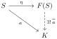
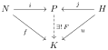

# Generators, Relations, and Semidirect Products

Free groups allow arbitrary images of generators; presentations impose
relations on those images. Semidirect products prescribe the conjugation
between two factors. Each construction is characterized by the homomorphisms
it admits, and an explicit model establishes its existence.

!!! notation "Notation"
    Groups may be infinite unless stated otherwise. Write $C_n$ for a
    [cyclic group](subgroups-and-quotients.md#def-cyclic-group) of order $n$.
    All conjugation actions use $h\cdot n=hnh^{-1}$.

## Generating Sets

!!! proposition "Proposition (Universal property of a generated subgroup)"
    
    Let $S\subseteq G$ and $P=\langle S\rangle$. For every subgroup
    $L\leq G$ containing $S$, there is a unique homomorphism $u:P\to L$
    such that $i_L\circ u=i_P$, where $i_L,i_P$ are the inclusions into
    $G$. This property determines $P$ uniquely among subgroups containing
    $S$.

??? proof "Proof"
    The equation forces $u(p)=p$, so it says exactly that $P\leq L$ for
    every such $L$. For existence, the finite products

    $$
    s_1^{\varepsilon_1}\cdots s_m^{\varepsilon_m},
    \qquad s_i\in S,\quad \varepsilon_i\in\{1,-1\},\quad m\geq0,
    $$

    form a subgroup: products concatenate the factors, inverses reverse
    their order and change their signs, and the empty product is $e$.
    Every subgroup containing $S$ contains these products. This is the
    [generated subgroup](subgroups-and-quotients.md#def-generated-subgroup).

    Such formal products are called **words** in $S$; different words
    may have the same value in $G$.

!!! definition "Definition (Finitely generated group)"
    
    A group $G$ is **finitely generated** if
    $G=\langle g_1,\ldots,g_r\rangle$ for some finite list. The empty
    list generates the trivial group.

!!! example "Example (Finite generation)"
    
    Every finite group is generated by its underlying set. An infinite
    group may also be finitely generated: $(\mathbb Z,+)=\langle1\rangle$,
    and $\mathbb Z^r$ is generated by its $r$ standard coordinate vectors.

    By contrast, $(\mathbb Q,+)$ is not finitely generated. A finite list
    of rational numbers has a common positive denominator $d$, so its
    integer linear combinations lie in $\frac1d\mathbb Z$. This subgroup
    does not contain $1/(2d)$.

!!! proposition "Proposition (Lifting generators)"
    
    Let $N\trianglelefteq G$. If

    $$
    N=\langle a_1,\ldots,a_r\rangle,
    \qquad
    G/N=\langle b_1N,\ldots,b_sN\rangle,
    $$

    then $G=\langle a_1,\ldots,a_r,b_1,\ldots,b_s\rangle$.
    In particular, if $N$ and $G/N$ are finitely generated, so is $G$.

??? proof "Proof"
    For $g\in G$, express $gN$ as a word in the $b_jN$ and their
    inverses. Evaluate that word on the chosen $b_j$, obtaining $w\in G$.
    Then $gN=wN$, so $gw^{-1}\in N$ and can be expressed using the $a_i$.
    Thus $g=(gw^{-1})w$ belongs to the stated generated subgroup.

!!! remark "Remark (Images and lifts)"
    
    A homomorphism sends a generating set to a generating set of its image,
    so images of finitely generated groups are finitely generated. Lifting
    generators from a quotient does not assert that their lifts generate
    a subgroup isomorphic to the quotient; this requires a
    [splitting](#prop-splitting-complement).

## Free Groups

A subgroup generated inside a given group inherits its relations. A free
group separates the choice of generators from the relations one may later
impose.

!!! definition "Definition (Free group)"
    
    Let $S$ be a set. A group $F(S)$ with a function $\eta:S\to F(S)$ is
    **free on $S$** if, for every group $K$ and every function $a:S\to K$,
    there is a unique homomorphism $\widetilde a:F(S)\to K$ satisfying
    $\widetilde a\circ\eta=a$.

    { .commutative-diagram style="--mn-diagram-width: 9rem" }

    There is no compatibility condition on the function $a$.

!!! example "Example (One free generator)"
    
    The additive group $\mathbb Z$ is free on one generator. Choosing an
    arbitrary $k\in K$ gives the unique homomorphism
    $\mathbb Z\to K$, $n\mapsto k^n$.

!!! theorem "Theorem (Construction by words)"
    
    A free group exists on every set $S$.

??? proof "Proof"
    **Letters and concatenation.** Use the formal alphabet
    $A=S\times\{1,-1\}$. Write $s^\delta$ for $(s,\delta)$ and
    $\overline{(s,\delta)}=(s,-\delta)$ for its opposite. These are
    symbols, not yet elements of a group. A **word** is a finite ordered
    list of letters; the empty word is $\epsilon$. Let $\mathcal W(S)$
    be the set of all words. Concatenation joins lists:

    $$
    (\ell_1,\ldots,\ell_m)\ast(k_1,\ldots,k_n)
    =(\ell_1,\ldots,\ell_m,k_1,\ldots,k_n).
    $$

    It is associative, with identity $\epsilon$, but a nonempty word has
    no inverse because lengths add. In particular,
    $(x,y^{-1})\ast(y,x^{-1})=(x,y^{-1},y,x^{-1})$ is a list of length
    four, not the empty list.

    **Cancellation equivalence.** An elementary move inserts or deletes
    an adjacent pair of opposite letters, anywhere in a word:

    $$
    u\ast(\ell,\bar\ell)\ast v
    \longleftrightarrow u\ast v.
    $$

    Declare $w\sim w'$ if finitely many such moves connect them. Zero
    moves, reversing moves, and composing sequences of moves prove
    reflexivity, symmetry, and transitivity. For example,

    $$
    (x,y^{-1},y,x^{-1})\sim(x,x^{-1})\sim\epsilon.
    $$

    A word $w$, its class $[w]$, and its value in a target group are
    distinct objects. Put $F(S)=\mathcal W(S)/{\sim}$ and define
    $[u][v]=[u\ast v]$.
    This is well-defined: moves in the first and second portions give

    $$
    u\ast v\sim u'\ast v\sim u'\ast v'
    \qquad(u\sim u',\ v\sim v').
    $$

    **Group axioms.** Associativity descends from concatenation, and
    $[\epsilon]$ is the identity. For $w=(\ell_1,\ldots,\ell_m)$, put

    $$
    w^\vee=(\bar\ell_m,\ldots,\bar\ell_1).
    $$

    Successive deletions from the middle outwards show
    $w\ast w^\vee\sim\epsilon$ and $w^\vee\ast w\sim\epsilon$.
    Thus $[w^\vee]=[w]^{-1}$. Define $\eta(s)=[(s^1)]$; now
    $[(s^{-1})]=\eta(s)^{-1}$ in this group.

    **Universal property.** Given $a:S\to K$, evaluate words in $K$:

    $$
    E_a(s_1^{\delta_1},\ldots,s_m^{\delta_m})
    =a(s_1)^{\delta_1}\cdots a(s_m)^{\delta_m},
    \qquad E_a(\epsilon)=e_K.
    $$

    Each elementary move inserts or deletes a factor equal to $e_K$,
    so $\widetilde a([w])=E_a(w)$ is well-defined. Since
    $E_a(u\ast v)=E_a(u)E_a(v)$, it is a homomorphism, and
    $\widetilde a(\eta(s))=a(s)$. Finally,

    $$
    [(s_1^{\delta_1},\ldots,s_m^{\delta_m})]
    =\eta(s_1)^{\delta_1}\cdots\eta(s_m)^{\delta_m}
    $$

    forces the value of any such homomorphism, proving uniqueness. If
    $S=\varnothing$, the only word is $\epsilon$, giving the trivial
    group. No theorem about unique reduced words is needed.

!!! proposition "Proposition (Uniqueness of a free group)"
    
    Two free groups on $S$ are uniquely isomorphic by an isomorphism
    respecting their maps from $S$. Moreover, $\eta(S)$ generates $F(S)$.

??? proof "Proof"
    Extend the generator maps in both directions. Both composites agree
    with the identity on the generators, hence are identities by
    uniqueness. The word construction is generated by $\eta(S)$, so the
    same is true of every universal pair.

## Presentations

!!! definition "Definition (Presentation)"
    
    Let $R\subseteq F(S)$. Its elements are called **relators**. The
    **group presented by generators $S$ and relators $R$** is

    $$
    \langle S\mid R\rangle
    =F(S)/\langle\!\langle R\rangle\!\rangle,
    $$

    where $\langle\!\langle R\rangle\!\rangle$ is the
    [normal closure](subgroups-and-quotients.md#def-normal-closure) of $R$.
    An equation $u=v$ is imposed by taking $uv^{-1}$ as a relator. If
    $q:F(S)\to\langle S\mid R\rangle$ is the quotient map, write
    $\bar s=q(\eta(s))$; these elements generate the presented group.

!!! proposition "Proposition (Mapping property of a presentation)"
    
    An assignment $a:S\to K$ extends to a homomorphism
    $f:\langle S\mid R\rangle\to K$ with $f(\bar s)=a(s)$ if and only
    if every relator evaluates to $e_K$. When it exists, the extension is
    unique.

??? proof "Proof"
    Freeness gives $\widetilde a:F(S)\to K$. Since its kernel is normal,

    $$
    \widetilde a(r)=e_K\quad(r\in R)
    \iff \langle\!\langle R\rangle\!\rangle\subseteq\ker\widetilde a.
    $$

    The [quotient universal property](subgroups-and-quotients.md#thm-quotient-universal-property)
    then gives exactly one $f$ satisfying $f\circ q=\widetilde a$.

!!! example "Example (One power relation)"
    
    For $n\geq2$, the free group on $x$ is $\mathbb Z$, and the normal
    closure of $x^n$ corresponds to $n\mathbb Z$. Hence

    $$
    \langle x\mid x^n=e\rangle\cong\mathbb Z/n\mathbb Z.
    $$

    A homomorphism to $K$ is determined by an element $k\in K$ with
    $k^n=e$; the order of $k$ may be a proper divisor of $n$.

!!! remark "Remark (Relations versus defining relations)"
    
    Suppose $(g_s)_{s\in S}$ generates $G$. Evaluation gives a surjection
    $p:F(S)\to G$. If the relators hold in $G$, there is a surjection

    $$
    \langle S\mid R\rangle\longrightarrow G.
    $$

    It is an isomorphism exactly when
    $\ker p=\langle\!\langle R\rangle\!\rangle$: the specified relations
    must account for the whole kernel. A finite generating set need not
    admit a finite set of defining relations.

!!! example "Example (Two commuting involutions)"
    
    For the standard generators $a,b$ of $C_2\times C_2$, a homomorphism
    to $K$ is equivalent to choosing $x,y\in K$ satisfying

    $$
    x^2=y^2=e,
    \qquad xy=yx.
    $$

    These conditions are necessary. Conversely, the unique expressions
    $a^ib^j$, $i,j\in\{0,1\}$, define a homomorphism
    $a^ib^j\mapsto x^iy^j$: commutation allows multiplication of these
    expressions, and the square relations reduce the exponents modulo
    $2$. Thus

    $$
    C_2\times C_2\cong
    \langle a,b\mid a^2=b^2=e,\ ab=ba\rangle.
    $$

    The assignment $a\mapsto(12)$, $b\mapsto(23)$ in $S_3$ respects
    the orders but does not extend, since the images do not commute.

## Semidirect Products

If $N\trianglelefteq G$ and $H\leq G$, conjugation defines a homomorphism
$\varphi:H\to\operatorname{Aut}(N)$, where $\operatorname{Aut}(N)$ is
the group of automorphisms of $N$ under composition. More generally, such an action by
automorphisms can be specified before placing $N,H$ in a common group.
Its identities are

$$
\varphi_e=\operatorname{id}_N,
\qquad \varphi_{hh'}=\varphi_h\circ\varphi_{h'},
\qquad \varphi_{h^{-1}}=(\varphi_h)^{-1}.
$$

Each $\varphi_h$ must preserve multiplication in $N$, which is an extra
requirement beyond an action on its underlying set.

!!! definition "Definition (Semidirect product)"
    
    Fix $\varphi:H\to\operatorname{Aut}(N)$. A **semidirect product** is
    a group $P$ with homomorphisms $i:N\to P$, $j:H\to P$ such that

    $$
    j(h)i(n)j(h)^{-1}=i(\varphi_h(n))
    \qquad(n\in N,\ h\in H),
    $$

    and with the following universal property. For any group $K$ and
    homomorphisms $f:N\to K$, $u:H\to K$ satisfying

    $$
    u(h)f(n)u(h)^{-1}=f(\varphi_h(n)),
    $$

    there is a unique homomorphism $F:P\to K$ with
    $F\circ i=f$ and $F\circ j=u$. Write $P=N\rtimes_\varphi H$.

    { .commutative-diagram style="--mn-diagram-width: 14rem" }

    The maps $f,u$ need not be injective or surjective. Injectivity of
    $i,j$ and unique factorization inside $P$ will follow from the model
    below.

!!! proposition "Proposition (Uniqueness of the semidirect product)"
    
    For a fixed action $\varphi$, two universal triples $(P,i,j)$ and
    $(P',i',j')$ admit a unique isomorphism $A:P\to P'$ satisfying
    $A\circ i=i'$ and $A\circ j=j'$.

??? proof "Proof"
    The universal properties give $A:P\to P'$ and $B:P'\to P$ with
    the specified restrictions. The composites $BA$ and
    $\operatorname{id}_P$ agree after composition with both $i$ and $j$,
    so uniqueness gives $BA=\operatorname{id}_P$. Similarly,
    $AB=\operatorname{id}_{P'}$.

!!! theorem "Theorem (External semidirect product)"
    
    On $N\times H$, the multiplication

    $$
    (n,h)(n',h')=(n\varphi_h(n'),hh')
    $$

    defines a group with identity $(e_N,e_H)$ and inverse

    $$
    (n,h)^{-1}=(\varphi_{h^{-1}}(n^{-1}),h^{-1}).
    $$

    Together with $i(n)=(n,e_H)$ and $j(h)=(e_N,h)$, it satisfies the
    semidirect-product universal property.

??? proof "Proof"
    The conjugation relation first suggests the multiplication: moving
    $j(h)$ past $i(n')$ forces

    $$
    i(n)j(h)i(n')j(h')=i(n\varphi_h(n'))j(hh').
    $$

    For associativity, the two parenthesizations in the pair model give

    $$
    \begin{aligned}
    ((n,h)(m,k))(\ell,t)
      &=(n\varphi_h(m)\varphi_{hk}(\ell),hkt),\\
    (n,h)((m,k)(\ell,t))
      &=(n\varphi_h(m)\varphi_h(\varphi_k(\ell)),hkt).
    \end{aligned}
    $$

    They agree because $\varphi$ is a homomorphism and each
    $\varphi_h$ preserves multiplication. The identity formula follows
    from $\varphi_e=\operatorname{id}_N$ and $\varphi_h(e)=e$; the
    displayed inverse gives the identity on both sides.

    The maps $i,j$ are homomorphisms, and
    $(e,h)(n,e)(e,h^{-1})=(\varphi_h(n),e)$ verifies the prescribed
    conjugation. Given compatible $f,u$, set $F(n,h)=f(n)u(h)$. Then

    $$
    \begin{aligned}
    F(n,h)F(n',h')
      &=f(n)u(h)f(n')u(h')\\
      &=f(n)f(\varphi_h(n'))u(h)u(h')\\
      &=F(n\varphi_h(n'),hh').
    \end{aligned}
    $$

    Thus $F$ is the required homomorphism. Since $(n,h)=i(n)j(h)$,
    its value at every element is forced.

!!! proposition "Proposition (Factors and quotient)"
    
    In any semidirect product $P=N\rtimes_\varphi H$, the maps $i,j$ are
    injective, every element has a unique expression $i(n)j(h)$, and

    $$
    i(N)\trianglelefteq P,
    \qquad i(N)\cap j(H)=\{e\}.
    $$

    The homomorphism $\pi:P\to H$, $i(n)j(h)\mapsto h$, is surjective,
    with kernel $i(N)$, and $\pi\circ j=\operatorname{id}_H$. Hence
    $P/i(N)\cong H$. For finite factors, $|P|=|N||H|$.

??? proof "Proof"
    By uniqueness it suffices to use the pair model, where
    $i(n)j(h)=(n,h)$ and all assertions follow from the multiplication.
    In particular, $i(N)=\ker\pi$ is normal, and the quotient statement
    follows from the first isomorphism theorem.

!!! remark "Remark (The trivial action and projections)"
    
    For the trivial action, $N\rtimes H=N\times H$ with componentwise
    multiplication. Compatibility then says that $f(N)$ and $u(H)$
    commute elementwise: precisely these pairs of maps extend uniquely
    to a homomorphism $N\times H\to K$.

    This concerns maps out of the product. The earlier
    [product universal property](subgroups-and-quotients.md#def-product-groups)
    concerns maps into it. In a general semidirect product the second
    coordinate projection is a homomorphism, whereas the first is a
    homomorphism exactly when $\varphi$ is trivial: compare
    $(e,h)(n,e)=(\varphi_h(n),h)$ with the product of its first
    coordinates.

## Complements and Splitting

!!! definition "Definition (Complement)"
    
    Let $N\trianglelefteq G$. A subgroup $H\leq G$ is a **complement**
    to $N$ if

    $$
    NH=G,
    \qquad N\cap H=\{e\},
    $$

    where $NH=\{nh:n\in N,\ h\in H\}$ is a product of subsets in $G$.
    Such a decomposition is called an **internal semidirect product**.

!!! theorem "Theorem (Internal semidirect product)"
    
    If $N\trianglelefteq G$ and $H$ is a complement, conjugation
    $\varphi_h(n)=hnh^{-1}$ gives an isomorphism

    $$
    N\rtimes_\varphi H\xrightarrow{\sim}G,
    \qquad (n,h)\longmapsto nh.
    $$

    Every $g\in G$ has a unique expression $nh$, and

    $$
    (nh)(n'h')=n(hn'h^{-1})hh'.
    $$

    The quotient map restricts to an isomorphism $H\cong G/N$.

??? proof "Proof"
    The inclusions of $N,H$ into $G$ satisfy the compatibility condition,
    so the universal property gives $F(n,h)=nh$. It is surjective since
    $NH=G$. If $nh=n'h'$, then

    $$
    n'^{-1}n=h'h^{-1}\in N\cap H=\{e\},
    $$

    proving injectivity and uniqueness. Inserting $h^{-1}h$ gives the
    multiplication formula. Finally, $h\mapsto hN$ has kernel
    $H\cap N=\{e\}$ and is surjective because every coset has a
    representative in $H$.

!!! proposition "Proposition (When the factors give a direct product)"
    
    Under the preceding hypotheses, the multiplication map
    $N\times H\to G$, $(n,h)\mapsto nh$, is an isomorphism for the usual
    direct-product law if and only if $hn=nh$ for all $h\in H,n\in N$.
    This is equivalent to $H\trianglelefteq G$.

??? proof "Proof"
    Commutation makes the multiplication formula componentwise.
    Conversely, the standard factors of a direct product commute, so
    their images under a homomorphism must commute. If both $N$ and
    $H$ are normal, $hnh^{-1}n^{-1}$ lies in $N\cap H=\{e\}$. If the
    factors commute, conjugation by any $nh\in G$ preserves $H$, so
    $H$ is normal.

!!! example "Example (The group $S_3$)"
    
    Put $r=(123)$, $s=(12)$, $N=A_3=\langle r\rangle$, and
    $H=\langle s\rangle$. Since $N=\ker(\operatorname{sgn})$, it is
    normal, and $N\cap H=\{e\}$ because its order divides both $3$ and
    $2$. The six products $r^is^j$, $0\leq i<3$, $0\leq j<2$, are
    distinct and exhaust $S_3$. Thus

    $$
    S_3\cong C_3\rtimes C_2,
    \qquad srs^{-1}=r^{-1}.
    $$

    The action is nontrivial. In particular $S_3\not\cong C_3\times C_2$,
    since the latter group is abelian.

!!! proposition "Proposition (Splitting and complements)"
    
    Let $q:G\to Q$ be a surjective homomorphism with kernel $N$.
    The following are equivalent:

    + There is a homomorphism $s:Q\to G$ with
      $q\circ s=\operatorname{id}_Q$.
    + $N$ has a complement in $G$.

    Such a homomorphism $s$ is a **section**, and $q$ **splits**. It
    gives an isomorphism $G\cong N\rtimes_\varphi Q$, where
    $\varphi_v(n)=s(v)ns(v)^{-1}$.

??? proof "Proof"
    Given a section, put $H=s(Q)$. Applying $q$ shows that $s$ is
    injective. If $s(v)\in N$, then $v=q(s(v))=e$, so
    $N\cap H=\{e\}$. For $g\in G$, take $h=s(q(g))$; then
    $q(gh^{-1})=e$, so $g=(gh^{-1})h\in NH$. Thus $H$ is a complement.

    Conversely, let $H$ be a complement. The restriction
    $r=q|_H:H\to Q$ has kernel $H\cap N=\{e\}$ and is injective.
    To check surjectivity, choose $g\in G$ with $q(g)=v$ and write
    $g=nh$. Then $v=q(n)q(h)=q(h)=r(h)$. Thus $r$ is an isomorphism.
    Its inverse is a homomorphism: applying $r$ to
    $r^{-1}(v)r^{-1}(w)$ gives $vw$, and injectivity forces
    $r^{-1}(vw)=r^{-1}(v)r^{-1}(w)$. With $i_H:H\hookrightarrow G$, set
    $s=i_H\circ r^{-1}$; then
    $q\circ s=r\circ r^{-1}=\operatorname{id}_Q$.

    Conjugation by $s(v)$ defines the asserted action on $N$. The
    universal property gives $F:N\rtimes_\varphi Q\to G$,
    $F(n,v)=ns(v)$. It is surjective since $G=Ns(Q)$. If $ns(v)=e$,
    applying $q$ gives $v=e$, and then $n=e$. Hence $F$ is an isomorphism.

!!! example "Example (A quotient that does not split)"
    
    Let $G=C_4=\langle x\rangle$ and $N=\langle x^2\rangle$, so
    $G/N\cong C_2$. A section would send the nonidentity element of
    $C_2$ to an element outside $N$ whose square is $e$. Both such
    elements, $x$ and $x^3$, have order $4$, so no section exists.

    Thus $N\cong C_2$ and $G/N\cong C_2$ do not determine $G$: both
    $C_4$ and $C_2\times C_2$ have this subgroup and quotient, but only
    the second quotient splits. Arbitrary coset representatives need
    not form a subgroup.

!!! proposition "Proposition (Groups of order $30$)"
    
    Every group $G$ of order $30$ is an internal semidirect product
    $N\rtimes H$ with $N\cong C_{15}$ and $H\cong C_2$.

??? proof "Proof"
    The [Sylow argument](cauchy-and-sylow.md#prop-order-30-normal-subgroup)
    supplies $N\trianglelefteq G$ of order $15$.
    [Groups of order $15$](cauchy-and-sylow.md#ex-order-15-cyclic) are
    cyclic: their Sylow subgroups are normal and give
    $C_3\times C_5\cong C_{15}$.
    By [Cauchy's theorem](cauchy-and-sylow.md#thm-cauchy), choose an
    element $s$ of order $2$ and put $H=\langle s\rangle$. Lagrange
    gives $N\cap H=\{e\}$.

    Before using internal recognition, check $NH=G$. The map of sets
    $\mu:N\times H\to G$, $(n,h)\mapsto nh$, is injective: equality of
    two products gives $n'^{-1}n=h'h^{-1}\in N\cap H$. Its image is
    $NH$, so $|NH|=15\cdot2=30=|G|$, and $NH=G$. All complement
    hypotheses now hold, giving $G\cong N\rtimes_\varphi H$.

    This determines the form of the group; it does not classify the
    possible conjugation actions.

## Dihedral Groups

!!! definition "Definition (Dihedral group)"
    
    Let $n\geq3$, $C_n=\langle r\rangle$, and $C_2=\langle s\rangle$.
    Inversion is an automorphism of $C_n$ of order $2$, hence defines
    an action of $C_2$. The **dihedral group** is

    $$
    D_{2n}=C_n\rtimes C_2
    $$

    for this inversion action. Our subscript denotes the group order:
    $|D_{2n}|=2n$.

!!! proposition "Proposition (Dihedral multiplication)"
    
    Each element of $D_{2n}$ has a unique expression $r^is^j$,
    $0\leq i<n$, $j\in\{0,1\}$. The conjugation and multiplication
    formulas are

    $$
    srs^{-1}=r^{-1},
    \qquad
    (r^is^j)(r^ks^\ell)=r^{i+(-1)^jk}s^{j+\ell},
    $$

    with exponents reduced modulo $n$ and $2$, respectively. In
    particular, $(r^is)^2=e$. The group is nonabelian since
    $r\neq r^{-1}$ for $n\geq3$.

!!! example "Example (Symmetries of a regular polygon)"
    
    Label the vertices by $\mathbb Z/n\mathbb Z$, and define
    $r(x)=x+1$, $s(x)=-x$. The relations give compatible homomorphisms
    from $C_n,C_2$ to $\operatorname{Sym}(\mathbb Z/n\mathbb Z)$, so
    the universal property gives a $D_{2n}$-action. Its permutations are

    $$
    x\longmapsto i+(-1)^jx.
    $$

    They are distinct: evaluation at $0$ determines $i$, and evaluation
    at $1$ determines $j$ because $1\neq-1\pmod n$. Thus this action
    identifies $D_{2n}$ with the group generated by a polygon's rotation
    and reflection. The preceding $S_3$ example gives $D_6\cong S_3$.

!!! proposition "Proposition (Dihedral presentation)"
    
    There is a presentation

    $$
    D_{2n}=\langle r,s\mid r^n=e,\ s^2=e,\ srs^{-1}=r^{-1}\rangle.
    $$

    Explicitly, if $a,b$ in any group $K$ satisfy
    $a^n=b^2=e$ and $bab^{-1}=a^{-1}$, there is a unique homomorphism
    $D_{2n}\to K$ taking $r\mapsto a$, $s\mapsto b$, with image
    $\langle a,b\rangle$.

??? proof "Proof"
    The power relations define homomorphisms $f:C_n\to K$, $r^i\mapsto a^i$,
    and $u:C_2\to K$, $s^j\mapsto b^j$. Since
    $ba^ib^{-1}=a^{-i}$ for all integers $i$, these maps satisfy the
    compatibility condition for the inversion action. The universal
    property gives the unique homomorphism $r^is^j\mapsto a^ib^j$.
    This proves that the displayed relations are defining relations,
    rather than merely relations that hold in the group. The orders of
    the images may be smaller than $n$ and $2$.
