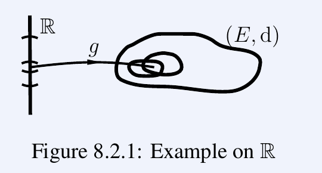
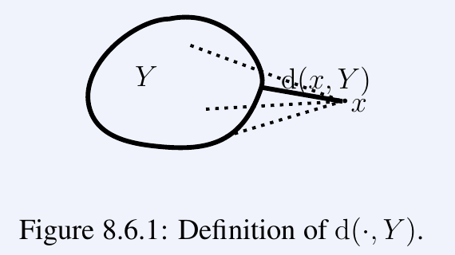
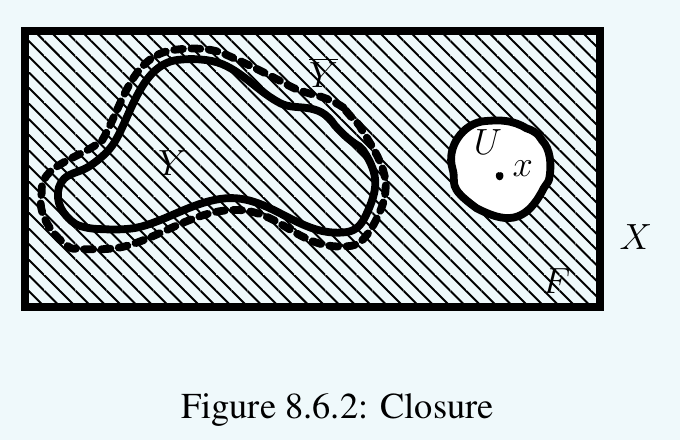
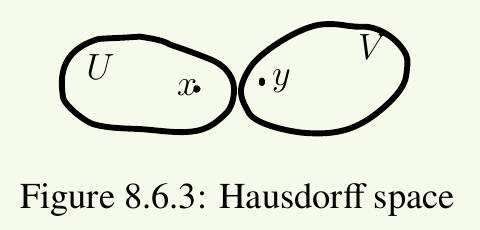
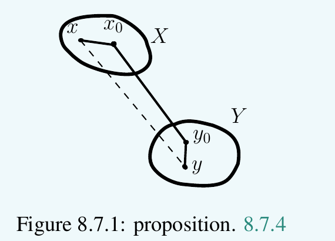
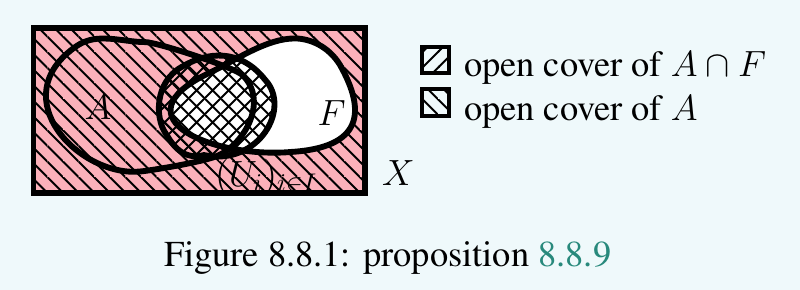
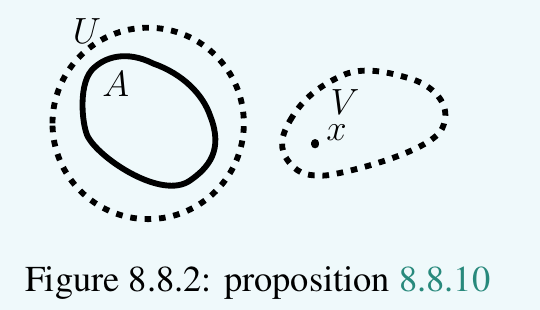
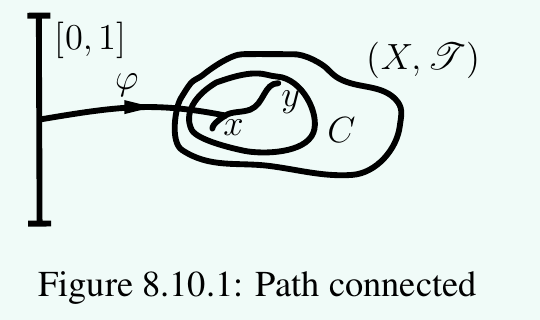

# Topology

This chapter develops the basic theory of **topological spaces** and
**continuous maps** between them, then singles out the notions of
**completeness** and **compactness** that will accompany us throughout
analysis.

## Topological Spaces

!!! definition "Definition (Topological space, open set)"
    
    

    A **topology** on a set $X$ is a subset $\mathcal{T} \subseteq \mathscr{P}(X)$ such that

    + $\varnothing, X \in \mathcal{T}$;
    + any union of elements of $\mathcal{T}$ is in $\mathcal{T}$;
    + any finite intersection of elements of $\mathcal{T}$ is in
      $\mathcal{T}$.

    The pair $(X, \mathcal{T})$ is a **topological space**, and the
    elements of $\mathcal{T}$ are the **open sets** of $X$.

!!! example "Example (Standard topologies)"
    

    + **Discrete topology**: $\mathcal{T} = \mathscr{P}(X)$.
    + **Indiscrete topology**: $\mathcal{T} = \{\varnothing, X\}$.
    + **Co-countable topology** on an uncountable set $X$:
      $\mathcal{T}$ = the empty set + all subsets whose complement is
      countable.
    + On $\mathbb{R}$: the **standard topology** generated by the open
      intervals.

!!! definition "Definition (Closed set and closure)"
    
    

    A subset $F \subseteq X$ is **closed** if $X \setminus F$ is open.
    The **closure** $\bar A$ of a subset $A$ is the smallest closed set
    containing $A$.

!!! theorem "Theorem (Topology from local filters)"
    

    Suppose that each $x\in X$ is assigned a filter $\mathcal G_x$ contained in the principal filter of $\{x\}$. Declare $U$ open when $U\in\mathcal G_x$ for every $x\in U$. This defines a topology. Its open neighbourhoods of $x$ form a filter basis contained in $\mathcal G_x$. They generate $\mathcal G_x$ provided every $A\in\mathcal G_x$ contains a $V\in\mathcal G_x$ such that $V\in\mathcal G_y$ for every $y\in V$.

??? proof "Proof"
    The empty set satisfies the condition vacuously, and $X$ belongs to every filter. If $x$ lies in a finite intersection of open sets, every factor belongs to $\mathcal G_x$, hence so does the intersection. If $x$ lies in a union, one member of that union belongs to $\mathcal G_x$, and upward closure puts the union in $\mathcal G_x$. Open neighbourhoods contain $x$ and are closed under finite intersections. Under the additional condition, the chosen $V$ is itself open, so open neighbourhoods refine every member of $\mathcal G_x$.

!!! definition "Definition (Neighbourhood filter)"
    

    A neighbourhood of $x$ is a set containing an open set that contains $x$. These sets form the neighbourhood filter $\mathcal V_x$. A set $U$ is open exactly when it is a neighbourhood of each of its points: write it as the union of the open sets supplied by this condition. Thus neighbourhood filters recover the topology.

!!! example "Example (Local bases for familiar topologies)"
    

    Taking $\mathcal G_x=\{X\}$ gives the indiscrete topology; taking the principal filter of $\{x\}$ gives the discrete topology. In a pseudometric space, balls $B(x,r)$, $r>0$, generate $\mathcal G_x$. These balls are open: if $y\in B(x,r)$, then $B(y,r-d(x,y))\subseteq B(x,r)$ by the triangle inequality.

    In a totally ordered set, rays $\{y:y>a\}$ with $a<x$, and $\{y:y<b\}$ with $x<b$, generate the order neighbourhood filter at $x$. On $\mathbb R$, the resulting topology equals the usual metric topology: every interval about $x$ contains a sufficiently small symmetric interval, and every symmetric interval is an intersection of two such rays.

!!! theorem "Theorem (Generated topologies and bases)"
    

    The intersection of any family of topologies on $X$ is a topology. Consequently, a family $\mathcal S\subseteq\mathscr P(X)$ generates a least topology containing it. Finite intersections of members of $\mathcal S$, including the empty intersection $X$, form a basis for this topology.

    A family $\mathcal B$ is a topology basis precisely when it covers $X$ and, whenever $x\in B_1\cap B_2$, some $B_3\in\mathcal B$ satisfies $x\in B_3\subseteq B_1\cap B_2$. The associated open sets are all unions of basis elements.

??? proof "Proof"
    Every topology axiom is preserved by intersection. All unions of finite intersections of members of $\mathcal S$ contain $\varnothing$ and $X$, are closed under arbitrary unions, and are closed under finite intersections by distribution. Any topology containing $\mathcal S$ contains all these sets. For a general basis, refine $B_1\cap B_2$ at each of its points and take the union of these refinements. Distribution then proves closure under intersections of arbitrary unions. Conversely, an intersection of two open basis elements is open, so a basis element can be chosen about each point in it.

## Sequences, Nets, and Filters

!!! definition "Definition (Convergence of a sequence)"
    
    

    A sequence $(x_n)$ in a topological space $X$ **converges** to
    $L \in X$ if for every open neighbourhood $U$ of $L$ there exists
    $N$ such that $n \geq N \Rightarrow x_n \in U$. In a Hausdorff
    space, the limit (if it exists) is unique.

!!! definition "Definition (Net)"
    
    

    A **net** is a family $(x_i)_{i \in I}$ indexed by a directed set $I$.
    A net converges to $L$ if for every neighbourhood $U$ of $L$ there
    exists $i_0$ such that $i \geq i_0 \Rightarrow x_i \in U$. Nets
    describe convergence in general topological spaces, where sequences
    may be insufficient.

!!! definition "Definition (Filter formulation of continuity)"
    
    

    A map $f:X\to Y$ is continuous exactly when, for every proper filter $\mathcal F$ converging to $x$, its direct image $f_*\mathcal F$ converges to $f(x)$.

??? proof "Proof"
    Continuity pulls each target neighbourhood back to a source neighbourhood, which belongs to $\mathcal F$. Conversely, apply the condition to the neighbourhood filter at each point to obtain pointwise continuity.

!!! definition "Definition (Convergence along a filter)"
    

    A proper filter $\mathcal F$ on $X$ converges to $l\in X$ when $\mathcal V_l\subseteq\mathcal F$. A mapping $f:D\to Y$ has limit $l$ along a filter on $D$ when $f^{-1}(V)\in\mathcal F$ for every neighbourhood $V$ of $l$. It suffices to test a neighbourhood basis at $l$. If $D\subseteq X$, the notation $\lim_{x\in D,\ x\to p}f(x)=l$ uses the trace on $D$ of the neighbourhood filter at $p$, assumed proper; a punctured limit uses $D\setminus\{p\}$.

!!! example "Example (Metric criteria and limits at infinity)"
    

    For a sequence indexed by an infinite $I\subseteq\mathbb N$ in a semimetric space, convergence means that for every $\varepsilon>0$, some $N$ satisfies $d(x_n,l)<\varepsilon$ for all $n\in I$ with $n\ge N$. For a mapping between semimetric spaces, the limit at $p$ means that every $\varepsilon>0$ admits $\delta>0$ with $d_X(x,p)<\delta$ implying $d_Y(f(x),l)<\varepsilon$ for $x\in D$. At $+\infty$ in a real domain, use the filter generated by $(M,+\infty)\cap D$: every $\varepsilon>0$ admits $M$ with $x>M$, $x\in D$ implying $d_Y(f(x),l)<\varepsilon$. Its trace is proper precisely when $D$ is unbounded above. There is an analogous condition at $-\infty$.

!!! proposition "Proposition (Order-topological and order-theoretic limits)"
    

    In a complete totally ordered set with its order topology, a mapping has topological limit $l$ along a proper filter exactly when its inferior and superior limits both equal $l$.

??? proof "Proof"
    Suppose it converges topologically. For each $a<l$, the set $\{f>a\}$ belongs to the filter and gives $\liminf f\ge a$. If $\sup\{a:a<l\}=l$, taking the supremum gives $\liminf f\ge l$. If that supremum is a strict predecessor $a_0<l$, membership in $\{f>a_0\}$ gives $f\ge l$ there and the same bound. At a least element the bound is automatic. Reversing the order gives $\limsup f\le l$, including the greatest-element case. Since $\liminf f\le\limsup f$, both equal $l$.

    Conversely, equality of limiting extrema supplies a filter member on which $f>a$ for each $a<l$, and one on which $f<b$ for each $b>l$. Finite intersections satisfy every basic order neighbourhood, proving topological convergence. This includes isolated points and one-sided endpoints, so no order-density assumption is needed.

*A mapping from a real subset into a metric space, with a limit at infinity. Source: FAA I, printed page 141.*

## Continuity and Bases

!!! definition "Definition (Continuous map)"
    
    

    A map $f : X \to Y$ between topological spaces is **continuous** if
    for every open $V \subseteq Y$, the preimage $f^{-1}(V)$ is open in
    $X$. Equivalently, $f^{-1}$ sends closed sets to closed sets.

!!! definition "Definition (Basis of a topology)"
    
    

    A **basis** for a topology $\mathcal{T}$ is a collection
    $\mathcal{B} \subseteq \mathcal{T}$ such that every $U \in \mathcal{T}$ is a union of elements of $\mathcal{B}$. The
    **topology generated by $\mathcal{B}$** is the smallest topology
    containing $\mathcal{B}$.

!!! definition "Definition (Initial topology)"
    
    

    The **initial topology** on $X$ induced by a family of maps
    $f_i : X \to Y_i$ is the coarsest topology making every $f_i$
    continuous. It is generated by the sets $f_i^{-1}(U_i)$ for open $U_i\subseteq Y_i$.

!!! definition "Definition (Hausdorff, first countable)"
    
    

    A topological space is **Hausdorff** (or $T_2$) if any two distinct
    points have disjoint open neighbourhoods. It is **first countable**
    if every point has a countable neighbourhood basis.

!!! definition "Definition (Continuity at a point for partial mappings)"
    

    A mapping $f:D\to Y$, $D\subseteq X$, is continuous at $p\in D$ if each neighbourhood of $f(p)$ contains $f(D\cap V)$ for some neighbourhood $V$ of $p$. This is the filter limit condition at $p$. For metric spaces it is precisely the usual epsilon–delta condition.

!!! proposition "Proposition (Composition and sequential continuity)"
    

    Identity and constant mappings are continuous. Composites of mappings continuous at the relevant points are continuous. Continuity at $p$ implies that $x_n\to p$ forces $f(x_n)\to f(p)$. The converse holds if $p$ has a countable neighbourhood basis.

??? proof "Proof"
    Pull a target neighbourhood back first through the outer mapping and then through the inner mapping. For a convergent sequence, the resulting source neighbourhood contains all sufficiently late terms.

    For the converse, replace a countable basis by the decreasing basis $V_n$ of its first $n$ finite intersections. If continuity fails for a neighbourhood $U$ of $f(p)$, choose $x_n\in D\cap V_n$ with $f(x_n)\notin U$. Then $x_n\to p$ while $f(x_n)$ fails to tend to $f(p)$, a contradiction.

!!! theorem "Theorem (Open set criterion for continuity)"
    

    A mapping is continuous at every point exactly when preimages of open sets are open. It suffices to test a subbasis of the target topology.

??? proof "Proof"
    Pointwise continuity makes $f^{-1}(U)$ a neighbourhood of each of its points, hence open. Conversely, an open set inside a neighbourhood of $f(p)$ has an open preimage containing $p$. For the subbasis criterion, the sets with open preimage form a topology, since preimages preserve arbitrary unions and finite intersections; this topology contains the subbasis and therefore the generated target topology.

!!! theorem "Theorem (Initial and product topologies)"
    

    For maps $f_i:X\to Y_i$, the initial topology is generated by all $f_i^{-1}(U_i)$ with $U_i$ open. A basis consists of their finite intersections; repeated indices may be combined by intersection in $Y_i$. This is the least topology making every $f_i$ continuous. A mapping $h:Z\to X$ is continuous at a point precisely when every $f_i\circ h$ is continuous there.

    The product topology on $\prod_iY_i$ is the initial topology of its coordinate projections. A filter converges in a product exactly when each coordinate filter converges.

??? proof "Proof"
    Necessity follows by composition. For sufficiency, each of finitely many coordinate conditions supplies a source neighbourhood. Their intersection satisfies the corresponding basis neighbourhood in $X$. The same finite-intersection argument proves the statement about filter convergence in a product.

## Uniform Continuity and Normed Spaces

!!! definition "Definition (Lipschitz and uniformly continuous mappings)"
    

    A mapping between pseudometric spaces is $C$-Lipschitz if $d(f(x),f(y))\leq C d(x,y)$. It is uniformly continuous if each $\varepsilon>0$ admits a $\delta>0$ valid for all pairs $x,y$. A Lipschitz mapping is uniformly continuous, and a uniformly continuous mapping is continuous, by fixing one member of the pair.

!!! example "Example (The p-adic absolute value)"
    

    For a prime $p$ and nonzero $q\in\mathbb Q$, uniquely write $q=p^k m/n$ with $p\nmid mn$; set $\operatorname{ord}_p(q)=k$, $\operatorname{ord}_p(0)=+\infty$, and $|q|_p=p^{-k}$, $|0|_p=0$. Then

    $$
    \operatorname{ord}_p(ab)=\operatorname{ord}_p(a)+\operatorname{ord}_p(b),\qquad
    \operatorname{ord}_p(a+b)\geq\min(\operatorname{ord}_p(a),\operatorname{ord}_p(b)).
    $$

    For the second formula, factor out the smaller power of $p$ and put the remaining rationals over a denominator prime to $p$. If the two orders differ, the numerator is prime to $p$, so equality holds. It follows that $|a+b|_p\leq\max(|a|_p,|b|_p)$. Absolute values satisfying this stronger triangle inequality are nonarchimedean; the other absolute values are archimedean.

!!! definition "Definition (Seminorm, norm and induced distance)"
    

    Let $K$ have a real-valued absolute value. A seminorm on a $K$-vector space $E$ is a function $\|\cdot\|:E\to\mathbb R_{\geq0}$ satisfying $\|\lambda x\|=|\lambda|\|x\|$ and $\|x+y\|\leq\|x\|+\|y\|$. A norm additionally satisfies $\|x\|=0\Rightarrow x=0$. An ultrametric seminorm uses the maximum in its triangle inequality. The formula $d(x,y)=\|x-y\|$ gives a pseudometric, or a metric for a norm.

    On $K$, $|\cdot|$ is a norm. On a finite product, the maximum and the sum of the coordinate norms are norms when the coordinate norms are norms. A seminorm pulls back along any linear mapping.

!!! proposition "Proposition (Quotient seminorm)"
    

    A surjective linear mapping $\pi:E\to F$ gives $F$ the seminorm

    $$
    \|y\|_F=\inf_{\pi(x)=y}\|x\|_E.
    $$

??? proof "Proof"
    For $\lambda\neq0$, multiplication by $\lambda$ bijects the fibres over $y$ and $\lambda y$, proving homogeneity; the zero case uses the zero representative. Choose representatives of $y,z$ within an arbitrary positive error of their respective infima. Their sum represents $y+z$ and proves the triangle inequality on letting the error tend to zero.

!!! proposition "Proposition (Translations, scalings and the norm function)"
    

    Translations are isometries, multiplication by $\lambda$ is $|\lambda|$-Lipschitz, and $x\mapsto\|x\|$ is $1$-Lipschitz. The last assertion follows from the two inequalities $\|x\|\leq\|x-y\|+\|y\|$ and $\|y\|\leq\|x-y\|+\|x\|$.

!!! definition "Definition (Bounded linear mappings and operator norm)"
    

    A linear mapping $T:E\to F$ is bounded if $\|Tx\|\leq C\|x\|$ for some finite $C$. The infimum of such $C$ is its operator norm $\|T\|$. When $T$ sends every vector of seminorm zero to one of seminorm zero, it also equals the supremum of $\|Tx\|/\|x\|$ over vectors of positive seminorm, with empty supremum zero. If this nullspace condition fails, the operator norm is infinite. This qualification is necessary for seminormed spaces.

    Bounded linear mappings form a vector space, and the operator norm is a seminorm: the triangle and homogeneity inequalities follow by applying the corresponding inequalities to $Tx$ and taking the least bound. A bounded mapping is $\|T\|$-Lipschitz.

!!! theorem "Theorem (Continuity and boundedness of linear mappings)"
    

    If the absolute value on $K$ is nontrivial, a linear mapping is bounded exactly when it is continuous at zero. Over $\mathbb R$, its operator norm is also the supremum of $\|Tx\|$ on the unit ball.

??? proof "Proof"
    Boundedness implies continuity by the Lipschitz estimate. Choose $a\in K$ with $|a|>1$. Continuity gives $\delta>0$ such that $\|u\|<\delta$ implies $\|Tu\|<1$. For $\|x\|>0$, choose an integer $n$ with $|a|^n\|x\|<\delta\leq|a|^{n+1}\|x\|$. Apply the bound to $a^nx$ to get $\|Tx\|\leq(|a|/\delta)\|x\|$. If $\|x\|=0$, every $a^nx$ lies in the same small ball, and $|a|^n\|Tx\|<1$ for every $n$ forces $\|Tx\|=0$. Over $\mathbb R$, rescaling nonzero vectors to the unit sphere proves the supremum formula.

!!! proposition "Proposition (Equivalent norms and finite product metrics)"
    

    Norms are equivalent if $c\|x\|_1\leq\|x\|_2\leq C\|x\|_1$ for positive constants. Equivalent norms give the same topology and the same Cauchy filters. The metric $\max_i d_i(x_i,y_i)$ on a finite product gives its product topology, since a ball is a product of balls of the same radius and finitely many radii have a positive minimum. The sum metric is equivalent to it: maximum $\leq$ sum $\leq$ number of factors times maximum.

## Closed Sets and Separation

!!! example "Example (Intervals, half-spaces and closed preimages)"
    

    In $\mathbb R$, $(a,b)=B((a+b)/2,(b-a)/2)$ is open, and $(a,+\infty)=\bigcup_{n\ge1}(a,a+n)$ is open. Taking complements proves that $[a,b]$ and $(-\infty,a]$ are closed. In $\mathbb R^2$, the half-space $\{(x,y):x\ge1\}$ has open complement $(-\infty,1)\times\mathbb R$, so is closed. The printed complement's endpoint zero is a typo. Since $(x,y)\mapsto x+y$ is continuous, its preimage $\{(x,y):x+y\ge0\}$ of the closed ray $[0,+\infty)$ is also closed.

!!! proposition "Proposition (Closed sets and distance to a subset)"
    

    Closed sets are closed under arbitrary intersections and finite unions. Real intervals $[a,b]$ and rays $(-\infty,a]$ are closed. In $\mathbb R^2$, $\{x\geq1\}$ and $\{x+y\geq0\}$ are closed, as preimages of closed rays under continuous coordinate and addition mappings.

    For a nonempty subset $A$ of a metric space, set $d(x,A)=\inf_{a\in A}d(x,a)$. It is $1$-Lipschitz. Consequently $\{x:d(x,A)<r\}$ is open and $\{x:d(x,A)\leq r\}$ is closed.

??? proof "Proof"
    The closed-set axioms follow by taking complements of the open-set axioms. The triangle inequality gives $d(x,A)\leq d(x,y)+d(y,A)$ by taking an infimum in $a$; reverse $x,y$ for the reverse inequality. The assertions about distance balls follow by continuity. In particular the closure of an open distance ball is contained in its closed distance ball; equality need not hold in an arbitrary metric space.

!!! definition "Definition (Adherent points, closure and interior)"
    

    A point $p$ is adherent to a filter $\mathcal F$ when every $A\in\mathcal F$ meets every neighbourhood of $p$, or equivalently when $\mathcal F$ together with $\mathcal V_p$ generates a proper filter. The closure $\overline A$ is the set of points adherent to the principal filter of $A$. The interior $A^\circ$ is the union of all open sets contained in $A$.

!!! theorem "Theorem (Closure and interior characterizations)"
    

    The closure is the least closed set containing $A$, and the interior is the greatest open set contained in $A$. Moreover $X\setminus A^\circ=\overline{X\setminus A}$. In a first-countable space, each point of $\overline A$ is the limit of a sequence in $A$.

??? proof "Proof"
    If $p\notin\overline A$, an open neighbourhood $U$ of $p$ misses $A$. Every point of $U$ then has a neighbourhood missing $A$, so the complement of $\overline A$ is open. If a closed set $F$ contains $A$, its open complement prevents any point outside $F$ from being adherent to $A$. The interior assertion follows directly from its union definition; the complement identity follows by testing whether a neighbourhood misses $X\setminus A$. For the sequence assertion, use a decreasing countable neighbourhood basis $V_n$ at $p$ and choose $x_n\in V_n\cap A$.

!!! theorem "Theorem (Hausdorff separation and uniqueness of limits)"
    

    A space is Hausdorff exactly when its diagonal is closed in $X\times X$. In a Hausdorff space proper filters have at most one limit, and singletons are closed. Every metric space is Hausdorff.

??? proof "Proof"
    Disjoint neighbourhoods of distinct $x,y$ produce a product neighbourhood of $(x,y)$ missing the diagonal. Conversely, a product neighbourhood missing the diagonal supplies disjoint neighbourhoods. If a proper filter converged to two distinct points, it would contain two disjoint neighbourhoods and hence the empty set. For a singleton, separate each other point from it. In a metric space choose radii smaller than half the positive distance between the two points.

!!! corollary "Corollary (Images, closed subsets and quotient norms)"
    

    Any limit of a mapping whose values lie in $A$ lies in $\overline A$. If $A$ is closed and $x\notin A$, then $d(x,A)>0$, since some ball about $x$ misses $A$. For a normed space $E$ and subspace $W$, the quotient seminorm on $E/W$ is a norm exactly when $W$ is closed: it equals $d(x,W)$ on $[x]$. The quotient map is $1$-Lipschitz; conversely, if the quotient seminorm is a norm, $W$ is the preimage of the closed singleton $\{0\}$.

*Distance to a subset is the infimum of the distances to its points. Source: FAA I, printed page 154.*

*Every neighbourhood of an adherent point intersects the subset. Source: FAA I, printed page 155.*

*Distinct points in a Hausdorff space admit disjoint neighbourhoods. Source: FAA I, printed page 157.*

## Completeness

!!! definition "Definition (Cauchy filter, complete uniform space)"
    
    

    A **Cauchy filter** on a uniform space $X$ is a filter
    $\mathcal{F}$ such that for every entourage $U$ there exists
    $V \in \mathcal{F}$ with $V \times V \subseteq U$. A uniform space
    is **complete** if every Cauchy filter converges.

!!! example "Example (Metric space complete ⇔ Cauchy sequences converge)"
    

    $\mathbb{R}$ with the standard uniform structure is complete. The
    space $\mathbb{Q}$ is not.

!!! theorem "Theorem (Metric space complete ⇔ Cauchy sequences converge)"
    
    

    A metric space $(X, d)$ is complete iff every Cauchy sequence in $X$
    converges.

!!! definition "Definition (Diameter and metric Cauchy filters)"
    

    Set $\operatorname{diam}A=\sup_{x,y\in A}d(x,y)$, with diameter zero for the empty set. A metric filter is Cauchy when $\inf_{A\in\mathcal F}\operatorname{diam}A=0$. A metric space is complete when every proper Cauchy filter converges in it.

    Diameter is monotone under inclusion. A ball of radius $r$ has diameter at most $2r$, and a nonempty set of finite diameter lies in a bounded ball about any of its points. For $x_0\in A$, $y_0\in B$,

    $$
    \operatorname{diam}(A\cup B)\leq\operatorname{diam}A+d(x_0,y_0)+\operatorname{diam}B.
    $$

    For points in different sets, follow the three segments from $x$ to $x_0$, from $x_0$ to $y_0$, and from $y_0$ to $y$. Points in the same set satisfy the same bound directly. If the sets meet, choose $x_0=y_0$.

!!! theorem "Theorem (Cauchy filters and adherent points)"
    

    Every convergent proper metric filter is Cauchy. Every point adherent to a Cauchy filter is its limit.

??? proof "Proof"
    A convergent filter contains balls of arbitrarily small radius, whose diameters are at most twice that radius. For the converse, choose $A\in\mathcal F$ with diameter less than $\varepsilon/2$. Adherence gives $y\in A\cap B(p,\varepsilon/2)$. Every $x\in A$ satisfies $d(x,p)\leq d(x,y)+d(y,p)<\varepsilon$, so $B(p,\varepsilon)\in\mathcal F$.

!!! example "Example (A Cauchy filter without a limit)"
    

    In $(0,1]$, the filter generated by $(0,\varepsilon)$ is Cauchy but has no limit in that space. In $\mathbb Q$, a rational sequence tending to $\sqrt2$ in $\mathbb R$ is Cauchy without a rational limit.

!!! proposition "Proposition (Cauchy sequences)"
    

    A sequence is Cauchy exactly when its direct image tail filter is Cauchy, equivalently when all sufficiently late pairs have arbitrarily small distance. Such a sequence is bounded, as a small tail ball together with finitely many initial terms is bounded. Every subsequence is Cauchy. If a Cauchy sequence has a convergent subsequence, the full sequence converges, because that subsequence limit is adherent to the tail filter.

??? proof "Proof"
    A tail has small diameter precisely when all its pairs have small distance. These tails form a filter basis. The remaining assertions follow from this characterization and the preceding theorem.

??? proof "Proof"
    Here is the filter-to-sequence step in the completeness criterion. For a proper Cauchy filter choose $A_n$ of diameter less than $1/(n+1)$ and put $B_n=\bigcap_{k\leq n}A_k$. Choose $x_n\in B_n$. For $m\geq n$, both points lie in $B_n$, so $(x_n)$ is Cauchy. If every Cauchy sequence converges, let $x_n\to p$.

    For any $A\in\mathcal F$, choose $y_n\in A\cap B_n$. Then $d(x_n,y_n)<1/(n+1)$, hence $y_n\to p$. Thus every neighbourhood of $p$ meets $A$, and $p$ is adherent to $\mathcal F$. The preceding theorem gives convergence. Conversely a Cauchy sequence supplies a proper Cauchy tail filter, so filter completeness gives sequence completeness.

!!! proposition "Proposition (Products, closed subsets and uniform mappings)"
    

    A filter on a finite metric product is Cauchy exactly when each projected filter is Cauchy: intersect finitely many preimages of coordinate sets of small diameter. Thus finite products of complete metric spaces are complete. Closed subsets of a complete metric space are complete, since their limits remain in the subset. Complete subspaces of a metric space are closed: a point of their closure is a limit of a sequence in the subspace, which is Cauchy and therefore has a limit there; uniqueness identifies the two limits.

    Uniformly continuous mappings send Cauchy filters to Cauchy filters, using the uniform delta to map a sufficiently small-diameter set to one of small diameter. A mapping with $c d(x,y)\leq d(f(x),f(y))\leq C d(x,y)$ preserves and reflects Cauchy filters and convergence in its image. A complete domain consequently has closed image in a metric target. Convergence in the ambient target alone does not imply convergence in the domain, as $\mathbb Q\hookrightarrow\mathbb R$ shows.

!!! example "Example (Completeness of the real line)"
    

    A real Cauchy sequence is bounded. Its limsup and liminf are finite, and the diameter of sufficiently late tails is arbitrarily small, so these order bounds coincide. The order limit theorem gives convergence. Hence $\mathbb R$ is complete.

!!! theorem "Theorem (Finite-dimensional normed spaces over a complete field)"
    

    Over a complete valued field with nontrivial absolute value, all norms on a finite-dimensional vector space are equivalent. Every such normed space is complete, every linear mapping from it into a normed space is bounded, and every finite-dimensional subspace of a normed space is closed.

??? proof "Proof"
    For a basis $e_1,\ldots,e_n$, set $\|\sum a_ie_i\|_0=\max_i|a_i|$. The triangle inequality gives $\|v\|\leq(\sum_i\|e_i\|)\|v\|_0$, and the same estimate proves boundedness of a linear mapping once the converse bound is established.

    Prove that converse by induction on $n$. The span $W$ of the first $n-1$ basis vectors is complete by induction and hence closed. The quotient norm therefore gives $q=\|[e_n]\|>0$. For $v=w+a_ne_n$,

    $$
    |a_n|\leq\|v\|/q,\qquad
    \|w\|\leq(1+\|e_n\|/q)\|v\|.
    $$

    The induction bound $\|w\|_0\leq A\|w\|$ controls the remaining coefficients. Thus $\|v\|_0\leq\max(1/q,A(1+\|e_n\|/q))\|v\|$. The coordinate norm is complete because it is a finite product of copies of $K$; norm equivalence transfers completeness. A finite-dimensional subspace, equipped with its induced norm, is therefore complete and hence closed.

*Intersecting sets control the diameter of their union by the sum of their diameters. Source: FAA I, printed page 160.*

## Compactness

!!! definition "Definition (Compact / sequentially compact)"
    
    

    A topological space $X$ is **compact** if every open cover of $X$
    has a finite subcover. It is **sequentially compact** if every
    sequence has a convergent subsequence.

!!! theorem "Theorem (Tychonoff)"
    
    

    An arbitrary product of compact topological spaces is compact (in
    the product topology).

!!! theorem "Theorem (Heine–Borel)"
    
    

    A subset of $\mathbb{R}^n$ is compact (in the standard topology) iff
    it is closed and bounded.

!!! definition "Definition (Connected, path connected)"
    
    

    A topological space is **connected** if it cannot be written as a
    disjoint union of two non-empty open sets. It is **path connected**
    if every pair of points can be joined by a continuous path
    $[0, 1] \to X$.

!!! theorem "Theorem (Ultrafilter characterizations)"
    

    Every proper filter extends to an ultrafilter. For a proper filter $\mathcal U$, the following are equivalent: it is maximal; for every $A\subseteq X$, exactly one of $A,X\setminus A$ belongs to it; a finite union belonging to it has a member belonging to it. The direct image of an ultrafilter is an ultrafilter.

??? proof "Proof"
    The union of a chain of proper filters is a proper filter: finitely many of its members occur together in one member of the chain. Zorn's lemma gives a maximal extension. If neither $A$ nor its complement belongs to a maximal filter, adjoining $A$ still generates a proper filter unless an old member misses $A$; that latter case puts the complement in the old filter. This proves the complement criterion. If $A\cup B$ belongs but neither member does, intersect their complements to obtain a contradiction. Conversely, a strictly larger proper filter would contain a new $A$ and the old complement of $A$, contradicting propriety. The complement criterion transfers to direct images because preimages preserve complements.

!!! definition "Definition (Covers and compact subsets)"
    

    A cover of $A\subseteq X$ is a family of sets whose union contains $A$. An open cover consists of open sets; a subcover is a subfamily still covering $A$. The subset $A$ is compact if every open cover has a finite subcover.

!!! theorem "Theorem (Three compactness criteria)"
    

    For $A\subseteq X$, compactness is equivalent to each of the following: every proper filter containing $A$ has a point adherent to it in $A$; every ultrafilter containing $A$ converges to a point in $A$.

??? proof "Proof"
    If a proper filter has no adherent point in $A$, for each $a\in A$ choose an open neighbourhood $U_a$ missing a filter member $F_a$. A finite subcover of the $U_a$ makes $A\cap\bigcap F_a$ empty, contradicting propriety. Conversely, an open cover with no finite subcover gives a proper filter generated by $A$ and the complements of finite unions of cover members. Every point of $A$ has a cover neighbourhood disjoint from a member of this filter, so there is no adherent point in $A$.

    Extend a proper filter to an ultrafilter; a limit of the extension is adherent to the original. Conversely, a point adherent to an ultrafilter makes its union with the neighbourhood filter generate a proper filter. Maximality then forces every neighbourhood to belong to the ultrafilter, proving convergence.

!!! proposition "Proposition (Images, intersections and Hausdorff separation)"
    

    Continuous images of compact sets are compact: pull an open cover back, take a finite subcover, and push it forward. The intersection of a compact set with a closed set is compact: add the complement of the closed set to a cover. In a Hausdorff space a compact set is closed, and disjoint compact sets have disjoint open neighbourhoods.

??? proof "Proof"
    For a point $x$ outside a compact set $A$, separate $x$ from each $a\in A$. Finitely many of the neighbourhoods of $a$ cover $A$; intersect their partner neighbourhoods of $x$. This gives disjoint neighbourhoods of $x$ and $A$, so $A$ is closed. For two disjoint compact sets, perform this construction for each point of the second set, then take a finite union of its neighbourhoods and the corresponding finite intersection of the neighbourhoods of the first set.

!!! theorem "Theorem (Directed intersections of closed sets)"
    

    Let $A$ be compact and $(F_i)$ a decreasing family of closed sets indexed by a directed set. If every $A\cap F_i$ is nonempty, then $A\cap\bigcap_iF_i$ is nonempty. In particular, a nested sequence of nonempty compact sets in a Hausdorff space has nonempty intersection.

??? proof "Proof"
    If the intersection were empty, the complements of the $F_i$ would cover $A$. Take finitely many and a common upper index. Its $F_i$ would miss $A$, a contradiction. For a nested sequence, work in its first compact member; Hausdorffness makes all later members closed. This closedness hypothesis is needed for the nested-set version.

??? proof "Proof"
    To prove Tychonoff's theorem, take an ultrafilter on the product containing the product of the compact sets. Each coordinate ultrafilter converges in its compact factor. Choose these limits, using choice, to obtain a tuple. Every finite-coordinate neighbourhood of that tuple belongs to the original ultrafilter, since each coordinate preimage does and filters are closed under finite intersections. Thus the original ultrafilter converges, and the filter criterion proves compactness.

*An open cover of a closed subset of a compact set extends to a cover of the compact set. Source: FAA I, printed page 170.*

*A finite subcover separates a compact set from an exterior point in a Hausdorff space. Source: FAA I, printed page 171.*

## Compact Metric Spaces

!!! definition "Definition (Total boundedness and sequential compactness)"
    

    A metric space is totally bounded if, for every $\varepsilon>0$, finitely many epsilon balls cover it. A subset is sequentially compact if every sequence in it has a subsequence converging to a point of that subset.

!!! theorem "Theorem (Metric compactness criteria)"
    

    A metric space is compact exactly when it is complete and totally bounded, and exactly when it is sequentially compact. More generally, a compact space with countable neighbourhood bases is sequentially compact.

??? proof "Proof"
    In a compact space a sequence's tail filter has an adherent point. Use a decreasing countable basis there to choose successive terms with strictly increasing indices in successive neighbourhoods. This gives a convergent subsequence.

    A compact metric space is complete because every Cauchy filter has an adherent point and hence a limit. Its epsilon-ball cover has a finite subcover. Conversely, total boundedness makes every ultrafilter Cauchy: in each finite cover by small balls, at least one ball belongs to the ultrafilter. Completeness gives a limit and therefore compactness.

    If a metric space is sequentially compact, every Cauchy sequence has a convergent subsequence and thus converges. If total boundedness failed for a radius $\varepsilon$, recursively choose each new point outside the epsilon balls about all previous points. Their pairwise distances are at least $\varepsilon$, so no subsequence is Cauchy. This contradiction establishes total boundedness and completes the equivalence.

!!! proposition "Proposition (Real intervals, boundedness and local compactness)"
    

    A closed bounded real interval is compact: it is complete, and a finite grid of mesh smaller than any given radius gives total boundedness. A compact metric subset is bounded by a finite ball cover; it is closed because metric spaces are Hausdorff. A space is locally compact when every point has a compact neighbourhood. The real line is locally compact, using $[x-1,x+1]$.

    A locally compact valued field is complete. If its absolute value is nontrivial, closed bounded subsets of any finite-dimensional normed vector space over it are compact, and the vector space is locally compact.

??? proof "Proof"
    A compact neighbourhood of zero contains a closed ball of some positive radius, which is compact as a closed subset. A Cauchy sequence has a tail lying in a translate of this ball. Compactness gives a convergent subsequence, so the whole sequence converges. For a trivial absolute value the topology is discrete and Cauchy sequences are eventually constant.

    In the nontrivial case choose $a$ with $|a|>1$. Dilates by powers of $a$ of the small compact ball contain every prescribed bounded ball. Any closed bounded subset of the field is a closed subset of one such compact dilate. In $K^n$, coordinate bounds place a closed bounded set inside a finite product of these compact sets. Norm equivalence transfers this assertion to any finite-dimensional normed space. A sufficiently small product of compact neighbourhoods supplies local compactness.

!!! theorem "Theorem (Extrema and uniform continuity on compact sets)"
    

    A nonempty compact subset of $\mathbb R$ has a maximum and a minimum. A continuous real-valued function on a nonempty compact space attains both extrema. A continuous mapping from a compact metric space to a metric space is uniformly continuous.

??? proof "Proof"
    A compact real subset is closed and bounded. Its supremum and infimum belong to its closure, hence to the set itself. Apply this to the compact image of a continuous function. If uniform continuity failed, choose $x_n,y_n$ with $d(x_n,y_n)<1/n$ but target distances at least some $\varepsilon>0$. Pass to a convergent subsequence of $x_n$. The corresponding $y_n$ has the same limit, and continuity makes their image distance tend to zero, a contradiction.

## Paths and Intervals

!!! proposition "Proposition (Continuous images of paths)"
    

    A path from $x$ to $y$ in $A$ is a continuous mapping $\gamma:[0,1]\to A$ with those endpoints. A set is path connected if every pair admits such a path. Its continuous image is path connected: choose preimages of the endpoints and compose their path with the mapping.

!!! theorem "Theorem (Path-connected subsets of the real line)"
    

    A subset of $\mathbb R$ is path connected exactly when it is an interval. Consequently the continuous image of a real interval is an interval; in particular, a continuous real function that takes values of opposite signs has a zero between the corresponding arguments.

??? proof "Proof"
    In an interval the path $t\mapsto(1-t)a+tb$ stays in the interval. Conversely, suppose a path joins $a<c<b$ while omitting $c$. Start with parameter endpoints $s_0=0,t_0=1$ and bisect repeatedly, retaining endpoints with $\gamma(s_n)<c<\gamma(t_n)$. If a midpoint has value $c$ the assertion is already proved. Otherwise choose the half retaining the two inequalities. The endpoints converge to a common parameter $u$, since their distance is $2^{-n}$. Continuity gives

    $$
    0\leq(\gamma(u)-c)^2
    =\lim_n(\gamma(s_n)-c)(\gamma(t_n)-c)\leq0.
    $$

    Thus $\gamma(u)=c$, a contradiction. The assertions about continuous images follow from preservation of paths and the interval characterization.

*A path in a real subset cannot cross a missing intermediate point. Source: FAA I, printed page 177.*
