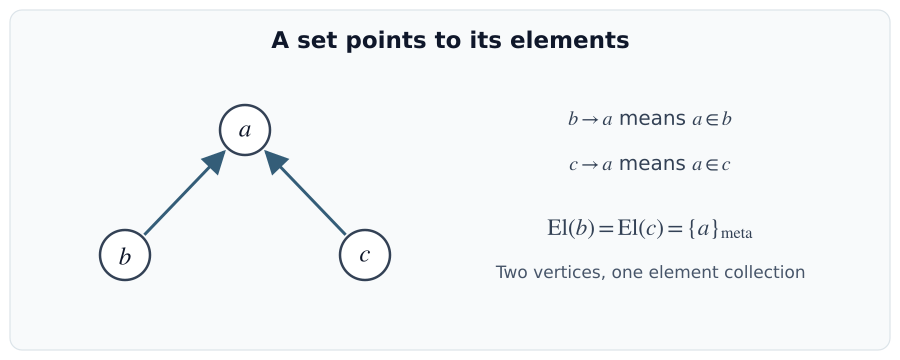
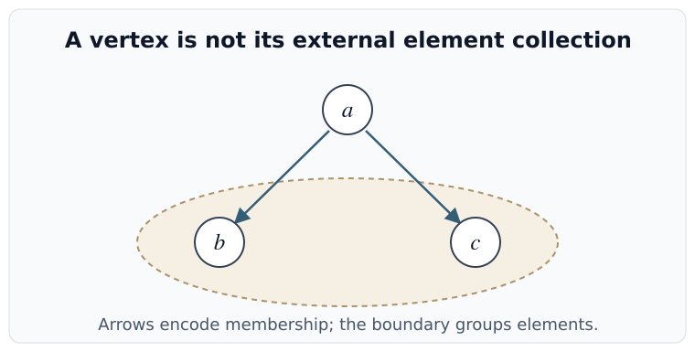
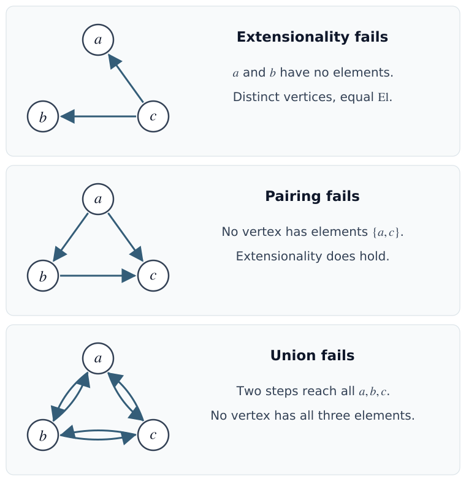
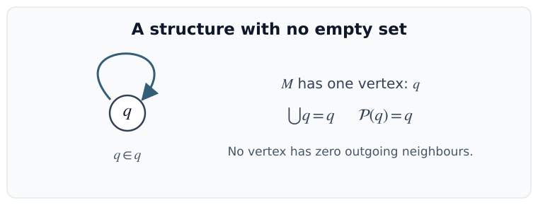
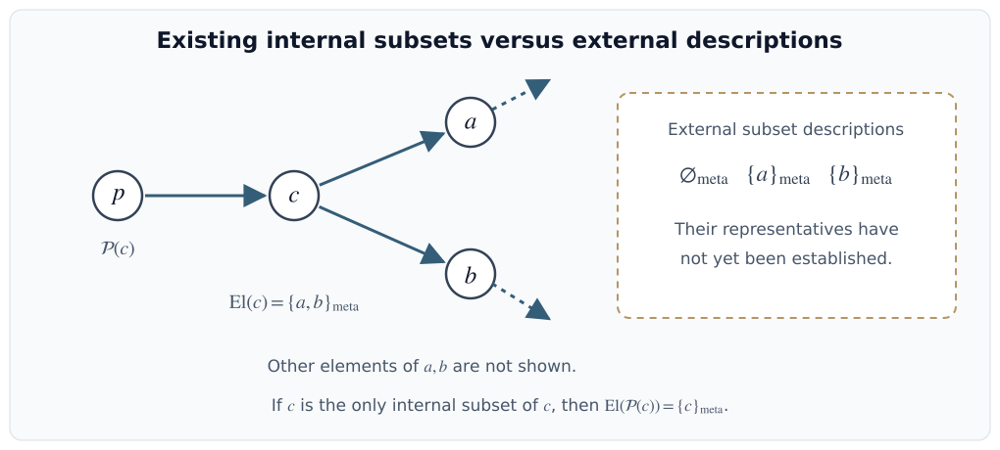
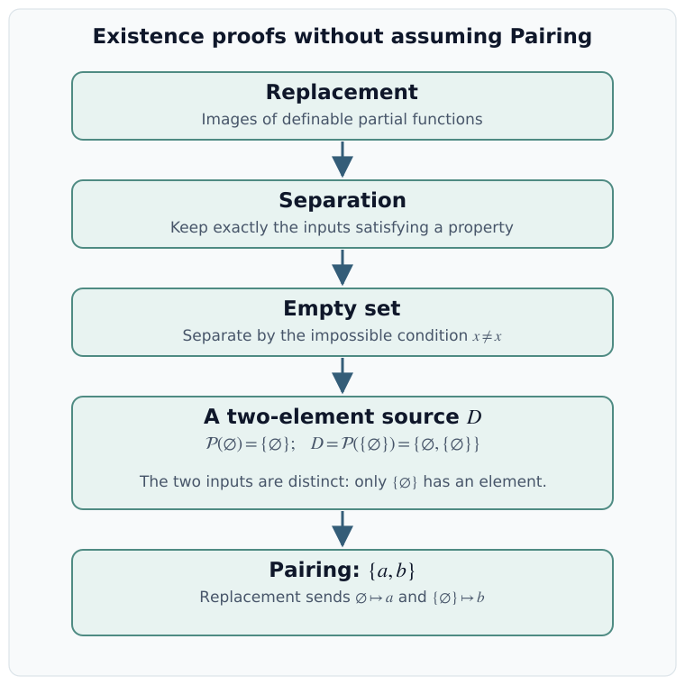
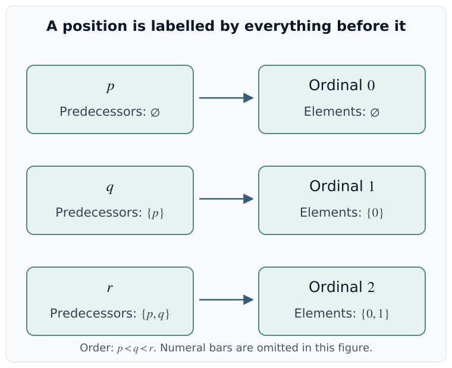
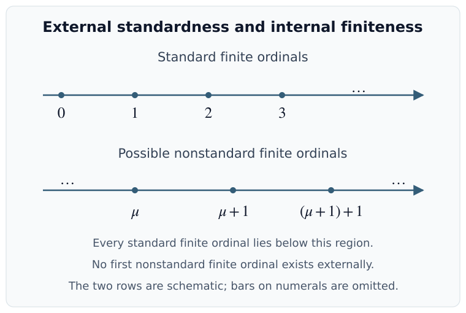
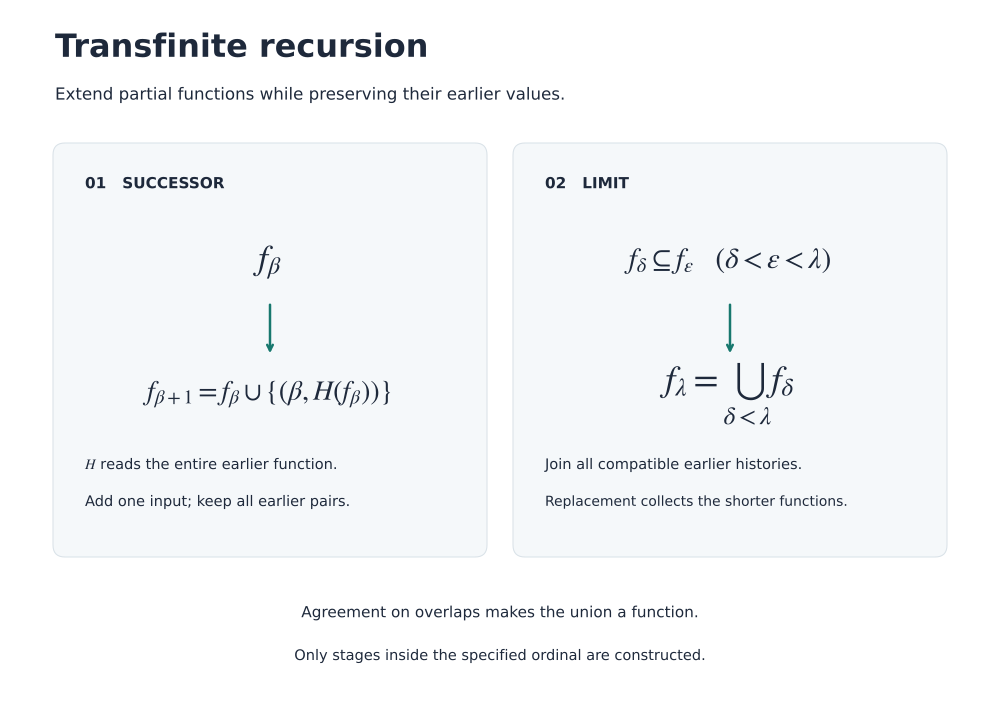

# Axiomatic Set Theory

Familiar notation such as $\varnothing$, $\{a,b\}$, and $a\times b$ hides existence claims. An axiomatic treatment makes these claims explicit: it specifies a membership relation, states the properties it must satisfy, and proves that the objects needed for further mathematics exist. This chapter develops these foundations using directed graphs, first-order formulas, and the replacement schema, then studies well-orders, ordinals, transfinite recursion, and Choice.

The main distinction is between an external description of some vertices and a vertex representing exactly those vertices as its elements. The early examples keep these two levels separate; the later existence proofs explain when they coincide. Only the axioms stated below are assumed, and Choice enters only in its own section. In particular, an infinite set and the foundation axiom have not yet been introduced. The later discussion of standard and nonstandard finite ordinals returns to the distinction between internal sets and external descriptions.

## Set-Theoretic Axioms

The axioms constrain a membership structure. First-order formulas then make definability precise, allowing Replacement to be stated and used to derive Separation, the empty set, and Pairing.

A directed graph provides a concrete interpretation of membership. The axioms restrict which graphs are admissible; drawing or describing a collection of vertices does not automatically supply a new vertex for it.

!!! definition "Definition (Membership structure)"
    
    A **membership structure** consists of a nonempty external set $M$ of vertices and a binary relation $\in_M$ on $M$. Its vertices are called **sets** within the structure. Following the direction used on the board,

    $$
    b\longrightarrow a
    \quad\Longleftrightarrow\quad a\in_M b.
    $$

    Thus the elements of $b$ are its **outgoing neighbours**. Loops are allowed at this stage: a loop at $a$ means $a\in_M a$.

    When the structure is fixed, write $\in$ for $\in_M$. All quantifiers in the set-theoretic formulas range over vertices of $M$: $\forall x$ means “for every vertex $x$”, and $\exists x$ means “there is a vertex $x$”. Equality means equality of vertices.

!!! notation "Notation (Sets and meta-sets)"
    
    The ordinary collections used externally to describe the graph are called **meta-sets** in this lecture. For a vertex $a$, its external collection of elements is

    $$
    \operatorname{El}(a)=\{x\in M:x\in_M a\}.
    $$

    A meta-set $A\subseteq M$ is **represented** by an internal set $a$ if $\operatorname{El}(a)=A$. The meta-set $A$ and the vertex $a$ are different kinds of objects. In particular, an external subset of $M$ need not be represented by any vertex.

!!! example "Example (Reading the arrows)"
    
    In the diagram $b\to a\leftarrow c$, the vertex $a$ belongs to both $b$ and $c$. If these are the only arrows, then

    $$
    \operatorname{El}(a)=\varnothing,\qquad
    \operatorname{El}(b)=\operatorname{El}(c)=\{a\}_{\mathrm{meta}}.
    $$

    This is a graph to interpret, not yet a model of all the axioms. The two distinct vertices $b,c$ have the same elements, which the next axiom will prohibit.

    <figure markdown="span">
      
      <figcaption>Arrows run from a set to an element, as on the board. The external list of outgoing neighbours is not itself an additional vertex.</figcaption>
    </figure>

!!! example "Example (A vertex and its element collection)"
    
    In the schematic picture below, the arrows $a\to b$ and $a\to c$ mean $b,c\in a$. The boundary around $b,c$ groups the displayed elements externally; it is not an additional vertex. If these are exactly the outgoing neighbours of $a$, then $\operatorname{El}(a)=\{b,c\}_{\mathrm{meta}}$. Other membership edges at $b,c$ are not specified by the sketch.

    <figure markdown="span">
      
      <figcaption>A redraw of the later board reminder: a representing vertex and the externally grouped elements play different roles.</figcaption>
    </figure>

!!! definition "Definition (Inclusion and extensionality)"
    
    For internal sets $a,b$, write $a\subseteq b$ if

    $$
    \forall x\,(x\in a\longrightarrow x\in b).
    $$

    The **extensionality axiom** is

    $$
    \forall a\,\forall b\,
    \bigl(\forall x\,(x\in a\longleftrightarrow x\in b)
    \longrightarrow a=b\bigr).
    $$

    It says that sets with the same elements are equal. Consequently, a representable meta-set has a unique representative, and $a\subseteq b$ and $b\subseteq a$ together imply $a=b$. Extensionality supplies uniqueness, not the existence of a representative.

!!! definition "Definition (Union and power-set axioms)"
    
    The **union axiom** states

    $$
    \forall a\,\exists b\,\forall x\,
    \bigl(x\in b\longleftrightarrow
    \exists y\,(y\in a\land x\in y)\bigr).
    $$

    By extensionality, this $b$ is unique; denote it by $\bigcup a$. Its elements are the vertices reachable from $a$ by a directed path of length two.

    The **power-set axiom** states

    $$
    \forall a\,\exists b\,\forall x\,
    (x\in b\longleftrightarrow x\subseteq a).
    $$

    Its unique witness is denoted by $\mathcal P(a)$. The quantified variable $x$ ranges over existing internal sets. The axiom collects all such $x$ whose elements belong to $a$.

!!! remark "Remark (Pairing is still to be proved)"
    
    The **pairing assertion** is

    $$
    \forall a\,\forall b\,\exists c\,\forall x\,
    \bigl(x\in c\longleftrightarrow(x=a\lor x=b)\bigr).
    $$

    Its witness would be written $\{a,b\}$. In this lecture it will be derived from the other axioms, so it is not available yet. Before this derivation, even $\bigcup\{a,b\}$ is not a justified construction: Union applies to an existing set, and the existence of $\{a,b\}$ is precisely what remains to be proved. Binary intersections also require an existence argument.

!!! example "Example (Testing the axioms on small graphs)"
    
    Consider the following graphs, with exactly the displayed vertices and arrows.

    + In the graph $c\to a$, $c\to b$, the distinct vertices $a,b$ both have no outgoing neighbours. Thus extensionality fails.
    + In the graph $a\to b$, $a\to c$, $b\to c$, the element collections are $\{b,c\}_{\mathrm{meta}}$, $\{c\}_{\mathrm{meta}}$, and $\varnothing_{\mathrm{meta}}$. They are distinct, so extensionality holds. Pairing fails: no vertex represents $\{a,c\}_{\mathrm{meta}}$.
    + In the complete directed triangle with both directions between every pair and no loops, each vertex has the other two as its elements. The would-be union of any vertex has all three vertices as elements. No vertex has that element collection, so Union fails.

    <figure markdown="span">
      
      <figcaption>To test an existence axiom, calculate the required outgoing-neighbour collection and check whether any vertex has exactly that collection.</figcaption>
    </figure>

!!! example "Example (The one-loop structure)"
    
    Let $M$ have just one vertex $q$, with the loop $q\to q$. Extensionality holds. The union axiom is satisfied by $\bigcup q=q$, since the only possible element occurs on a length-two path. Also $q\subseteq q$, so the power-set axiom is satisfied by $\mathcal P(q)=q$.

    Nevertheless, there is no internal empty set: the only vertex has an element. The external empty meta-set exists in the description of the graph, but has no representative. This shows why an internal empty set cannot simply be assumed from these three axioms.

    <figure markdown="span">
      
      <figcaption>This preliminary structure satisfies Extensionality, Union, and Power Set. It will fail the replacement schema introduced below.</figcaption>
    </figure>

!!! remark "Remark (What the internal power set contains)"
    
    Suppose $a\ne b$ and an internal set $c$ representing $\{a,b\}_{\mathrm{meta}}$ exists. Externally, the four subsets of that two-element meta-set are

    $$
    \varnothing_{\mathrm{meta}},\quad
    \{a\}_{\mathrm{meta}},\quad
    \{b\}_{\mathrm{meta}},\quad
    \{a,b\}_{\mathrm{meta}}.
    $$

    It is not yet justified to write $\mathcal P(c)=\{\varnothing,\{a\},\{b\},c\}$ internally: the first three meta-sets may have no internal representatives. If $c$ is the only existing internal subset of $c$, Power Set gives a vertex $p$ whose only element is $c$. Thus $\mathcal P(c)=p=\{c\}$, rather than a set with four elements. This is a conditional illustration of the axiom before the later existence proofs, not a claim that these missing representatives persist after Replacement is assumed.

    <figure markdown="span">
      
      <figcaption>The graph on the left is schematic: other elements of $a,b$ are omitted. The three external descriptions on the right are not being added as vertices. After Empty Set and Pairing are proved, all four representatives will exist.</figcaption>
    </figure>

### Definability

Replacement applies to relations specified by formulas. The syntax must therefore be fixed before the schema can be stated. Formulas describe properties of existing vertices; a further axiom is needed to turn their solutions into an internal set.

!!! definition "Definition (Formulas of set theory)"
    
    Fix a countable external list of variable symbols $x_1,x_2,\ldots$. The **atomic formulas** are

    $$
    x_i=x_j,\qquad x_i\in x_j.
    $$

    Formulas without parameters are generated recursively:

    + Every atomic formula is a formula.
    + If $E$ is a formula, then $\neg E$ is a formula.
    + If $E,F$ are formulas, then $E\lor F$ is a formula.
    + If $E$ is a formula, then $\exists x_i\,E$ is a formula.

    Every formula is a finite expression obtained by these rules. The external indexing of the variable symbols does not assert the existence of an internal set of natural numbers.

!!! notation "Notation (Derived logical operations)"
    The other connectives and the universal quantifier are abbreviations:

    $$
    \begin{aligned}
    E\land F&:=\neg(\neg E\lor\neg F),\\
    E\longrightarrow F&:=\neg E\lor F,\\
    E\longleftrightarrow F&:=(E\longrightarrow F)\land(F\longrightarrow E),\\
    \forall x_i\,E&:=\neg\exists x_i\,\neg E.
    \end{aligned}
    $$

!!! definition "Definition (Free variables, parameters, and sentences)"
    
    In $\exists x_i\,E$, the formula $E$ is the **scope** of the quantifier. An occurrence of $x_i$ is **bound** if it lies in the scope of a quantifier binding $x_i$; otherwise that occurrence is **free**. The same variable symbol may have free and bound occurrences in one formula.

    The notation $F(y_1,\ldots,y_n)$ says that all free variables of $F$ are among these distinct variable symbols; some of them may not actually occur. A **sentence** is a formula with no free variables.

    Given a parameter-free formula $F(y_1,\ldots,y_n,z_1,\ldots,z_k)$ and fixed internal sets $p_1,\ldots,p_k$, interpreting the free occurrences of $z_i$ as $p_i$ gives the formula with parameters

    $$
    F(y_1,\ldots,y_n,p_1,\ldots,p_k).
    $$

    Bound variables can be renamed before substitution to avoid capture. Parameters are fixed vertices, not additional variables over which the remaining quantifiers range.

!!! example "Example (Keeping track of a parameter)"
    
    In

    $$
    F(x,p):=x\in p\land\exists y\,(y\in x),
    $$

    $x,p$ are free and $y$ is bound. After fixing $p$, this formula describes the nonempty elements of that particular set. The sentence $\forall x\,\forall p\,F(x,p)$ makes an assertion about every pair of vertices and has a different meaning. Renaming the bound variable $y$ to an unused symbol does not change the property.

!!! definition "Definition (Definable relations and collections)"
    
    A formula with parameters $F(y_1,\ldots,y_n,p_1,\ldots,p_k)$ defines an $n$-ary relation $R_F$ by

    $$
    R_F(a_1,\ldots,a_n)
    \quad\Longleftrightarrow\quad
    F(a_1,\ldots,a_n,p_1,\ldots,p_k)\text{ holds in }M.
    $$

    A **collection** in the lecture's terminology is a unary definable relation, also commonly called a **definable class**. It is represented by a set $b$ if its defining property is equivalent to $x\in b$ for every vertex $x$.

    The formula $x=x$ defines the collection of all internal sets. The formula $x\notin x$ defines the collection of sets not belonging to themselves. Both are meaningful formulas; neither description by itself proves representability.

!!! remark "Remark (Three levels of description)"
    

    | Term | What it means here | Existence of a representing vertex |
    |---|---|---|
    | Set | A vertex of the structure | Already an object of the theory |
    | Meta-set | An external collection used to discuss the structure | Not automatic |
    | Collection | The solutions of a formula with fixed parameters | Requires an existence argument |

    Every internal set determines a collection, using the formula $x\in a$ with parameter $a$. An arbitrary external meta-set need not be definable. A definable collection need not be represented by an internal set. Keeping these statements separate is essential for the power-set example and Russell's argument.

### Replacement

Replacement asserts that the image of an existing set under a definable functional relation is again a set. Here **functional** means that each input has at most one output. This partial-functional version is the one written on the board.

!!! definition "Definition (Replacement schema)"
    
    For every parameter-free formula $F(x,y,z_1,\ldots,z_k)$, the following sentence is an axiom, where $a,b,y'$ are chosen fresh and $\bar z$ abbreviates $z_1,\ldots,z_k$:

    $$
    \begin{aligned}
    \forall z_1\cdots\forall z_k\,\Bigl[
    &\forall x\,\forall y\,\forall y'\,
       \bigl((F(x,y,\bar z)\land F(x,y',\bar z))\longrightarrow y=y'\bigr)\\
    &\longrightarrow
       \forall a\,\exists b\,\forall y\,
       \bigl(y\in b\longleftrightarrow
       \exists x\,(x\in a\land F(x,y,\bar z))\bigr)
    \Bigr].
    \end{aligned}
    $$

    The resulting $b$ is unique by extensionality. After fixing the parameters, its elements are exactly the outputs obtained from inputs in $a$. Inputs with no output contribute nothing. Injectivity is not required: several inputs may produce the same output.

    This is a **schema**: there is one first-order axiom for each formula $F$. The phrase “for every formula” belongs to the external description of the theory; it is not a quantifier over formulas inside the displayed sentence.

!!! example "Example (Filtering by a partial identity)"
    
    Fix a property $G(x,\bar p)$ and let

    $$
    F(x,y,\bar p):=(y=x\land G(x,\bar p)).
    $$

    An input satisfying $G$ maps to itself; any other input has no output. This relation is functional regardless of which inputs satisfy $G$. Replacement therefore forms the subcollection of an existing set consisting of the inputs that pass the test. There is no need to assign a default output to rejected inputs.

!!! theorem "Theorem (Separation schema)"
    
    For every formula $G(y,\bar p)$ with fixed parameters and every set $a$, there is a set $b$ such that

    $$
    \forall y\,
    \bigl(y\in b\longleftrightarrow(y\in a\land G(y,\bar p))\bigr).
    $$

    It is denoted by $\{y\in a:G(y,\bar p)\}$. The board calls this the **axiom schema of comprehension**; here it is a theorem derived from Replacement, and “comprehension” is restricted to an already existing set $a$.

??? proof "Proof"
    Apply Replacement to the functional relation $F(x,y,\bar p):=(x=y\land G(x,\bar p))$. Its image of $a$ satisfies

    $$
    \begin{aligned}
    y\in b
    &\longleftrightarrow\exists x\,(x\in a\land x=y\land G(x,\bar p))\\
    &\longleftrightarrow y\in a\land G(y,\bar p).
    \end{aligned}
    $$

    Extensionality gives uniqueness.

!!! theorem "Theorem (Empty set)"
    
    There is a unique set with no elements. It is denoted by $\varnothing$.

??? proof "Proof"
    Choose any set $a$, which is possible because the domain of the structure is nonempty. By [Theorem](#thm-separation-schema), the set

    $$
    \{x\in a:x\ne x\}
    $$

    exists. No vertex satisfies $x\ne x$, so this set has no elements. Any two sets with no elements are equal by extensionality.

!!! theorem "Theorem (Pairing)"
    
    For any sets $a,b$, there is a unique set whose elements are precisely $a,b$. Denote it by $\{a,b\}$; when $a=b$, write $\{a\}$.

??? idea "Idea"
    Replacement needs an existing source set. Construct a two-element source using two successive power sets of the empty set, and send its two elements to $a$ and $b$. This proves Pairing without using Pairing to create the source.

    <figure markdown="span">
      
      <figcaption>The two inputs are already available before the replacement step. Their distinctness follows from the fact that one has no elements and the other has an element.</figcaption>
    </figure>

??? proof "Proof"
    The only subset of $\varnothing$ is $\varnothing$: any subset has no elements and is equal to $\varnothing$ by extensionality. Hence

    $$
    \mathcal P(\varnothing)=\{\varnothing\}.
    $$

    This equation establishes the existence of the singleton using Power Set, not Pairing. The sets $\varnothing$ and $\{\varnothing\}$ are distinct, since the latter has an element.

    An internal subset of $\{\varnothing\}$ either has no elements or contains $\varnothing$, its only possible element. In the first case it equals $\varnothing$; in the second it equals $\{\varnothing\}$. Both exist, so

    $$
    D:=\mathcal P(\{\varnothing\})
      =\{\varnothing,\{\varnothing\}\}.
    $$

    Now apply Replacement to $D$ and the relation

    $$
    F(x,y):=(x=\varnothing\land y=a)
       \lor(x=\{\varnothing\}\land y=b).
    $$

    This is functional because $\varnothing\ne\{\varnothing\}$, and it is undefined outside $D$. Its image has exactly the elements $a,b$, even when $a=b$. Extensionality gives the unique set $\{a,b\}$.

!!! example "Example (Revisiting the two-element power set)"
    
    Now let $a\ne b$. Empty Set and Pairing supply $\varnothing$, $\{a\}$, $\{b\}$, and $\{a,b\}$. Every subset of $\{a,b\}$ is one of these four sets, according to whether it contains $a$ and whether it contains $b$. Thus the earlier classroom question now has the justified answer

    $$
    \mathcal P(\{a,b\})
    =\{\varnothing,\{a\},\{b\},\{a,b\}\}.
    $$

    The four-element set on the right is supplied by the power-set axiom. No separate assumption about four-element sets is being made.

## Set Constructions

The derived existence principles supply familiar set operations, ordered pairs, Cartesian products, functions, and indexed families. Each construction needs a bounding set or a uniquely defined image; the earlier axioms justify those steps.

Separation and Pairing now justify the usual elementary constructions. Each definition below is accompanied by an existing ambient set or an axiom that supplies its elements.

!!! theorem "Theorem (No universal set)"
    
    The collection of all sets is not represented by a set.

??? proof "Proof"
    Suppose a set $V$ contained every set as an element. Separation gives

    $$
    R=\{x\in V:x\notin x\}.
    $$

    Since $R$ is a set, $R\in V$. Applying its defining condition to $x=R$ yields

    $$
    R\in R\longleftrightarrow R\notin R,
    $$

    a contradiction.

!!! remark "Remark (Russell's paradox and restricted comprehension)"
    
    Unrestricted comprehension would assert a set $B=\{x:x\notin x\}$, producing $B\in B\longleftrightarrow B\notin B$ immediately. Separation instead gives $R_a=\{x\in a:x\notin x\}$ for an existing set $a$. This is consistent with the construction: necessarily $R_a\notin a$, since assuming $R_a\in a$ would produce the same contradiction. The restriction to $a$ is what prevents a universal set from being constructed.

!!! definition "Definition (Binary intersection and union)"
    
    For sets $a,b$, define

    $$
    a\cap b:=\{x\in a:x\in b\},
    \qquad
    a\cup b:=\bigcup\{a,b\}.
    $$

    The intersection exists by Separation. The union exists by Pairing followed by Union. Their defining membership conditions are

    $$
    \begin{aligned}
    x\in a\cap b&\longleftrightarrow(x\in a\land x\in b),\\
    x\in a\cup b&\longleftrightarrow(x\in a\lor x\in b).
    \end{aligned}
    $$

    These conditions also show that the definitions are symmetric in $a,b$.

!!! definition "Definition (Ordered pairs and tuples)"
    
    The **Kuratowski ordered pair** is

    $$
    (a,b):=\{\{a\},\{a,b\}\}.
    $$

    Each inner set and then the outer set exists by Pairing. Tuples are built recursively; in particular,

    $$
    (a,b,c):=(a,(b,c)).
    $$

    Parentheses specify order; the braces inside the encoding are ordinary unordered sets.

!!! proposition "Proposition (Recovering the coordinates)"
    
    For all sets $a,b,c,d$,

    $$
    (a,b)=(c,d)\quad\Longleftrightarrow\quad a=c\text{ and }b=d.
    $$

??? proof "Proof"
    If the coordinates agree, so do the defining sets. Conversely, let $p=(a,b)=(c,d)$. Using $p=\{\{a\},\{a,b\}\}$, a vertex $x$ belongs to every member of $p$ exactly when $x=a$: membership in $\{a\}$ forces this, and $a$ belongs to both members. The same property is equivalent to $x=c$ using the other representation. Hence $a=c$. This compares membership conditions and does not assume a general intersection operation.

    Also $\bigcup p=\{a,b\}=\{a,d\}$. If this set has no element other than $a$, then $b=d=a$. Otherwise its unique element other than $a$ must be both $b$ and $d$. Hence $b=d$. This includes the diagonal case $a=b$, where the outer set has only one element.

!!! definition "Definition (Cartesian product)"
    
    For sets $a,b$, define

    $$
    a\times b:=
    \bigl\{z\in\mathcal P(\mathcal P(a\cup b)):
    \exists x\,\exists y\,(x\in a\land y\in b\land z=(x,y))\bigr\}.
    $$

    It exists by Separation from $\mathcal P(\mathcal P(a\cup b))$. The notation $z=(x,y)$ abbreviates the formula saying that $z$ is the Kuratowski pair of $x,y$; all the set notation can be expanded into formulas using membership and equality.

!!! remark "Remark (Why two power sets appear)"
    
    If $x\in a$ and $y\in b$, then $\{x\}$ and $\{x,y\}$ are subsets of $a\cup b$. Consequently,

    $$
    \{x\},\{x,y\}\in\mathcal P(a\cup b),
    \qquad
    (x,y)\subseteq\mathcal P(a\cup b),
    $$

    and therefore $(x,y)\in\mathcal P(\mathcal P(a\cup b))$. The first power set contains the two inner sets; the second contains the set whose elements are those inner sets. Confusing $\subseteq$ with $\in$ at this step would place the ordered pair in the wrong ambient set.

!!! proposition "Proposition (Finite meta-sets are representable)"
    
    Every externally finite meta-set of vertices is represented by an internal set.

??? proof "Proof"
    The empty meta-set is represented by $\varnothing$. Given a finite external list $a_1,\ldots,a_n$, start with $s_0=\varnothing$ and form successively

    $$
    s_{j+1}=s_j\cup\{a_{j+1}\}
    \qquad(0\le j<n).
    $$

    Pairing supplies each singleton, and binary union supplies each next set. The elements of $s_j$ are exactly $a_1,\ldots,a_j$, so $s_n$ represents the given meta-set. Repetitions do not affect the result. This is an external finite induction; it does not assume an internal infinite set or assert representability of every infinite meta-set.

### Functions

A formula can describe a functional relation before its graph has been shown to be a set. Replacement provides the range of a relation with set-sized domain; the Cartesian product and Separation then provide its graph.

!!! notation "Notation (Evaluating a functional relation)"
    If a definable functional relation $E(x,y)$ has an output at $a$, write $E(a)$ for the unique $b$ satisfying $E(a,b)$. This notation can be used before the relation has a set-sized graph; it is a convenient abbreviation for a formula with a unique output.

!!! theorem "Theorem (Representing a functional relation)"
    
    Let $E(x,y,\bar p)$ be a definable functional relation whose domain is a set $a$: for each $x\in a$ there is exactly one $y$ satisfying $E(x,y,\bar p)$, and there are no inputs outside $a$. Then its range and its graph are sets.

??? proof "Proof"
    Replacement gives the range

    $$
    c=\{y:\exists x\,(x\in a\land E(x,y,\bar p))\}.
    $$

    Here the notation is justified by that axiom. Form $a\times c$ and use Separation to obtain

    $$
    f=\{z\in a\times c:
    \exists x\,\exists y\,(z=(x,y)\land E(x,y,\bar p))\}.
    $$

    This set contains exactly the ordered pairs specified by the relation. The uniqueness of outputs and the injectivity of the ordered-pair encoding make $f$ a function graph with domain $a$ and range $c$.

!!! definition "Definition (Set functions)"
    
    A **function** is a set $f$ of ordered pairs such that each input occurring in $f$ has exactly one output. Its **domain** and **range** are denoted by $\operatorname{dom}(f)$ and $\operatorname{ran}(f)$:

    $$
    \begin{aligned}
    \operatorname{dom}(f)&=\{x:\exists y\,((x,y)\in f)\},\\
    \operatorname{ran}(f)&=\{y:\exists x\,((x,y)\in f)\}.
    \end{aligned}
    $$

    These are sets by Replacement applied to the uniquely recoverable first and second coordinates of each member of $f$. For $x\in\operatorname{dom}(f)$, write $f(x)$ for its unique output.

    The notation $f:a\to b$ means $\operatorname{dom}(f)=a$ and $\operatorname{ran}(f)\subseteq b$. It does not require the range to equal $b$.

!!! theorem "Theorem (Function sets)"
    
    For sets $a,b$, the collection of all functions $a\to b$ is a set, denoted by $b^a$.

??? proof "Proof"
    Every such function graph is a subset of $a\times b$, so it belongs to $\mathcal P(a\times b)$. Separate out exactly the subsets with one output in $b$ for each input in $a$:

    $$
    b^a=\bigl\{f\in\mathcal P(a\times b):
    \forall x\in a\;\exists!y\in b\;((x,y)\in f)\bigr\}.
    $$

    In this formula, $\forall x\in a$ abbreviates $\forall x\,(x\in a\to\cdots)$, and $\exists!$ means “there exists exactly one”. Both abbreviations expand into first-order formulas. No extraneous inputs or outputs can occur because $f\subseteq a\times b$.

!!! example "Example (Empty domains and empty codomains)"
    
    There is exactly one function with empty domain, the empty graph. Hence $b^{\varnothing}=\{\varnothing\}$ for every set $b$, including $b=\varnothing$. If $a\ne\varnothing$, there is no function $a\to\varnothing$, so $\varnothing^a=\varnothing$.

!!! definition "Definition (Indexed family)"
    
    A **family of sets indexed by a set $I$** is a function $\alpha$ with domain $I$. Write $a_i=\alpha(i)$ and denote the family by $(a_i)_{i\in I}$.

    The index set $I$, the graph $\alpha$, and the range $\operatorname{ran}(\alpha)$ are distinct sets. Equal values at different indices occur only once in the range.

!!! proposition "Proposition (Unions and intersections of families)"
    
    For any set-indexed family $\alpha=(a_i)_{i\in I}$, its union exists and is

    $$
    \bigcup_{i\in I}a_i:=\bigcup\operatorname{ran}(\alpha).
    $$

    If $I\ne\varnothing$, choose $i_0\in I$. The intersection exists and is

    $$
    \bigcap_{i\in I}a_i
    :=\{x\in a_{i_0}:\forall i\,(i\in I\longrightarrow x\in a_i)\}.
    $$

    This definition is independent of the chosen $i_0$.

??? proof "Proof"
    The range is a set, so Union gives the union of the family. Its membership condition is $x\in\bigcup_{i\in I}a_i$ if and only if $x\in a_i$ for some $i\in I$.

    For a nonempty index set, Separation inside $a_{i_0}$ gives the displayed intersection. A vertex belongs to it exactly when it belongs to every $a_i$: this condition already includes membership in $a_{i_0}$. It therefore does not depend on which index was selected. Selecting one element of this particular nonempty set does not require the axiom of choice.

!!! remark "Remark (Why the empty intersection is different)"
    
    If $I=\varnothing$, the condition $\forall i\,(i\in I\to x\in a_i)$ holds for every set $x$. An unrestricted intersection defined by this condition would be a universal set, which does not exist by [Theorem](#thm-no-universal-set). Also, there is no $i_0\in I$ from which to obtain a bounding set.

    In contrast, $\bigcup_{i\in\varnothing}a_i=\varnothing$: no vertex belongs to a member of the empty family. If a fixed ambient set $U$ has been specified, one may define the **intersection relative to $U$** by

    $$
    \{x\in U:\forall i\in I\;(x\in a_i)\}.
    $$

    For an empty index set this relative intersection is $U$. It is a convention with an explicit bound, not an unrestricted set of all objects.

!!! definition "Definition (Product of a family)"
    
    Let $(a_i)_{i\in I}$ be a set-indexed family and put $U=\bigcup_{i\in I}a_i$. Its **product** is the set

    $$
    \prod_{i\in I}a_i
    :=\{f\in U^I:\forall i\in I\;(f(i)\in a_i)\}.
    $$

    The function set $U^I$ exists by [Theorem](#thm-function-set), and Separation gives the product. An element of the product is one function choosing a value in each factor. This construction proves that the product is a set; it does not yet prove that it has an element.

    If the indexing function is the identity $I\to I$, the family consists of the sets $i\in I$ themselves. In this case write $\bigcup I$, $\bigcap I$ (when $I\ne\varnothing$), and $\prod I$ for the corresponding operations.

!!! example "Example (A product as a choice of coordinates)"
    
    For $I=\{\bar0,\bar1\}$, $a_{\bar0}=\{u,v\}$ and $a_{\bar1}=\{w\}$, with $u\ne v$, the product has the two function graphs

    $$
    \{(\bar0,u),(\bar1,w)\},\qquad
    \{(\bar0,v),(\bar1,w)\}.
    $$

    Here $\bar0=\varnothing$ and $\bar1=\{\varnothing\}$ are two distinct indices. A function graph records which value belongs to which index, even when different factors overlap. A member of a two-factor product can be identified with an ordered pair of values, although the function graph and the Kuratowski pair are different encodings.

    If some $a_i=\varnothing$, the product is empty. If $I=\varnothing$, the empty function is its unique member, so $\prod_{i\in\varnothing}a_i=\{\varnothing\}$. For an arbitrary family of nonempty factors, nonemptiness is the additional assertion supplied later by Choice.

## Ordinals

Well-orders and initial segments provide the language for ordinal representation. After constructing ordinals and comparing their order types, the section examines what finiteness means inside a membership structure.

An order tells how elements are arranged. A well-order strengthens this by giving every nonempty subset a first element. Initial segments describe everything preceding a position; they are the link between an ordered set and its ordinal representation.

!!! definition "Definition (Orders)"
    
    An **order** or **partial order** on a collection $D$ is a binary relation $\le$ that is reflexive, antisymmetric, and transitive on $D$:

    $$
    \begin{aligned}
    x&\le x,\\
    (x\le y\land y\le x)&\Longrightarrow x=y,\\
    (x\le y\land y\le z)&\Longrightarrow x\le z.
    \end{aligned}
    $$

    Its associated **strict order** is $x<y$ if $x\le y$ and $x\ne y$. An order is **total** if $x\le y$ or $y\le x$ for every $x,y\in D$. Equivalently, its strict order satisfies exactly one of $x<y$, $x=y$, and $y<x$.

    Relations on collections are understood to be definable, with set parameters allowed. When $D$ is a set, the relation is represented by a subset of $D\times D$.

!!! definition "Definition (Well-ordered set)"
    
    A set $a$ contained in the domain of a total order is **well-ordered** if every nonempty subset $b\subseteq a$ has a **least element**: an element $m\in b$ such that $m\le x$ for every $x\in b$.

    In a membership structure, “every subset” means every internal subset, as in the power-set axiom. It does not quantify over all external meta-subsets of the structure.

!!! example "Example (Totality and well-ordering)"
    
    The three-element chain $p<q<r$ is well-ordered. The inclusion order on $\mathcal P(\{p,q\})$, for $p\ne q$, is a partial order but not a total order: $\{p\}$ and $\{q\}$ are incomparable.

    As an external familiar example, the usual order on the integers is total but is not a well-order: the integers have no least element. This comparison uses familiar meta-mathematics; it does not assert that an internal infinite set has already been constructed from the axioms so far.

!!! definition "Definition (Well-order relation on a collection)"
    
    Let $<$ be a strict total order on a definable collection $D$. For $x\in D$, write

    $$
    S_x(D,<):=\{y\in D:y<x\}.
    $$

    Following the lecture, $<$ is a **well-order relation on $D$** if every $S_x(D,<)$ is a set and is well-ordered by $<$. The requirement that each predecessor collection be a set is essential when $D$ itself need not be a set.

!!! proposition "Proposition (Least element of a subcollection)"
    
    If $<$ is a well-order relation on $D$, every nonempty definable subcollection $T$ of $D$ has a least element.

??? proof "Proof"
    Choose $t\in T$. If no element of $T$ precedes $t$, then $t$ is least. Otherwise Separation gives the nonempty set

    $$
    b=\{x\in S_t(D,<):T(x)\}.
    $$

    Since $S_t(D,<)$ is well-ordered, $b$ has a least element $m$. For $y\in T$, either $y<t$, in which case $y\in b$ and $m\le y$, or $t\le y$, in which case $m<t\le y$. Thus $m$ is least in all of $T$. This proof never collects all of $T$ into a set.

!!! definition "Definition (Initial segment)"
    
    Let $(a,<)$ be a well-ordered set. For $x\in a$, its **initial segment at $x$** is

    $$
    S_x(a)=\{y\in a:y<x\}.
    $$

    More generally, a subset $s\subseteq a$ is an **initial segment** if it is downward closed: whenever $x\in s$, $y\in a$, and $y<x$, one has $y\in s$. This convention allows both $\varnothing$ and $a$ itself.

!!! proposition "Proposition (All initial segments)"
    
    Every initial segment $s$ of a well-ordered set $a$ is either $a$ itself or $S_x(a)$ for a unique $x\in a$.

??? proof "Proof"
    If $s\ne a$, let $x$ be the least element of $a\setminus s$. Every $y<x$ belongs to $s$, by minimality. Conversely, if $y\in s$, then $y\ne x$; the possibility $x<y$ would force $x\in s$ by downward closure. Hence $y<x$, proving $s=S_x(a)$.

    If $x<z$, then $x\in S_z(a)$ but $x\notin S_x(a)$, so the two initial segments differ. This also proves uniqueness.

!!! definition "Definition (Order isomorphism)"
    
    An **order isomorphism** from $(a,<_{a})$ to $(b,<_{b})$ is a bijection $f:a\to b$ such that

    $$
    x<_{a}y\quad\Longleftrightarrow\quad f(x)<_{b}f(y)
    \qquad(x,y\in a).
    $$

    Write $(a,<_{a})\cong(b,<_{b})$ if such a function exists. Isomorphisms identify order structure, not the names of the elements. In particular, $f$ restricts to an isomorphism $S_x(a)\cong S_{f(x)}(b)$.

!!! example "Example (Positions and their predecessors)"
    
    In the chain $p<q<r$, the predecessor sets are $\varnothing$, $\{p\}$, and $\{p,q\}$. The map sending $p,q,r$ to $\bar0,\bar1,\bar2$ preserves their positions. The next section constructs these ordinal labels so that each label is itself the set of all earlier labels.

    <figure markdown="span">
      
      <figcaption>The arrows here show the order-preserving correspondence, not membership edges. Each position is determined by the ordered structure before it.</figcaption>
    </figure>

An ordinal is a canonical well-ordered set whose elements are its preceding positions. This turns comparison of order types into membership and inclusion. The construction uses the axioms already introduced; it does not require Choice or an axiom asserting an infinite set.

!!! definition "Definition (Ordinal)"
    
    A set $\alpha$ is an **ordinal** if membership $\in$ is a strict well-order on $\alpha$ and $\alpha$ is **transitive**:

    $$
    x\in\alpha\land y\in x\quad\Longrightarrow\quad y\in\alpha.
    $$

    Equivalently, every element of $\alpha$ is a subset of $\alpha$. The definable collection of all ordinals is denoted by $\mathrm{Ord}$; this notation does not assert that it is a set.

!!! example "Example (Standard finite ordinals)"
    
    For each external natural number $n\in\mathbb N_{\mathrm{meta}}$, define $\bar n$ by external finite induction:

    $$
    \bar0:=\varnothing,\qquad
    \overline{n+1}:=\bar n\cup\{\bar n\}.
    $$

    Thus

    $$
    \bar1=\{\bar0\},\qquad
    \bar2=\{\bar0,\bar1\},\qquad
    \bar3=\{\bar0,\bar1,\bar2\}.
    $$

    Each is a transitive set strictly well-ordered by membership. Each individual construction takes only finitely many applications of the previously established operations. No set containing all the $\bar n$ has yet been obtained.

!!! proposition "Proposition (Elements are initial segments)"
    
    If $\alpha$ is an ordinal and $\xi\in\alpha$, then $S_\xi(\alpha)=\xi$. Moreover, every element of an ordinal is an ordinal.

??? proof "Proof"
    The predecessor set is $S_\xi(\alpha)=\{\beta\in\alpha:\beta\in\xi\}$, so it is contained in $\xi$. Conversely, $\beta\in\xi\in\alpha$ implies $\beta\in\alpha$ by transitivity of $\alpha$. Thus $\xi\subseteq S_\xi(\alpha)$.

    The well-order on $\alpha$ restricts to a well-order on $\xi=S_\xi(\alpha)$. To check that $\xi$ is transitive, suppose $\eta\in\beta\in\xi$. Transitivity of $\alpha$ places $\eta,\beta,\xi$ in $\alpha$. Transitivity of its strict order $\in$ gives $\eta\in\xi$. Hence $\xi$ is an ordinal.

!!! proposition "Proposition (No ordinal belongs to itself)"
    
    For every ordinal $\alpha$, one has $\alpha\notin\alpha$.

??? proof "Proof"
    If $\alpha\in\alpha$, then $\alpha$ is an element of the domain on which $\in$ strictly well-orders $\alpha$. The same assumed membership is therefore the forbidden diagonal relation $\alpha<\alpha$. This contradicts irreflexivity. No appeal to the axiom of Foundation is needed.

!!! theorem "Theorem (Comparison of ordinals)"
    
    For any ordinals $\alpha,\beta$, exactly one of the following holds:

    $$
    \alpha=\beta,\qquad \alpha\in\beta,\qquad \beta\in\alpha.
    $$

??? proof "Proof"
    Put $\gamma=\alpha\cap\beta$. It is an initial segment of both ordinals: if $x\in\gamma$ and $y\in x$, transitivity puts $y$ in both $\alpha$ and $\beta$.

    By [Proposition](#prop-all-initial-segments) and [Proposition](#prop-ordinal-elements), $\gamma$ is either $\alpha$ or an element of $\alpha$, and either $\beta$ or an element of $\beta$. It cannot be a proper initial segment of both: then $\gamma\in\alpha\cap\beta=\gamma$, contrary to [Proposition](#prop-ordinal-irreflexivity). If $\gamma=\alpha=\beta$, the ordinals are equal. If $\gamma=\alpha\ne\beta$, then $\alpha=\gamma\in\beta$; the other case is symmetric.

    Equality cannot coexist with either membership relation. Nor can both membership relations hold: if $\alpha\in\beta$ and $\beta\in\alpha$, transitivity of $\alpha$ gives $\alpha\in\alpha$. Thus the three possibilities are mutually exclusive.

!!! notation "Notation (Ordinal comparison)"
    
    For ordinals, write $\alpha<\beta$ for $\alpha\in\beta$, and $\alpha\le\beta$ for $\alpha<\beta$ or $\alpha=\beta$. Then

    $$
    \alpha\le\beta\quad\Longleftrightarrow\quad\alpha\subseteq\beta.
    $$

    The forward implication follows from transitivity of $\beta$. For the converse, comparison leaves only the possible obstruction $\beta\in\alpha$; together with $\alpha\subseteq\beta$, it would imply $\beta\in\beta$.

!!! proposition "Proposition (The well-order relation on ordinals)"
    
    Membership is a well-order relation on $\mathrm{Ord}$. In particular, every nonempty definable collection of ordinals has a least member, and every set of ordinals is well-ordered by membership.

??? proof "Proof"
    Irreflexivity and comparison have been proved. If $\alpha\in\beta\in\gamma$, transitivity of $\gamma$ gives $\alpha\in\gamma$, so membership is a strict total order on $\mathrm{Ord}$. The predecessors of an ordinal $\alpha$ are exactly its elements, all of which are ordinals. Thus $S_\alpha(\mathrm{Ord},\in)=\alpha$, a well-ordered set. Now apply [Proposition](#prop-class-least-element).

!!! proposition "Proposition (Successor ordinal)"
    
    If $\alpha$ is an ordinal, then

    $$
    \alpha+\bar1:=\alpha\cup\{\alpha\}
    $$

    is an ordinal and is the least ordinal strictly greater than $\alpha$. It is called the **successor** of $\alpha$. A nonzero ordinal which is not a successor is called a **limit ordinal**.

??? proof "Proof"
    The displayed set is transitive: elements of an old element of $\alpha$ remain in $\alpha$, and elements of the new element $\alpha$ also lie in $\alpha$. Every element is an ordinal, so it is well-ordered by membership. Thus it is an ordinal.

    It contains $\alpha$ as an element, so $\alpha<\alpha+\bar1$. If $\alpha<\beta$, then $\alpha\in\beta$ and $\alpha\subseteq\beta$, whence $\alpha\cup\{\alpha\}\subseteq\beta$. By ordinal comparison, $\alpha+\bar1\le\beta$.

    Here $+\bar1$ denotes the successor construction; general ordinal addition has not been defined.

!!! proposition "Proposition (Supremum of a set of ordinals)"
    
    If $a$ is a set of ordinals, then $\bigcup a$ is an ordinal and

    $$
    \sup a=\bigcup a.
    $$

??? proof "Proof"
    If $x\in\bigcup a$, choose $\alpha\in a$ with $x\in\alpha$. Then $x$ is an ordinal, and transitivity of $\alpha$ gives $x\subseteq\alpha\subseteq\bigcup a$. Thus $\bigcup a$ is a transitive set of ordinals, and it is well-ordered by membership. Hence it is an ordinal.

    For each $\alpha\in a$, one has $\alpha\subseteq\bigcup a$, so $\alpha\le\bigcup a$. If $\delta$ is any ordinal upper bound for $a$, every $\alpha\in a$ is contained in $\delta$, and hence $\bigcup a\subseteq\delta$. This proves the least-upper-bound assertion. For $a=\varnothing$, the supremum is $\bar0$.

!!! example "Example (Supremum need not be strictly larger)"
    
    For $a=\{\bar1,\bar3\}$, the union is $\bar3$, so $\sup a=\bar3\in a$. By contrast, $\bar3+\bar1=\bar4$ is strictly greater than $\bar3$. Taking a supremum and taking a successor are different operations.

!!! theorem "Theorem (The ordinals do not form a set)"
    
    The collection $\mathrm{Ord}$ is not a set.

??? proof "Proof"
    Suppose it were a set $a$. By [Proposition](#prop-ordinal-supremum), $\bigcup a$ would be an ordinal and an upper bound for every ordinal. Since it would itself belong to $a$, it would be the greatest ordinal. But $\bigcup a<\bigcup a+\bar1$, and the latter is also an ordinal. This is a contradiction.

An ordinal represents the entire order structure of a well-ordered set. The proof below labels each position by the ordinal type of its predecessor set; Replacement makes those labels into a set.

!!! lemma "Lemma (Increasing maps between ordinals)"
    
    If $f:\alpha\to\beta$ is strictly increasing between ordinals, then $\xi\le f(\xi)$ for every $\xi\in\alpha$, and $\alpha\le\beta$.

??? proof "Proof"
    Suppose there is a $\xi\in\alpha$ with $f(\xi)<\xi$, and choose the least such $\xi$. Put $\eta=f(\xi)$. Then $\eta<\xi$, so minimality gives $\eta\le f(\eta)$; strict increase gives $f(\eta)<f(\xi)=\eta$, a contradiction. Therefore $\xi\le f(\xi)$ everywhere.

    If $\beta<\alpha$, the input $\beta$ is in $\alpha$, and $\beta\le f(\beta)<\beta$, again a contradiction. Comparison gives $\alpha\le\beta$.

!!! theorem "Theorem (Rigidity of ordinals)"
    
    Two ordinals are order-isomorphic if and only if they are equal. Every order isomorphism between ordinals is the identity.

??? proof "Proof"
    If $f:\alpha\to\beta$ is an order isomorphism, apply [Lemma](#lem-increasing-ordinal-map) to $f$ and its inverse. It gives $\alpha\le\beta$ and $\beta\le\alpha$, hence $\alpha=\beta$. For $\xi\in\alpha$, the same lemma gives $\xi\le f(\xi)$ and $f(\xi)\le f^{-1}(f(\xi))=\xi$. Thus $f(\xi)=\xi$. Conversely, the identity is an order isomorphism.

!!! theorem "Theorem (Ordinal type of a well-order)"
    
    Every well-ordered set is order-isomorphic to a unique ordinal, called its **order type**.

??? idea "Idea"
    For a position $x$, try to label it with the ordinal type $\beta(x)$ of everything before it. The labels already constructed must themselves form an ordinal. If a first unlabelled position existed, that ordinal would provide its missing label.

??? proof "Proof"
    Let $(a,<)$ be well-ordered. Following the board construction, use Separation to form

    $$
    d=\{x\in a:S_x(a)\text{ is isomorphic to an ordinal}\}.
    $$

    For $x\in d$, denote that ordinal by $\beta(x)$. It is unique by [Theorem](#thm-ordinal-rigidity), since two proposed ordinal images would be isomorphic by composition. “There is an order isomorphism” is a formula quantifying over function sets, so $d$ and this functional relation are definable.

    **Predecessors receive exactly the preceding labels.** Fix $x\in d$ and an isomorphism $g:S_x(a)\to\beta(x)$. For $y<x$, the restriction of $g$ gives

    $$
    S_y(a)\cong S_{g(y)}(\beta(x))=g(y).
    $$

    Thus $y\in d$ and $\beta(y)=g(y)$. In particular, $d$ is an initial segment, the labels increase strictly, and

    $$
    \{\beta(y):y<x\}=\beta(x).
    $$

    **The labels form an ordinal.** Replacement gives $B=\{\beta(x):x\in d\}$. The label map is an order isomorphism $d\to B$: strict increase implies injectivity and, by totality, also reflection of order. The displayed equality makes $B$ transitive. Hence $B$ is an ordinal.

    **There is no first missing position.** If $d\ne a$, let $t$ be the least element of $a\setminus d$. Then $S_t(a)=d$, so the isomorphism $d\to B$ shows $S_t(a)\cong B$. This puts $t$ in $d$, a contradiction. Therefore $d=a$, and $x\mapsto\beta(x)$ is the desired isomorphism onto $B$.

    Uniqueness of the ordinal follows again from rigidity. The construction is determined by unique ordinal labels; it makes no simultaneous arbitrary choices of isomorphisms.

The finite ordinals provide a useful test of the distinction between internal statements and external descriptions. The definition below is internal; the phrase “standard finite ordinal” also refers to the external natural numbers used to construct the numerals.

!!! definition "Definition (Finite ordinal)"
    
    An ordinal $\alpha$ is **finite** if every nonzero ordinal $\beta\le\alpha$ is a successor ordinal. Each $\bar n$ for $n\in\mathbb N_{\mathrm{meta}}$ is finite, by external induction, and is called a **standard finite ordinal**.

    A finite ordinal in a membership structure that is unequal to every standard $\bar n$ is called **nonstandard**. This is an external description of a possible structure, not an assertion that such an ordinal exists in every structure.

!!! remark "Remark (Why the standard part may not be an internal set)"
    
    If the structure contains a nonstandard finite ordinal, then the external collection

    $$
    \{\bar n:n\in\mathbb N_{\mathrm{meta}}\}
    $$

    is not represented by an internal set. Consequently, one cannot use Separation on “the standard ordinals” unless that condition has first been expressed by an appropriate internal formula. External standardness is not supplied by the internal definition of finiteness.

    <figure markdown="span">
      
      <figcaption>An external schematic picture of the board's two rows. The gap is not an ordinal or a jump in the order. If nonstandard finite ordinals exist, they have no least member as an external collection; that collection is not an available internal subset.</figcaption>
    </figure>

??? proof "Proof"
    Let $\nu$ be a nonstandard finite ordinal. Each $\bar n<\nu$: by comparison, $\nu\le\bar n$ would make $\nu$ one of the externally finitely many standard ordinals at most $\bar n$.

    Suppose an internal set $s$ had exactly the standard $\bar n$ as its elements. Then $s\subseteq\nu$. It is transitive, since every element of a standard finite ordinal is standard. The membership well-order on $\nu$ restricts to $s$, so $s$ is an ordinal and $s\le\nu$.

    The ordinal $s$ is nonzero, but it is not a successor: every element $\bar n$ of $s$ is followed by $\overline{n+1}\in s$, whereas a successor ordinal has a greatest element. This contradicts the defining finiteness of $\nu$.

    Also, any nonstandard finite ordinal $\nu$ is a successor $\mu+\bar1$, and its predecessor $\mu$ is finite and nonstandard; otherwise $\nu$ would be standard. Thus there is no least nonstandard finite ordinal externally. This does not contradict internal well-ordering, which quantifies over internal subsets.

!!! remark "Remark (What has not yet been assumed about infinity)"
    
    The ability to construct each $\bar n$ separately does not by itself produce a set of all of them. The supplied lecture stops at this distinction and has not yet stated an axiom of Infinity. The existence of an internal infinite ordinal is therefore not being assumed here. The nonstandard example is conditional, and is distinct from the question whether the structure contains a set of all its internally finite ordinals.

## Transfinite Recursion

A well-order supports two related operations. Induction proves a statement at every position from its truth at all earlier positions. Recursion constructs a value at every position from the function already constructed on all earlier positions. The latter requires an existence argument, not just an instruction to “continue”.

!!! theorem "Theorem (Transfinite induction)"
    
    Let $F(x)$ be a formula, possibly with parameters. Suppose that for every ordinal $\alpha$,

    $$
    \bigl(\forall\beta<\alpha\;F(\beta)\bigr)
    \quad\Longrightarrow\quad F(\alpha).
    $$

    Then $F(\alpha)$ holds for every ordinal $\alpha$.

??? proof "Proof"
    Otherwise the definable collection of ordinals satisfying $\neg F$ is nonempty and has a least member $\alpha$, by [Proposition](#prop-ord-well-order). All $\beta<\alpha$ satisfy $F$, so the hypothesis gives $F(\alpha)$, a contradiction.

!!! remark "Remark (The zero and limit stages)"
    
    At $\alpha=\bar0$, the condition on smaller ordinals is vacuous, so the hypothesis includes a proof of $F(\bar0)$. At a successor $\gamma+\bar1$, it allows all earlier cases, including $\gamma$. At a nonzero limit ordinal $\lambda$, there is no immediate predecessor: the hypothesis provides $F(\beta)$ for every $\beta<\lambda$. Such a limit case is required whenever a limit ordinal is under consideration; the scheme does not itself assert that a nonzero limit ordinal exists.

!!! notation "Notation (Functional relations and restriction)"
    
    If a definable relation $F(x,y)$ has at most one output for each input, write $F(x)$ for that output when it exists. If a definable collection $C$ is contained in its domain, the restricted relation $F\mathbin{\upharpoonright}C$ is defined by

    $$
    (F\mathbin{\upharpoonright}C)(x,y)
    \quad\Longleftrightarrow\quad F(x,y)\land C(x).
    $$

    This is a relation given by a formula; its graph need not be a set when $C$ is not a set. For a set function $f$ and a set $b\subseteq\operatorname{dom}(f)$, its restriction is the set function

    $$
    f\mathbin{\upharpoonright}b=\{(x,y)\in f:x\in b\}.
    $$

    If $\beta$ is an ordinal, $f\mathbin{\upharpoonright}\beta$ contains all earlier input-output pairs, since the elements of $\beta$ are exactly the smaller ordinals.

!!! definition "Definition (Inductive function for a recursion rule)"
    
    Let $H$ be a definable functional relation with one input and at most one output. A set function $f$ is **$H$-inductive** if its domain is an ordinal $\alpha$ and, for every $\beta<\alpha$, the function $f\mathbin{\upharpoonright}\beta$ belongs to the domain of $H$ and

    $$
    f(\beta)=H(f\mathbin{\upharpoonright}\beta).
    $$

    The input to $H$ is the entire function built before stage $\beta$, including its domain and all its values. The rule need not be defined on every set, or even on every function.

!!! theorem "Theorem (Transfinite recursion on an ordinal)"
    
    Let $H$ be a definable functional relation and $\alpha$ an ordinal. Suppose that every $H$-inductive function whose domain is an ordinal $\beta<\alpha$ belongs to the domain of $H$. Then there exists a unique $H$-inductive function with domain $\alpha$.

??? idea "Idea"
    Any two valid partial constructions agree wherever both are defined. A successor step adds one forced value. At a limit step, Replacement collects the unique shorter constructions, and their union is one function because they agree on overlaps.

    <figure markdown="span">
      
      <figcaption>The recursion rule supplies a new value; Replacement and Union justify collecting the earlier stages into a set.</figcaption>
    </figure>

??? proof "Proof"
    **Agreement on common domains.** If $f$ and $g$ are $H$-inductive with ordinal domains, their common domain is the smaller of the two ordinals. If they differ there, let $\xi$ be the least point of disagreement. Their restrictions to $\xi$ agree, so functionality of $H$ gives

    $$
    f(\xi)=H(f\mathbin{\upharpoonright}\xi)
    =H(g\mathbin{\upharpoonright}\xi)=g(\xi),
    $$

    a contradiction. This proves uniqueness whenever a construction exists.

    **Existence.** By transfinite induction, construct the unique $H$-inductive function $f_\gamma$ for every $\gamma\le\alpha$. For $\gamma=\bar0$, take the empty function. At a successor $\gamma=\delta+\bar1\le\alpha$, one has $\delta<\alpha$, so the hypothesis ensures that $H(f_\delta)$ exists. Set

    $$
    f_\gamma=f_\delta\cup\{(\delta,H(f_\delta))\}.
    $$

    Its domain is $\gamma$ and it obeys the recursion equation at the new input as well as at all old ones.

    At a nonzero limit $\gamma\le\alpha$, the induction hypothesis and uniqueness make $\delta\mapsto f_\delta$ a definable functional relation on the set $\gamma$. Replacement gives the set of these functions; put

    $$
    f_\gamma=\bigcup_{\delta<\gamma}f_\delta.
    $$

    Agreement on overlaps makes this a function, and its domain is $\bigcup\gamma=\gamma$. Indeed a nonzero limit ordinal has no greatest element, so each $\xi<\gamma$ lies in some $\delta<\gamma$. To verify the recursion at $\xi$, use the already constructed $f_{\xi+\bar1}$, whose domain is still below $\gamma$. The union agrees with that function through input $\xi$ and with $f_\xi$ below it. Thus the required equation holds.

    This completes existence, including at $\gamma=\alpha$. The agreement argument proves uniqueness. Choice is not used: each shorter function was unique, and Replacement collected its value.

!!! example "Example (A recursion that recovers its indices)"
    
    Take $H(g)=\operatorname{ran}(g)$ for every set function $g$ with ordinal domain. For any ordinal $\alpha$, the theorem gives a function $f$ on $\alpha$ with

    $$
    f(\beta)=\{f(\xi):\xi<\beta\}.
    $$

    Transfinite induction shows $f(\beta)=\beta$: if $f(\xi)=\xi$ for all $\xi<\beta$, then its preceding range is precisely $\beta$. For inputs present in the chosen domain, the first values are $\bar0$, $\{\bar0\}=\bar1$, and $\{\bar0,\bar1\}=\bar2$. At a limit input $\lambda$, if such an input is present, the same rule gives the set of all smaller ordinals, namely $\lambda$.

!!! remark "Remark (Induction versus recursion)"
    

    | Method | Input | Output | Main justification |
    |---|---|---|---|
    | Transfinite induction | An implication from all earlier cases to the current case | A property holds at every ordinal | A least counterexample cannot exist |
    | Transfinite recursion | A functional rule acting on the preceding function | A unique function on a specified ordinal | Agreement of partial functions, followed by Replacement and Union |

    A set function on a fixed ordinal is different from a functional relation defined on all ordinals. The latter can be described by a formula, but its domain is not a set by [Theorem](#thm-ord-proper-class).

## The Axiom of Choice

The earlier results construct sets and uniquely determined functions. Choice adds a different assertion: a family of nonempty sets admits a simultaneous selection even when no rule for choosing a particular element has been specified. The lecture introduces it as the next axiom, after Extensionality, Union, Power Set, and Replacement.

!!! definition "Definition (Axiom of Choice)"
    
    The **Axiom of Choice (AC)** states that if $a$ is a set of pairwise disjoint nonempty sets, then there is a set $c\subseteq\bigcup a$ such that $c\cap x$ has exactly one element for each $x\in a$. Such a $c$ is a **choice set** for $a$.

    From this point, results explicitly invoking AC use this additional axiom. The results on ordinals and transfinite recursion preceding this section do not require it.

!!! theorem "Theorem (Equivalent forms of Choice)"
    
    The following are equivalent:

    + **AC:** Every set of pairwise disjoint nonempty sets has a choice set.
    + **AC$'$:** For every set $a$, there is a function $h:\mathcal P(a)\setminus\{\varnothing\}\to a$ such that $h(x)\in x$ for every nonempty subset $x\subseteq a$.
    + **AC$''$:** For every set-indexed family $(a_i)_{i\in I}$ of nonempty sets, the product $\prod_{i\in I}a_i$ is nonempty.

??? proof "Proof"
    **AC implies AC$'$.** For each nonempty $x\subseteq a$, form the tagged set

    $$
    B_x=\{(x,y):y\in x\}.
    $$

    Replacement gives the set of all these $B_x$. They are nonempty and pairwise disjoint, because an ordered pair uniquely determines its first coordinate. AC gives a choice set meeting each $B_x$ in one pair $(x,y)$. These pairs form the graph of the required function $h(x)=y$. If $a=\varnothing$, the empty function suffices.

    **AC$'$ implies AC$''$.** Put $U=\bigcup_{i\in I}a_i$ and take a choice function $h$ on the nonempty subsets of $U$. Then $f(i)=h(a_i)$ defines a function on $I$ by Replacement and belongs to the product. For $I=\varnothing$, use the empty function.

    **AC$''$ implies AC.** Apply the product statement to the identity-indexed family $(x)_{x\in a}$. A member $f$ of the product satisfies $f(x)\in x$. Its range $c$ is a set contained in $\bigcup a$. Since distinct members of $a$ are disjoint, $c\cap x=\{f(x)\}$ for every $x\in a$.

!!! remark "Remark (Existence of a product and existence of a choice)"
    
    Separation already provided the set $\prod_{i\in I}a_i$, whether empty or nonempty. AC$''$ asserts that it contains a function when every factor is nonempty. Choosing one element of a single nonempty set, or constructing finitely many specified choices by external finite induction, does not require AC. Arbitrary set-indexed simultaneous choice is the new assertion.

!!! theorem "Theorem (Zermelo's well-ordering theorem)"
    
    Assuming AC, every set can be well-ordered.

??? idea "Idea"
    Fix a choice function on the nonempty subsets of $a$. At each ordinal stage, choose from what remains after the earlier choices. The process must exhaust $a$: otherwise its distinct choices would encode every ordinal inside one set, contradicting the fact that the ordinals do not form a set.

??? proof "Proof"
    The empty set has its unique empty well-order, so let $a\ne\varnothing$. By AC$'$, fix a choice function $h$ on its nonempty subsets. Define a partial functional rule on functions by

    $$
    H(g)=h(a\setminus\operatorname{ran}(g))
    \quad\text{when }\operatorname{ran}(g)\subseteq a
    \text{ and }a\setminus\operatorname{ran}(g)\ne\varnothing.
    $$

    Every $H$-inductive function takes its values in $a$ and is injective, since each value is chosen outside the preceding range.

    Suppose no such function has range $a$. Then every $H$-inductive function with ordinal domain belongs to the domain of $H$. For every ordinal $\gamma$, [Theorem](#thm-transfinite-recursion) therefore gives a unique $H$-inductive function $f_\gamma$ with domain $\gamma$. The agreement part of its proof shows that these functions restrict to one another.

    Consequently the formula

    $$
    F(\beta)=f_{\beta+\bar1}(\beta)
    $$

    defines an injective functional relation from all ordinals into $a$. Injectivity follows by comparing any two inputs inside one sufficiently long $f_\gamma$. Separation gives the subset $b\subseteq a$ of values of $F$. On $b$, the inverse relation has exactly one ordinal output for each input. Replacement would collect these outputs into a set containing exactly all ordinals, contradicting [Theorem](#thm-ord-proper-class).

    Hence some $H$-inductive function $f$ on an ordinal $\gamma$ has range $a$. It is a bijection. Transfer the membership order on $\gamma$ to $a$ by declaring $f(\xi)<_a f(\eta)$ exactly when $\xi<\eta$. This well-orders $a$.

    This supplies the transfinite-recursion argument indicated on the board; it does not assume in advance a set-sized list of all ordinals.

!!! definition "Definition (Chains and maximal elements)"
    
    In a partially ordered set $(P,\le)$, a **chain** is a subset on which the order is total. An **upper bound** for $C\subseteq P$ is an element $u\in P$ with $c\le u$ for every $c\in C$. An element $m\in P$ is **maximal** if $m\le p$ implies $p=m$ for every $p\in P$.

    A maximal element need not be a greatest element: maximality excludes a strictly larger element, whereas a greatest element lies above every element. For example, two incomparable elements are both maximal in their two-element poset, and neither is greatest.

!!! theorem "Theorem (Kuratowski–Zorn)"
    
    Assume AC. Let $(P,\le)$ be a nonempty partially ordered set. If every chain in $P$ has an upper bound in $P$, then $P$ has a maximal element.

??? proof "Proof"
    This supplementary proof uses the well-ordering theorem and transfinite recursion. Well-order $P$ and use [Theorem](#thm-ordinal-order-type) to enumerate it as $(p_\beta)_{\beta<\theta}$ for an ordinal $\theta$.

    Construct a chain greedily in this order. At stage $\beta$, let $D_\beta$ be the union of the chains produced at earlier stages. If $p_\beta$ is comparable with every member of $D_\beta$, set $C_\beta=D_\beta\cup\{p_\beta\}$; otherwise set $C_\beta=D_\beta$. These instructions are a definable functional rule on earlier functions with values in $\mathcal P(P)$, so transfinite recursion gives $(C_\beta)_{\beta<\theta}$. Transfinite induction verifies that the sets are increasing chains: a union of increasing chains is a chain, and the extra element is added only when it preserves comparability.

    Put $C=\bigcup_{\beta<\theta}C_\beta$. This is a chain and is maximal among chains under inclusion. Indeed, if $p\in P$ were comparable with every member of $C$, it was comparable with every element already selected when its index was reached, and hence was included in $C$.

    Let $u\in P$ be an upper bound for $C$. It is comparable with every member of $C$, so maximality of the chain gives $u\in C$. If $u<v$ for some $v\in P$, then $v$ too is comparable with every member of $C$ and must belong to $C$. This contradicts that $u$ is an upper bound. Thus $u$ is a maximal element of $P$.

!!! note "Further reading"
    Tim Button's [*Set Theory: An Open Introduction*](https://builds.openlogicproject.org/courses/set-theory/) provides supplementary explanations of set-theoretic axioms, Separation, and Replacement. The present chapter follows the board's arrow direction, its partial-functional replacement schema, and its proof of Pairing from two power sets of the empty set. These conventions should be checked when comparing textbook axiom lists.

    For the later topics, the Open Logic Project also has supplementary chapters on [ordinals](https://builds.openlogicproject.org/content/set-theory/ordinals/ordinals.pdf) and [Choice](https://builds.openlogicproject.org/content/set-theory/choice/choice.pdf). The present exposition retains the board's initial-segment proof of ordinal representation and its distinction between internal finiteness and external standardness.
