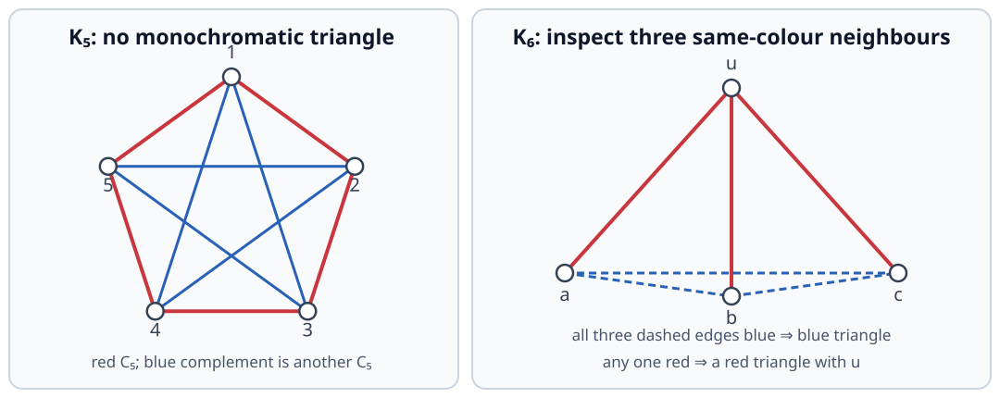
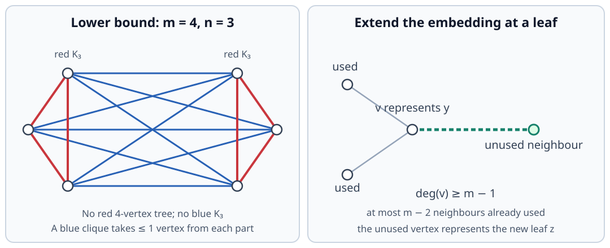
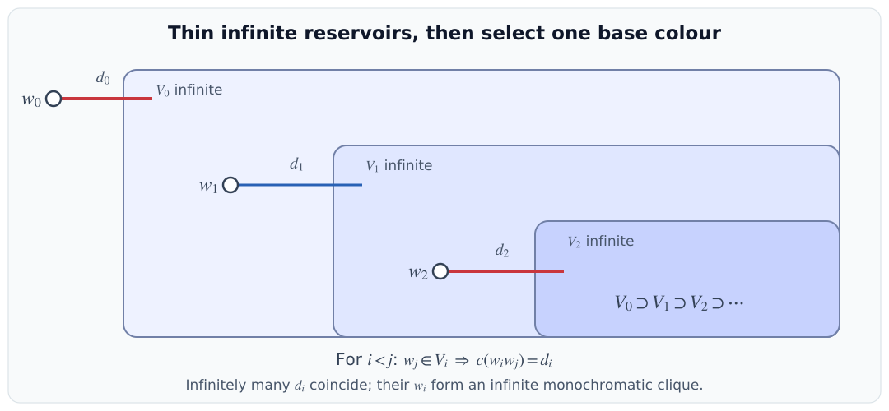
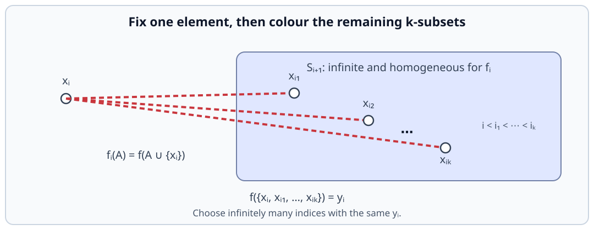
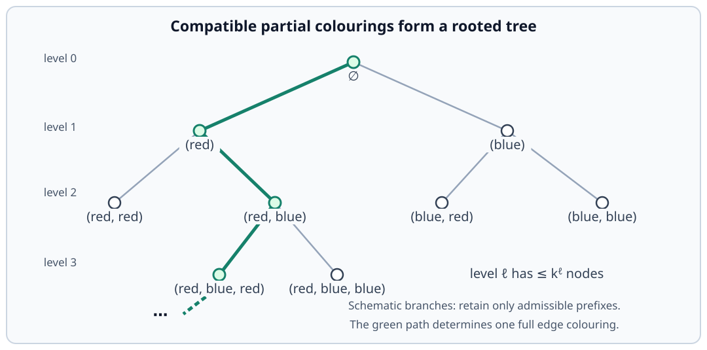
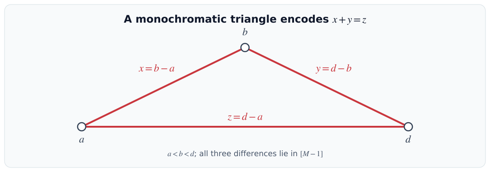
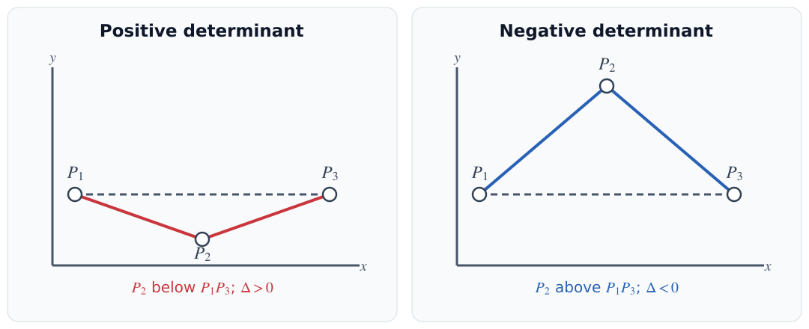
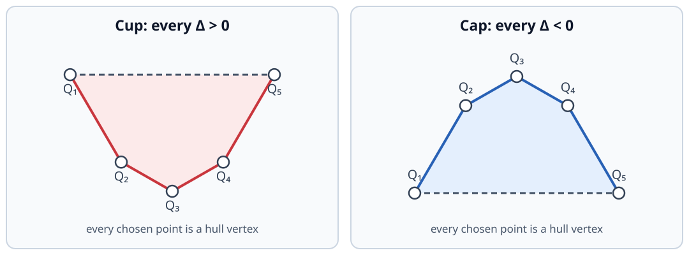
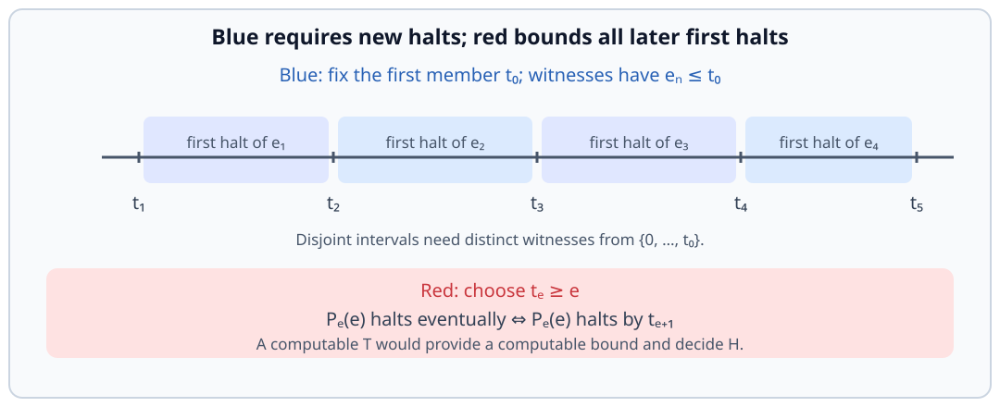

# Ramsey Theory

Ramsey theory asks how large a structure must be before every colouring contains a prescribed monochromatic pattern. For example, whenever the edges joining six vertices are coloured red or blue, some three vertices form a triangle whose edges all have the same colour. The colouring is arbitrary; the size of the graph forces the pattern to appear. We study both the size needed to force such patterns and the corresponding questions for infinite sets.

The chapter develops finite Ramsey numbers and their bounds, then infinite Ramsey theorems and the compactness arguments connecting the infinite and finite settings. Applications to arithmetic, order, convergence, and geometry follow. Sierpiński’s colouring then shows why the countable partition relation does not extend to successor cardinals. The final section treats the halting problem, with a supplementary application to homogeneous sets.

## Ramsey Numbers

An edge colouring partitions the edges of a complete graph into colour classes. Ramsey numbers measure the point at which one class must contain the desired graph. The section develops bounds for complete graphs, an exact tree–clique formula, and probabilistic lower bounds.

!!! definition "Definition (Edge colouring)"
    
    All graphs in this chapter are simple.

    Let $C$ be a nonempty set of colours. An **edge colouring** of a graph $G$ is a function

    $$
    c:E(G)\longrightarrow C.
    $$

    A subgraph is **monochromatic** if all its edges receive the same colour. A **$\ell$-colouring** uses a colour set of size $\ell$; not every colour need actually occur. An edgeless subgraph is monochromatic vacuously, so single-vertex targets cause no exception.

!!! definition "Definition (Ramsey number)"
    
    For integers $p,q\ge1$, the **Ramsey number** $R(p,q)$ is the least positive integer $n$, if it exists, such that every red–blue colouring of $E(K_n)$ contains either a red $K_p$ or a blue $K_q$.

!!! remark "Remark (Cliques and independent sets)"
    
    Equivalently, $R(p,q)$ is the least $n$ such that every graph on $n$ vertices contains a clique of size $p$ or an independent set of size $q$. Given a red–blue colouring, regard the red edges as a graph; its blue cliques are precisely its independent sets. Conversely, colour the edges of a graph red and its missing pairs blue.

    Swapping colours gives $R(p,q)=R(q,p)$. Once the Ramsey property holds for $K_n$, it holds for every larger complete graph by restricting to any $n$ vertices.

!!! example "Example (Boundary values)"
    
    For $q\ge1$, $R(1,q)=R(q,1)=1$. For $q\ge2$,

    $$
    R(2,q)=R(q,2)=q.
    $$

    Indeed, a colouring of $K_q$ either has a red edge or has every edge blue. An all-blue colouring of $K_{q-1}$ contains neither a red edge nor a blue $K_q$.

!!! example "Example (The first nontrivial Ramsey number)"
    
    We have $R(3,3)>5$ and $R(3,3)\le6$, hence

    $$
    R(3,3)=6.
    $$

??? proof "Proof"
    For the lower bound, colour the edges of a five-cycle in $K_5$ red and all remaining edges blue. The red graph is $C_5$, and the blue graph is also a five-cycle. Neither contains a triangle.

    For the upper bound, choose a vertex $u$ of a red–blue $K_6$. Among its five incident edges, at least three have the same colour. Suppose $ua,ub,uc$ are red. If any of $ab,bc,ca$ is red, it forms a red triangle with $u$; otherwise $a,b,c$ form a blue triangle. The argument is symmetric when the three incident edges are blue.

    <figure markdown="span">
      
      <figcaption>On the left, the red cycle and its blue complement are both $C_5$. On the right, the three red neighbours of $u$ either contain a red edge or form a blue triangle; the other two neighbours of $u$ are omitted.</figcaption>
    </figure>

!!! proposition "Proposition (Ramsey recurrence)"
    
    If $p,q\ge2$ and both $R(p-1,q)$ and $R(p,q-1)$ exist, then $R(p,q)$ exists and

    $$
    R(p,q)\le R(p-1,q)+R(p,q-1).
    $$

??? proof "Proof"
    Put $a=R(p-1,q)$, $b=R(p,q-1)$, and $n=a+b$. In any colouring of $K_n$, choose a vertex $u$. Let $A$ consist of its red neighbours and $B$ of its blue neighbours. Since $|A|+|B|=n-1$, either $|A|\ge a$ or $|B|\ge b$.

    In the first case, $K_n[A]$ contains a red $K_{p-1}$ or a blue $K_q$. The red clique together with $u$ gives a red $K_p$, while the blue clique already has the required size. In the second case, $K_n[B]$ contains a red $K_p$ or a blue $K_{q-1}$, and adjoining $u$ to the latter gives a blue $K_q$.

!!! theorem "Theorem (Finite Ramsey)"
    
    For every $p,q\ge1$, the Ramsey number $R(p,q)$ exists.

??? proof "Proof"
    Induct on $p+q$. The cases $p=1$ or $q=1$ are the boundary values above. For $p,q\ge2$, the induction hypothesis supplies $R(p-1,q)$ and $R(p,q-1)$, and the [Proposition](#prop-ramsey-recurrence) supplies $R(p,q)$.

!!! corollary "Corollary (Erdős–Szekeres bound)"
    
    For all $p,q\ge1$,

    $$
    R(p,q)\le\binom{p+q-2}{p-1}.
    $$

    In particular, $R(1,1)=1$ and, for $k\ge2$,

    $$
    R(k,k)\le\binom{2k-2}{k-1}<4^{k-1}.
    $$

??? proof "Proof"
    Induct on $p+q$. If $p=1$ or $q=1$, both sides equal $1$. Otherwise the recurrence and Pascal's identity give

    $$
    \begin{aligned}
    R(p,q)
    &\le R(p-1,q)+R(p,q-1)\\
    &\le\binom{p+q-3}{p-2}+\binom{p+q-3}{p-1}\\
    &=\binom{p+q-2}{p-1}.
    \end{aligned}
    $$

    For the diagonal bound, the central binomial coefficient is strictly smaller than the sum of all the binomial coefficients when $k\ge2$:

    $$
    \binom{2k-2}{k-1}
    <\sum_{j=0}^{2k-2}\binom{2k-2}{j}
    =(1+1)^{2k-2}=4^{k-1}.
    $$

!!! corollary "Corollary (Finitely many colours)"
    
    For every $\ell,m\ge1$, there is an integer $N$ such that every $\ell$-colouring of $E(K_N)$ contains a monochromatic $K_m$. Write $R_\ell(m)$ for the least such $N$.

??? proof "Proof"
    Induct on $\ell$. For one colour take $N_1=m$. If $N_{\ell-1}$ works for $\ell-1$ colours, set

    $$
    N_\ell=R(m,N_{\ell-1}).
    $$

    Regard colour $1$ as red and all remaining colours as blue. A red $K_m$ finishes the argument. A blue $K_{N_{\ell-1}}$ uses only the remaining $\ell-1$ colours, so induction finds a monochromatic $K_m$ inside it.

    In particular, the three-colour choice written on the board is

    $$
    N_3=R\bigl(m,R(m,m)\bigr).
    $$

### Trees and Cliques

Complete graphs are only one possible target. When one target is a tree, a minimum-degree embedding argument gives an exact answer.

!!! definition "Definition (Graph Ramsey number)"
    
    A **copy** of a graph is a subgraph isomorphic to it; the copy need not be induced.

    For finite graphs $F,H$, each with at least one vertex, $R(F,H)$ is the least positive integer $n$, if it exists, such that every red–blue colouring of $E(K_n)$ contains a red copy of $F$ or a blue copy of $H$.

!!! remark "Remark (Existence for finite targets)"
    
    A red clique on $|V(F)|$ vertices contains a red copy of $F$, and a blue clique on $|V(H)|$ vertices contains a blue copy of $H$. Therefore

    $$
    R(F,H)\le R\bigl(|V(F)|,|V(H)|\bigr).
    $$

!!! lemma "Lemma (Embedding a tree)"
    
    Let $T$ be a tree on $m\ge1$ vertices. Every nonempty finite graph $G$ with $\delta(G)\ge m-1$ contains a copy of $T$.

??? proof "Proof"
    Induct on $m$. For $m=1$, any vertex of $G$ is a copy of $T$. If $m\ge2$, choose a leaf $z$ of $T$ and let $y$ be its neighbour. The tree $T-z$ has $m-1$ vertices, so induction embeds it in $G$.

    Let $v$ represent $y$ in this embedding. The vertex $v$ has at least $m-1$ neighbours in $G$, and at most $m-2$ of them are used by the copy of $T-z$. Choose an unused neighbour to represent $z$. The edge from $y$ to $z$ is then present, extending the embedding to $T$. Extra edges among the selected vertices are harmless because the copy need not be induced.

!!! theorem "Theorem (Chvátal's tree–clique formula)"
    
    If $T$ is a tree on $m\ge2$ vertices and $n\ge1$, then

    $$
    R(T,K_n)=(m-1)(n-1)+1.
    $$

??? proof "Proof"
    **Lower bound.** For $n\ge2$, partition $(m-1)(n-1)$ vertices into $n-1$ sets of size $m-1$. Colour edges within each set red and edges between different sets blue. Every red component has only $m-1$ vertices, so the connected $m$-vertex tree $T$ cannot occur in red. A blue clique uses at most one vertex from each set, so it has at most $n-1$ vertices. Thus

    $$
    R(T,K_n)\ge(m-1)(n-1)+1.
    $$

    For $n=1$, the lower bound $R(T,K_1)\ge1$ follows from the definition.

    **Upper bound.** We prove by induction on $n$ that every graph on at least $(m-1)(n-1)+1$ vertices contains a copy of $T$ or an independent set of size $n$. Regard this graph as the red graph of a colouring; an independent set is a blue clique.

    The case $n=1$ is immediate. Suppose $n\ge2$. If every vertex has degree at least $m-1$, the [Lemma](#lem-tree-embedding) gives a copy of $T$. Otherwise choose a vertex $v$ of degree at most $m-2$. Delete $v$ and all its neighbours. The induced graph remaining has at least

    $$
    \begin{aligned}
    (m-1)(n-1)+1-(m-1)
    &=(m-1)(n-2)+1
    \end{aligned}
    $$

    vertices. By induction it contains a copy of $T$ or an independent set of size $n-1$. In the second case, adjoining $v$ gives an independent set of size $n$, because every neighbour of $v$ was deleted. This proves the upper bound and the formula.

    <figure markdown="span">
      
      <figcaption>The lower-bound example uses $m=4,n=3$: two red $K_3$ components with all cross-edges blue. The right panel illustrates the unused-neighbour step in the tree-embedding lemma.</figcaption>
    </figure>

### Probabilistic Lower Bounds

An upper bound must control every colouring. For a lower bound it is enough to find one colouring avoiding the targets. The probabilistic method proves such a colouring exists by showing that a random colouring has positive probability of avoiding every bad event.

!!! notation "Notation (The random-colouring space)"
    Colour each edge of $K_n$ independently red or blue with probability $1/2$. The $2^{\binom n2}$ colourings are equally likely. An **event** is a subset of this finite space, and its probability is its cardinality divided by $2^{\binom n2}$.

!!! lemma "Lemma (Union bound)"
    
    For any events $A_1,\ldots,A_M$ in a finite probability space,

    $$
    \mathbb P\left(\bigcup_{i=1}^M A_i\right)
    \le\sum_{i=1}^M\mathbb P(A_i).
    $$

??? proof "Proof"
    Every outcome in the union belongs to at least one $A_i$. Adding the probabilities of the individual events therefore counts each outcome of the union at least once. Events may overlap, so this need not be an equality. No independence assumption is needed for this inequality.

!!! theorem "Theorem (Erdős's probabilistic lower bound)"
    
    Let $n\ge k\ge2$. If

    $$
    \binom nk\,2^{1-\binom k2}<1,
    $$

    then some red–blue colouring of $K_n$ has no monochromatic $K_k$. Consequently $R(k,k)>n$.

??? proof "Proof"
    For each $k$-element set $S\subseteq V(K_n)$, let $A_S$ be the event that every edge with both endpoints in $S$ has the same colour. The $\binom k2$ relevant edge colours are independent. There are two monochromatic assignments, all red or all blue, out of $2^{\binom k2}$ possible assignments. Hence

    $$
    \mathbb P(A_S)=\frac{2}{2^{\binom k2}}=2^{1-\binom k2}.
    $$

    A monochromatic $K_k$ exists exactly when at least one $A_S$ occurs. Since there are $\binom nk$ choices of $S$, the union bound gives

    $$
    \mathbb P(\text{a monochromatic }K_k\text{ exists})
    \le\sum_{|S|=k}\mathbb P(A_S)
    =\binom nk\,2^{1-\binom k2}<1.
    $$

    The complementary event has positive probability and therefore contains a colouring. Independence is used to compute each $\mathbb P(A_S)$; the different events $A_S$ need not be independent.

!!! corollary "Corollary (An exponential lower bound)"
    
    For every $k\ge3$,

    $$
    R(k,k)>2^{k/2}.
    $$

??? proof "Proof"
    Put $n=\lfloor2^{k/2}\rfloor$. If $n<k$, then $R(k,k)\ge k>2^{k/2}$; the last strict inequality follows because an integer $k>\lfloor2^{k/2}\rfloor$ also exceeds $2^{k/2}$.

    If $n\ge k$, use $\binom nk\le n^k/k!$ and $n\le2^{k/2}$ to obtain the calculation from the board:

    $$
    \begin{aligned}
    \binom nk\,2^{1-\binom k2}
    &\le\frac{2^{k^2/2}}{k!}\,2^{1-k(k-1)/2}\\
    &=\frac{2^{1+k/2}}{k!}<1.
    \end{aligned}
    $$

    To check the final inequality for every $k\ge3$, it holds at $k=3$ since $2^{5/2}<6$, and the ratio of successive terms $2^{1+k/2}/k!$ is $\sqrt2/(k+1)<1$. The [Theorem](#thm-erdos-probabilistic) gives $R(k,k)>n$. Since $R(k,k)$ is an integer, it exceeds $2^{k/2}$ as well.

## Infinite Ramsey Theory

Infinite Ramsey theory uses repeated thinning to keep an infinite supply of vertices. We first establish the graph theorem and then pass from pairs to subsets of arbitrary fixed finite size. Compactness connects these infinite results to their finite counterparts.

!!! lemma "Lemma (Infinite pigeonhole principle)"
    
    If $P$ is an infinite set, $H$ is a finite set, and $f:P\to H$ is a map, then $f^{-1}(h)$ is infinite for some $h\in H$.

??? proof "Proof"
    If every fibre were finite, then $P=\bigcup_{h\in H}f^{-1}(h)$ would be a finite union of finite sets and therefore finite.

!!! theorem "Theorem (Infinite Ramsey)"
    
    Let $k\ge1$ be finite, and let $G$ be the complete graph on a countably infinite vertex set. Every $k$-colouring of $E(G)$ contains an infinite complete monochromatic subgraph.

??? proof "Proof"
    Enumerate $V(G)=\{v_0,v_1,\ldots\}$, and write the colours as $c_1,\ldots,c_k$. We construct vertices $w_0,w_1,\ldots$ and nested infinite reservoirs $V_0,V_1,\ldots$.

    Start with $w_0=v_0$. Partition $V(G)\setminus\{w_0\}$ according to the colour of the edge from $w_0$. Some colour class is infinite; let $V_0$ be that class and let $d_0$ be its common edge colour.

    Having constructed $w_i$ and $V_i$, let $w_{i+1}$ be the first vertex of $V_i$ in the enumeration. Partition $V_i\setminus\{w_{i+1}\}$ by the colour of its edges to $w_{i+1}$. Choose an infinite class $V_{i+1}$, with common colour $d_{i+1}$. Thus

    $$
    V_{i+1}\subseteq V_i\setminus\{w_{i+1}\},
    \qquad c(w_{i+1}v)=d_{i+1}\quad(v\in V_{i+1}).
    $$

    For $i<j$, nesting gives $w_j\in V_i$, so $c(w_iw_j)=d_i$. In the board's terminology, $w_i$ is **$\ell$-based** if every edge $w_iw_j$ with $j>i$ has colour $c_\ell$; each $w_i$ is based in one of the finitely many colours.

    The infinite pigeonhole principle now gives an infinite set of indices $I$ and a colour $d$ such that $d_i=d$ for all $i\in I$. For $i<j$ in $I$, the edge $w_iw_j$ has colour $d_i=d$. Therefore $\{w_i:i\in I\}$ induces an infinite complete monochromatic subgraph.

    <figure markdown="span">
      
      <figcaption>Every later selected vertex remains in the earlier reservoir $V_i$, so the colour of $w_iw_j$ for $i\lt j$ depends only on $i$. An infinite subsequence with one base colour is monochromatic.</figcaption>
    </figure>

Edges are two-element subsets. Replacing pairs by $k$-element subsets gives the general Ramsey theorem.

!!! notation "Notation (Partition arrows)"
    
    For a set $V$ and an integer $k\ge1$, write

    $$
    [V]^k=\{A\subseteq V:|A|=k\}.
    $$

    Given a colouring $f:[V]^k\to C$, a set $S\subseteq V$ is **homogeneous** if $f$ is constant on $[S]^k$. When $|S|<k$, this condition holds vacuously.

    For a finite or countably infinite cardinal $\kappa$, a target cardinal $\lambda$, and an integer $c\ge1$, the notation

    $$
    \kappa\longrightarrow(\lambda)^k_c
    $$

    means that every $c$-colouring of the $k$-element subsets of a set of size $\kappa$ has a homogeneous subset of size $\lambda$. Write $\aleph_0$ for the cardinality of $\mathbb N=\{0,1,2,\ldots\}$.

    For pairs this is the graph version: $6\to(3)^2_2$ expresses $R(3,3)=6$'s upper bound, and the [Theorem](#thm-infinite-ramsey) gives $\aleph_0\to(\aleph_0)^2_c$ for every finite $c\ge1$.

!!! theorem "Theorem (Infinite Ramsey for subsets)"
    
    For all integers $k,\ell\ge1$,

    $$
    \aleph_0\longrightarrow(\aleph_0)^k_\ell.
    $$

??? proof "Proof"
    Induct on $k$. For $k=1$, this is the [Lemma](#lem-infinite-pigeonhole). Suppose the result holds for $k$-element subsets, and let

    $$
    f:[\mathbb N]^{k+1}\longrightarrow[\ell],
    \qquad [\ell]=\{1,\ldots,\ell\}.
    $$

    Set $S_0=\mathbb N$. We construct infinite sets $S_0\supseteq S_1\supseteq S_2\supseteq\cdots$, selected numbers $x_i=\min S_i$, and colours $y_i$. Given $S_i$, define

    $$
    f_i:[S_i\setminus\{x_i\}]^k\longrightarrow[\ell],
    \qquad f_i(A)=f(A\cup\{x_i\}).
    $$

    By induction, there is an infinite set $S_{i+1}\subseteq S_i\setminus\{x_i\}$ homogeneous for $f_i$. Let its colour be $y_i$. Thus

    $$
    f(A\cup\{x_i\})=y_i
    \qquad\text{for every }A\in[S_{i+1}]^k. \tag{*}
    $$

    Since $x_i$ is the least element of $S_i$, the sequence $x_0<x_1<\cdots$ is strictly increasing. Whenever $i_0<i_1<\cdots<i_k$, all of $x_{i_1},\ldots,x_{i_k}$ lie in $S_{i_0+1}$. By $(*)$,

    $$
    f(\{x_{i_0},x_{i_1},\ldots,x_{i_k}\})=y_{i_0}. \tag{**}
    $$

    Apply the infinite pigeonhole principle to the sequence of colours: some colour $y$ occurs on an infinite set of indices $I\subseteq\mathbb N$. Put $H=\{x_i:i\in I\}$. For any $(k+1)$-element subset of $H$, order its indices increasingly. Formula $(**)$ says its colour is the colour of its least-indexed member, which is $y$. Thus $H$ is infinite and homogeneous.

    <figure markdown="span">
      
      <figcaption>Fixing $x_i$ turns a colouring of $(k+1)$-element sets into a colouring of $k$-element sets. After thinning, the colour of a selected $(k+1)$-set depends only on its first index. The dashed spokes group one tuple; they are not independently coloured graph edges.</figcaption>
    </figure>

### Compactness

König's lemma provides a different infinite construction: compatible finite colourings form a tree, and an infinite path turns them into one colouring of a countably infinite graph. This compactness argument recovers finite Ramsey from infinite Ramsey, first for pairs and then for subsets of any fixed finite size.

!!! definition "Definition (Rooted tree and levels)"
    
    A **rooted tree** is a tree with a chosen vertex $r$, its **root**. The **level** $L_\ell$ consists of vertices at distance $\ell$ from $r$. Each vertex other than $r$ has a unique **parent**, the preceding vertex on its path from $r$; its neighbours one level farther from $r$ are its **children**.

    An **infinite path from the root**, or **ray**, is a sequence $r=v_0,v_1,v_2,\ldots$ of distinct vertices with each $v_{i+1}$ a child of $v_i$.

!!! theorem "Theorem (König's infinity lemma)"
    
    If a rooted tree is infinite and every level is finite, then it contains an infinite path from the root.

??? proof "Proof"
    Call a vertex's descendants the vertices whose path from the root passes through it, including the vertex itself. The root has infinitely many descendants. If $v_i$ has infinitely many descendants, its children form a finite set because they belong to the finite next level. All descendants other than $v_i$ lie below these children. At least one child therefore has infinitely many descendants, by the infinite pigeonhole principle. Choose it as $v_{i+1}$.

    Continuing gives $r=v_0,v_1,v_2,\ldots$. Each chosen vertex is in the next level, so the vertices are distinct and consecutive vertices are adjacent. This is the required infinite path.

!!! theorem "Theorem (Finite Ramsey from infinite Ramsey)"
    
    Fix a finite integer $k\ge2$. For every $n\ge1$, there is an integer $m\ge1$ such that every $k$-colouring of $E(K_m)$ contains a monochromatic $K_n$.

??? proof "Proof"
    The case $n=1$ is immediate, so assume $n\ge2$. Suppose the conclusion fails for this $n$. Then for every $m$ there is a $k$-colouring of $K_m$ with no monochromatic $K_n$.

    Let $G$ be the complete graph on $V=\{v_0,v_1,\ldots\}$, and enumerate its edges as $E=\{e_1,e_2,\ldots\}$. Construct a rooted tree $T$ of partial colourings. A vertex at level $\ell$ is a sequence

    $$
    (a_1,\ldots,a_\ell)\in\{1,\ldots,k\}^\ell
    $$

    such that colouring $e_i$ with $a_i$ for $1\le i\le\ell$ creates no monochromatic $K_n$ using only these coloured edges. Here a clique is counted only if all its edges have been coloured. The root is the empty sequence, and the parent of a nonempty sequence is obtained by deleting its last entry.

    Removing a coloured edge cannot create a forbidden clique, so parents are valid vertices. The prefix relation makes $T$ connected and acyclic: every sequence has a unique path to the empty sequence. Thus it is a rooted tree. Level $\ell$ has at most $k^\ell$ vertices.

    Every level is nonempty. The endpoints of $e_1,\ldots,e_\ell$ form a finite vertex set; a sufficiently large finite complete graph has, by the assumed failure, a colouring with no monochromatic $K_n$. Restrict it to these first $\ell$ edges. Hence $T$ has vertices at arbitrarily large levels and is infinite.

    By [Theorem](#thm-konig-infinity), $T$ has an infinite path. The successive prefixes on this path are compatible, so they define a colouring of every edge of $G$.

    This full colouring still has no monochromatic $K_n$: any such clique has finitely many edges, all of which occur among $e_1,\ldots,e_\ell$ for some $\ell$, contradicting the validity of the corresponding prefix. But [Theorem](#thm-infinite-ramsey) gives an infinite monochromatic clique, which contains a $K_n$. This contradiction proves the finite statement.

    <figure markdown="span">
      
      <figcaption>A node records the colours of the first $\ell$ edges; its parent forgets the last colour. Only admissible prefixes are retained. König's lemma chooses compatible prefixes at all levels, yielding one colouring of the infinite graph.</figcaption>
    </figure>

!!! remark "Remark (Two proofs of finite Ramsey)"
    
    The recurrence proves existence directly and gives an explicit numerical upper bound. The infinite-Ramsey proof uses a tree of compatible finite choices and gives existence without a numerical bound. Both arguments are retained because they explain different mechanisms: a finite neighbourhood split and an infinite compatibility construction.

!!! theorem "Theorem (Finite Ramsey for subsets)"
    
    For all positive integers $k,n,c$, there is a positive integer $m$ such that

    $$
    m\longrightarrow(n)^k_c.
    $$

??? idea "Idea"
    The board leaves this proof as an exercise. The same compactness construction used for pairs works for $k$-element subsets: organise finite counterexample colourings by restriction, select an infinite compatible path, and contradict the infinite theorem. The complete argument follows.

??? proof "Proof"
    If $n\le k$, take $m=n$: an $n$-element set has at most one $k$-element subset, so it is homogeneous for every colouring. Assume $n>k$ and suppose, for contradiction, that every finite complete $k$-uniform structure admits a $c$-colouring with no homogeneous $n$-element set.

    Form a rooted tree whose vertices at level $j$ are the pairs $(j,f_j)$, where $f_j:[\{0,\ldots,j-1\}]^k\to[c]$ has no homogeneous $n$-element set. The root is $(0,\varnothing)$, recording the unique colouring of the empty domain. Join a colouring at level $j+1$ to its restriction at level $j$. Recording the level distinguishes the initial nodes even when their colouring domains are empty.

    Restrictions remain valid, and each nonroot node has exactly one parent. Each level is finite, with at most $c^{\binom jk}$ nodes, and is nonempty by the assumed failure. Thus the tree is infinite. By [Theorem](#thm-konig-infinity), it has an infinite path of compatible colourings.

    Their union defines $f:[\mathbb N]^k\to[c]$, because each finite $k$-set is contained in some initial segment. By [Theorem](#thm-infinite-ramsey-subsets), $f$ has an infinite homogeneous set and therefore a homogeneous $n$-element set. This finite set lies in some initial segment, contradicting the validity of the corresponding node of the path.

## Applications

The applications use a colouring to record a local relation, so that a homogeneous set has one consistent global structure. The relevant relations arise from differences of integers, comparisons in orders and sequences, and orientations of planar triples.

Monochromatic triangles encode an arithmetic equation, giving Schur's theorem.

!!! theorem "Theorem (Schur)"
    
    For every integer $k\ge1$, there is an integer $N\ge1$ such that every $k$-colouring of $[N]=\{1,\ldots,N\}$ contains numbers $x,y,z$ of the same colour with

    $$
    x+y=z.
    $$

    The numbers need not be pairwise distinct; in particular, $x=y$ is allowed.

??? proof "Proof"
    Choose $M$ so that every $k$-colouring of $E(K_M)$ contains a monochromatic triangle, using the [Corollary](#cor-multicolour-ramsey), and put $N=M-1$.

    Given $c:[N]\to\{1,\ldots,k\}$, use $[M]$ as the vertex set of $K_M$ and colour its edges by

    $$
    \widetilde c(\{a,b\})=c(|a-b|).
    $$

    All differences lie in $[N]$. Let $a<b<d$ be the vertices of a monochromatic triangle. Then

    $$
    x=b-a,\qquad y=d-b,\qquad z=d-a
    $$

    have the same colour, and $x+y=z$.

    <figure markdown="span">
      
      <figcaption>Edge colours come from the colours of the differences. The triangle forces $c(b-a)=c(d-b)=c(d-a)$, and $(b-a)+(d-b)=d-a$.</figcaption>
    </figure>

For orders and sequences, colour pairs by their comparison relation. Homogeneity then gives a chain, an antichain, or a monotone subsequence.

!!! example "Example (Chains and antichains)"
    
    Every countably infinite partially ordered set contains an infinite chain or an infinite antichain. Here a **chain** is a subset in which every pair of elements is comparable, and an **antichain** is a subset in which no two distinct elements are comparable.

??? proof "Proof"
    Colour each two-element subset red if its elements are comparable and blue otherwise. An infinite homogeneous set exists by [Theorem](#thm-infinite-ramsey-subsets) with $k=2$. A red one is a chain; a blue one is an antichain.

!!! example "Example (Infinite monotone subsequences)"
    
    Every real sequence has an infinite monotone subsequence, where monotone means nondecreasing or nonincreasing, allowing equality.

??? proof "Proof"
    Given $(a_n)$, colour every pair $\{i,j\}$ with $i<j$ according as

    $$
    a_i<a_j,\qquad a_i=a_j,\qquad a_i>a_j.
    $$

    An infinite homogeneous set of indices $n_0<n_1<\cdots$ gives a strictly increasing, constant, or strictly decreasing subsequence, respectively. Each is monotone.

!!! remark "Remark (Bolzano–Weierstrass)"
    
    For a bounded real sequence, its infinite monotone subsequence is bounded and therefore convergent. This gives the Bolzano–Weierstrass theorem from infinite Ramsey together with monotone convergence for real sequences.

For planar points, the local relation is the orientation of a triple. A homogeneous set for this relation forms a convex polygon.

!!! definition "Definition (General and convex position)"
    
    A finite set of points in the plane is in **general position** if no three points are collinear. It is in **convex position** if every one of its points is a vertex of its convex hull, the smallest convex set containing the points.

    For at least three points in general position, their convex hull is a polygon. Convex position requires every given point to occur as a corner; an interior point does not qualify.

!!! definition "Definition (Orientation of a triple)"
    
    For $P_i=(x_i,y_i)$ with $x_1<x_2<x_3$, define

    $$
    \Delta(P_1,P_2,P_3)
    =\det\begin{pmatrix}
    x_2-x_1&x_3-x_1\\
    y_2-y_1&y_3-y_1
    \end{pmatrix}.
    $$

    The determinant is positive if $P_2$ lies below the line $P_1P_3$, negative if it lies above that line, and zero if the three points are collinear. Indeed,

    $$
    \Delta=(x_3-x_1)\bigl(y_{13}(x_2)-y_2\bigr),
    $$

    where $y_{13}(x)$ is the height of the line through $P_1,P_3$ at horizontal coordinate $x$.

    <figure markdown="span">
      
      <figcaption>Coordinates increase from left to right. A positive determinant puts the middle point below the endpoint chord; a negative determinant puts it above.</figcaption>
    </figure>

!!! theorem "Theorem (Erdős–Szekeres convex-polygon theorem)"
    
    For every integer $m\ge0$, there is a positive integer $N$ such that every set of at least $N$ planar points in general position contains $m$ points in convex position.

    The polygon interpretation concerns $m\ge3$; for $m=0,1,2$, the corresponding subsets are immediate.

??? idea "Idea"
    Choose coordinates so all horizontal coordinates are distinct, and colour every triple by the sign of its orientation determinant. Finite Ramsey yields a homogeneous set of $m$ points. Its left-to-right chain bends consistently: it is a cup when the determinant is positive and a cap when it is negative. The chain together with the endpoint chord bounds a convex polygon. The supporting-line argument below makes this geometric description precise.

??? proof "Proof"
    For $m\le2$, choose $N=\max\{1,m\}$. Let $m\ge3$ and choose $N$ such that $N\to(m)^3_2$, using [Theorem](#thm-finite-ramsey-subsets). If more than $N$ points are given, restrict to any $N$ of them.

    Choose a horizontal direction for which no two points have the same horizontal coordinate. Such a direction exists because each of the finitely many differences between two distinct points rules out only the directions perpendicular to it. Changing coordinates preserves general and convex position.

    Order the points by increasing horizontal coordinate and colour each triple by the sign of $\Delta$ in that order. There are only two colours because general position excludes zero determinants. Take a homogeneous $m$-element set $Q=\{Q_1,\ldots,Q_m\}$, again indexed from left to right.

    Suppose every ordered triple has positive determinant. For an internal index $1<i<m$, put

    $$
    a_i=\frac{y_i-y_{i-1}}{x_i-x_{i-1}},
    \qquad b_i=\frac{y_{i+1}-y_i}{x_{i+1}-x_i}.
    $$

    Positivity for $(Q_{i-1},Q_i,Q_{i+1})$ gives $a_i<b_i$. Choose $s_i$ strictly between them. For $j<i-1$, positivity for $(Q_j,Q_{i-1},Q_i)$ gives

    $$
    \frac{y_i-y_j}{x_i-x_j}<a_i<s_i.
    $$

    The same strict inequality with $s_i$ holds for $j=i-1$. Since $x_j-x_i<0$, it follows that $y_j>y_i+s_i(x_j-x_i)$ for every $j<i$. Similarly, positivity for $(Q_i,Q_{i+1},Q_j)$ gives

    $$
    \frac{y_j-y_i}{x_j-x_i}>b_i>s_i
    \qquad(j>i+1),
    $$

    and the case $j=i+1$ follows directly from $b_i>s_i$. Thus the line through $Q_i$ with slope $s_i$ has every other point of $Q$ strictly above it. It is a supporting line touching the convex hull only at $Q_i$, so $Q_i$ is a vertex.

    The endpoints $Q_1,Q_m$ are also vertices: vertical supporting lines meet $Q$ uniquely at its least and greatest horizontal coordinates. Therefore every point of $Q$ is a hull vertex. The negative-determinant case follows by reflecting the picture in a horizontal line, which reverses the determinant signs and preserves convex position.

    <figure markdown="span">
      
      <figcaption>All ordered triples have the same sign. Every selected point is a vertex of the convex hull; the dashed segment closes the polygon between the endpoints.</figcaption>
    </figure>

## Uncountable Partition Relations

The countable theorem gives $\aleph_0\to(\aleph_0)^2_2$. Does there exist an ordinal $\alpha>0$ such that $\aleph_\alpha\to(\aleph_\alpha)^2_2$? This is the uncountable analogue posed in the lecture. Sierpiński's construction gives an obstruction at every successor cardinal; it does not settle the question for all uncountable cardinals.

This section uses Choice, [cardinal arithmetic](axiomatic-set-theory.md#def-cardinal-arithmetic), and [regularity of successor cardinals](axiomatic-set-theory.md#thm-successor-cardinal-regular). The notation $\mu\nrightarrow(\lambda)^2_2$ means that some two-colouring of the pairs of a set of cardinality $\mu$ has no homogeneous subset of cardinality $\lambda$.

!!! theorem "Theorem (Sierpiński)"
    
    For every infinite cardinal $\kappa$,

    $$
    2^\kappa=|\mathcal P(\kappa)|
    \nrightarrow(\kappa^+)^2_2.
    $$

Identify subsets of $\kappa$ with their characteristic functions. The construction compares two orders on the set of these functions: its lexicographic order and a well-order supplied by Choice.

!!! definition "Definition (Lexicographic order on binary functions)"
    
    Let $S={}^\kappa2=\{x:x:\kappa\to\{0,1\}\}$. For distinct $x,y\in S$, put

    $$
    d(x,y)=\min\{\xi<\kappa:x(\xi)\ne y(\xi)\}.
    $$

    Define

    $$
    x<_{\mathrm{lex}}y
    \quad\Longleftrightarrow\quad
    x(d(x,y))=0\text{ and }y(d(x,y))=1.
    $$

    This is a strict total order. For transitivity, if $x<_{\mathrm{lex}}y<_{\mathrm{lex}}z$, the two first-difference coordinates $d(x,y)$ and $d(y,z)$ cannot be equal, since equality would require the same value of $y$ to be both $1$ and $0$. At the smaller of the two coordinates, $x$ has value $0$ and $z$ has value $1$, and they agree before it. Thus $x<_{\mathrm{lex}}z$.

!!! lemma "Lemma (No long monotone sequence)"
    
    In $(S,<_{\mathrm{lex}})$, there is no strictly increasing or strictly decreasing sequence indexed by $\kappa^+$.

??? proof "Proof"
    Suppose $(x_\alpha)_{\alpha<\kappa^+}$ is strictly increasing. We prove by transfinite induction on $\xi\le\kappa$ that the sequence of restrictions

    $$
    (x_\alpha\mathbin{\upharpoonright}\xi)_{\alpha<\kappa^+}
    $$

    is eventually constant. Explicitly, there is $\beta_\xi<\kappa^+$ such that all the restrictions agree for $\alpha\ge\beta_\xi$.

    **Zero.** For $\xi=0$, every restriction is empty.

    **Successor.** Suppose the restrictions to $\xi<\kappa$ agree on a tail. On that tail, $x_\alpha(\xi)$ is nondecreasing: a change from $1$ to $0$ would make the later function lexicographically smaller, since all earlier coordinates agree. A nondecreasing sequence in $\{0,1\}$ is eventually constant. Combining this with the fixed earlier restriction proves the claim for $\xi+1$.

    **Limit.** Let $\lambda\le\kappa$ be a nonzero limit ordinal, and suppose the claim holds for every $\xi<\lambda$. For each such $\xi$, let $\beta_\xi<\kappa^+$ be the least stage after which the restrictions to $\xi$ are constant. Since $|\lambda|\le\kappa<\operatorname{cf}(\kappa^+)=\kappa^+$, regularity gives

    $$
    \beta:=\sup_{\xi<\lambda}\beta_\xi<\kappa^+.
    $$

    For any $\alpha,\alpha'\ge\beta$, their restrictions to every $\xi<\lambda$ agree. Each coordinate below $\lambda$ is included in one such restriction, so $x_\alpha\mathbin{\upharpoonright}\lambda=x_{\alpha'}\mathbin{\upharpoonright}\lambda$. This proves the limit step.

    Taking $\xi=\kappa$ shows that the original sequence is eventually constant, contradicting strict increase. For a strictly decreasing sequence, the successor step uses a nonincreasing binary sequence instead. Equivalently, replacing every bit $b$ by $1-b$ reverses the lexicographic order and reduces that case to the increasing case.

??? proof "Proof of Sierpiński's theorem"
    By Choice, fix a well-order $\prec$ on $S$. For $x\prec y$, define

    $$
    c(\{x,y\})=
    \begin{cases}
    0,&x<_{\mathrm{lex}}y,\\
    1,&y<_{\mathrm{lex}}x.
    \end{cases}
    $$

    Totality makes this a two-colouring of $[S]^2$. Suppose $H\subseteq S$ is homogeneous and $|H|=\kappa^+$. Its order type under $\prec$ is at least $\kappa^+$; take its first $\kappa^+$ elements and enumerate them in that order as $(x_\alpha)_{\alpha<\kappa^+}$.

    If the common colour is $0$, this sequence is strictly increasing for $<_{\mathrm{lex}}$. If it is $1$, the sequence is strictly decreasing. Both possibilities contradict [Lemma](#lem-lexicographic-no-long-monotone). Thus no such $H$ exists. Since $|S|=2^\kappa$, this is the asserted negative partition relation.

!!! corollary "Corollary (Failure at successor cardinals)"
    
    For every infinite cardinal $\kappa$,

    $$
    \kappa^+\nrightarrow(\kappa^+)^2_2.
    $$

    In particular, $\aleph_1\nrightarrow(\aleph_1)^2_2$.

??? proof "Proof"
    Cantor's theorem gives $\kappa^+\le2^\kappa$. Restrict the colouring in [Theorem](#thm-sierpinski-partition) to a subset of $S$ of size $\kappa^+$. A homogeneous set of size $\kappa^+$ for the restricted colouring would also be one for the original colouring.

## The Halting Problem

The halting problem asks whether program termination can be decided algorithmically. We introduce effective program codes and use diagonalisation to exhibit a noncomputable set of halting computations. A supplementary application then connects this obstruction to homogeneous sets in Ramsey theory.

!!! definition "Definition (Computable functions and sets)"
    
    Fix a model of computation in which programs have finite descriptions that can be effectively encoded by natural numbers; a programming language such as C gives the classroom example. Choose an **effective enumeration** $P_0,P_1,\ldots$ of all programs with natural-number input and output, including programs that do not terminate. Each program computes a partial function $\mathbb N\rightharpoonup\mathbb N$.

    A total function $g:\mathbb N\to\mathbb N$ is **computable** if some program $P_e$ halts on every input $n$ and outputs $g(n)$. A set $A\subseteq\mathbb N$ is **computable** if its characteristic function is computable:

    $$
    \chi_A(n)=\begin{cases}
    1,&n\in A,\\
    0,&n\notin A.
    \end{cases}
    $$

    An enumeration of an infinite set is **computable** if a program computes its elements in strictly increasing order.

!!! notation "Notation (Halting and bounded simulation)"
    Write $P_e(n)\downarrow=a$ if the computation eventually halts with output $a$, and write $P_e(n)\uparrow$ if it never halts. Write $P_e(n)\downarrow_s$ if it halts within $s$ computation steps, regardless of output, and $P_e(n)\uparrow_s$ if it has not halted within those steps. The latter notation does not assert that it never halts.

    The coding and enumeration are effective: given $e$, one can obtain the program code $P_e$, and given $e,n,s$, one can simulate $P_e(n)$ for $s$ steps and decide $P_e(n)\downarrow_s$. This is the precise content of the board's statement that $e\mapsto P_e$ is computable. Bounded simulation is a total procedure even though unrestricted program execution is partial.

!!! theorem "Theorem (A noncomputable diagonal set)"
    
    The set

    $$
    H=\{n\in\mathbb N:P_n(n)\downarrow=0\}
    $$

    is not computable.

??? proof "Proof"
    Suppose $H$ were computable. Then some program $P_e$ would compute $\chi_H$ on every input, so $P_e(n)=\chi_H(n)$ for all $n$. In particular,

    $$
    \chi_H(e)=0
    \quad\Longleftrightarrow\quad P_e(e)\downarrow=0
    \quad\Longleftrightarrow\quad e\in H
    \quad\Longleftrightarrow\quad\chi_H(e)=1,
    $$

    a contradiction.

If termination could be decided for arbitrary programs and inputs, one could decide membership in $H$: first decide whether $P_n(n)$ halts, and, if it does, run it and check whether its output is $0$. The noncomputability of $H$ therefore rules out such a procedure.

### Noncomputable Homogeneous Sets

The existence arguments repeatedly select an infinite colour class. They do not provide an algorithm for finding one. The next construction shows that this limitation can be intrinsic: a computable colouring of triples can force every infinite homogeneous set to be noncomputable.

Does every computable colouring have an infinite homogeneous set that can itself be computed? The following construction gives a negative answer, already for two colours on triples.

!!! theorem "Theorem (No computable infinite homogeneous set)"
    
    There is a computable colouring

    $$
    f:[\mathbb N]^3\longrightarrow\{\text{red},\text{blue}\}
    $$

    with no infinite computable homogeneous set. Infinite homogeneous sets nevertheless exist by [Theorem](#thm-infinite-ramsey-subsets).

??? proof "Proof"
    For $i<j<k$, define

    $$
    f(\{i,j,k\})=\text{red}
    \quad\Longleftrightarrow\quad
    \bigl(P_e(e)\downarrow_j\ \Longleftrightarrow\ P_e(e)\downarrow_k\bigr)
    \text{ for every }e\le i.
    $$

    Otherwise colour the triple blue. Equivalently, a blue triple witnesses a program with index at most $i$ whose computation first halts after step $j$ and no later than step $k$. This colouring is computable: only finitely many programs, $e=0,\ldots,i$, are simulated, each for at most $k$ steps.

    Let $T=\{t_0<t_1<\cdots\}$ be an infinite homogeneous set.

    **First, $T$ cannot be blue.** If it were, then for every $n\ge1$ the triple $\{t_0,t_n,t_{n+1}\}$ would be blue. Choose a witness $e_n\le t_0$ such that

    $$
    P_{e_n}(e_n)\uparrow_{t_n},
    \qquad P_{e_n}(e_n)\downarrow_{t_{n+1}}.
    $$

    Infinitely many indices $e_n$ lie in the finite set $\{0,\ldots,t_0\}$, so $e_p=e_q$ for some $1\le p<q$. But $t_{p+1}\le t_q$. The same computation would have halted by $t_{p+1}$ while not having halted by the later time $t_q$, a contradiction. Thus $T$ is red.

    **Second, a computable $T$ would decide $H$.** Suppose $T$ is computable. Its increasing enumeration is then computable: search successively for the first member and the next larger member, using its characteristic function; every search terminates because $T$ is infinite.

    Fix $e\in\mathbb N$. Since $t_0<t_1<\cdots$ are nonnegative integers, $e\le t_e$. For every $n>e+1$, the red triple $\{t_e,t_{e+1},t_n\}$ gives

    $$
    P_e(e)\downarrow_{t_{e+1}}
    \quad\Longleftrightarrow\quad P_e(e)\downarrow_{t_n}.
    $$

    If $P_e(e)$ ever halts, choose $n$ sufficiently large that $t_n$ exceeds its halting time; the displayed equivalence shows it must already halt by $t_{e+1}$. Conversely, halting by $t_{e+1}$ is certainly eventual halting.

    To decide whether $e\in H$, compute $t_{e+1}$ and simulate $P_e(e)$ for that many steps. Answer yes exactly when it halts in this interval with output $0$. A later first halt is impossible by the equivalence above. This would compute $\chi_H$, contradicting [Theorem](#thm-diagonal-noncomputable). Therefore no infinite homogeneous $T$ is computable.

    <figure markdown="span">
      
      <figcaption>Blue triples with fixed first member $t_0$ would require infinitely many distinct first halts among only $t_0+1$ programs. A red homogeneous set instead supplies the time bound $t_{e+1}$ for deciding the computation with index $e$.</figcaption>
    </figure>

!!! proposition "Proposition (Computable sets and increasing enumerations)"
    
    
    Let $T=\{t_0<t_1<\cdots\}\subseteq\mathbb N$ be infinite. Its characteristic function $\chi_T$ is computable if and only if its increasing enumeration $n\mapsto t_n$ is computable.

??? proof "Proof"
    **From membership to enumeration.** Suppose $\chi_T$ is computable. Search through $0,1,2,\ldots$ until the first member of $T$ is found; this computes $t_0$. Once $t_n$ is known, search through $t_n+1,t_n+2,\ldots$ until the next member is found; this computes $t_{n+1}$. Every search terminates because $T$ is infinite. Repeating these searches computes $t_n$ for any given $n$.

    **From enumeration to membership.** Suppose $n\mapsto t_n$ is computable. To decide whether an input $a$ belongs to $T$, compute $t_0,t_1,\ldots$ until the first $t_n\ge a$. This search terminates because a strictly increasing infinite sequence of natural numbers is unbounded. If $t_n=a$, answer yes. If $t_n>a$, answer no: all earlier elements are below $a$, and all later elements are above it. This computes $\chi_T$.

    Consequently, the colouring in [Theorem](#thm-computable-colouring-no-computable-set) admits neither an infinite homogeneous set with computable membership nor one with a computable increasing enumeration.
