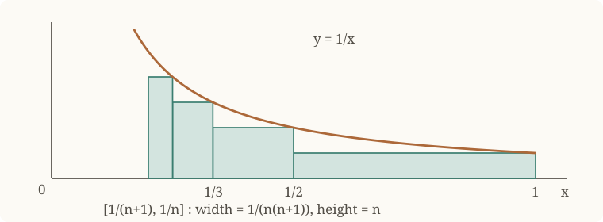
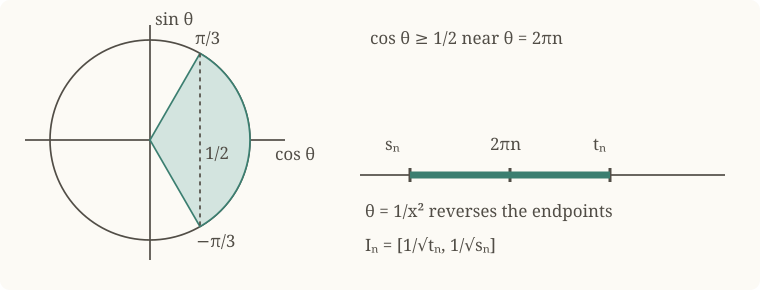
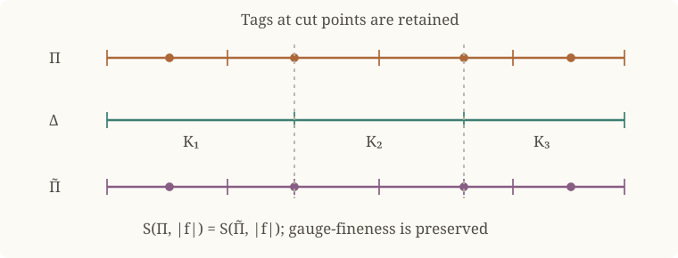
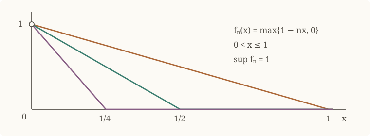

# Monotone Convergence and Lebesgue Measure

Absolute integrability controls the total size of local integrals, whereas
ordinary KH-integrability can depend on cancellation. We develop a criterion
for absolute integrability, prove that integration commutes with monotone
limits when the integrals are bounded, and use indicator functions to define Lebesgue measure for
integrable sets. Countable additivity follows from monotone convergence.

Throughout, $I$ denotes a compact cell unless another interval is specified,
and $\lambda(J)$ denotes the length of a compact cell $J$.

## Absolute Kurzweil–Henstock Integrability

!!! definition "Definition (Positive and negative parts)"
    
    Let $S$ be a set and let $f:S\to\mathbb R$. The **positive part** and
    **negative part** of $f$ are the nonnegative functions

    $$
    f^+(x):=\max\{f(x),0\},
    \qquad
    f^-(x):=-\min\{f(x),0\}.
    $$

    Pointwise on $S$,

    $$
    f=f^+-f^-,
    \qquad
    |f|=f^++f^-,
    $$

    and therefore

    $$
    f^+=\frac{|f|+f}{2},
    \qquad
    f^-=\frac{|f|-f}{2}.
    $$

    More generally, for real-valued functions $f$ and $g$ on the same set,

    $$
    \max\{f,g\}=\frac{f+g+|f-g|}{2},
    \qquad
    \min\{f,g\}=\frac{f+g-|f-g|}{2}.
    $$

!!! definition "Definition (Absolute KH-integrability)"
    
    Let $I$ be an interval and let $f:I\to\mathbb R$. We say that $f$ is
    **absolutely Kurzweil–Henstock integrable** on $I$, and write

    $$
    f\in\operatorname{AKH}(I),
    $$

    if both $f$ and $|f|$ belong to $\operatorname{KH}(I)$.

!!! proposition "Proposition (Characterization by positive and negative parts)"
    
    Let $I\subseteq\mathbb R$ be an interval and let $f:I\to\mathbb R$.
    The following are equivalent:

    1. $f\in\operatorname{AKH}(I)$;
    2. $f^+,f^-\in\operatorname{KH}(I)$.

??? proof "Proof"
    If $f$ and $|f|$ are KH-integrable, linearity and

    $$
    f^+=\frac{|f|+f}{2},
    \qquad
    f^-=\frac{|f|-f}{2}
    $$

    show that $f^+$ and $f^-$ are KH-integrable. Conversely, if $f^+$ and
    $f^-$ are KH-integrable, then

    $$
    f=f^+-f^-,
    \qquad
    |f|=f^++f^-
    $$

    are KH-integrable by linearity. Hence $f\in\operatorname{AKH}(I)$.

The word *absolute* is essential: a derivative may be KH-integrable without
its absolute value being KH-integrable.

!!! example "Example (Divergence of the integral of the reciprocal function)"
    
    The function $x\mapsto1/x$ is KH-integrable on every compact subinterval
    of $(0,1]$, but not on $(0,1]$ itself.

??? proof "Proof by an antiderivative"
    For $0<a<1$, the fundamental theorem of calculus gives

    $$
    \int_a^1\frac{dx}{x}=[\log x]_a^1=-\log a\longrightarrow+\infty
    \qquad(a\downarrow0).
    $$

    Thus the finite endpoint limit required for KH-integrability does not exist.

??? proof "Proof by lower rectangles"
    Put $a_n=1/(n+1)$ and $b_n=1/n$ for $n\geq1$. The cells
    $[a_n,b_n]$ have disjoint interiors and cover $(0,1]$. On each cell,
    $1/x\geq1/b_n=n$, while $b_n-a_n=1/(n(n+1))$. Therefore

    $$
    \int_{1/(N+1)}^1\frac{dx}{x}
    =\sum_{n=1}^N\int_{a_n}^{b_n}\frac{dx}{x}
    \geq\sum_{n=1}^N\frac{b_n-a_n}{b_n}
    =\sum_{n=1}^N\frac1{n+1}\longrightarrow+\infty.
    $$

    

    Each rectangle contributes $1/(n+1)$ despite its shrinking width.

!!! example "Example (A KH-integrable derivative that is not absolutely integrable)"
    
    Define $F:[-1,1]\to\mathbb R$ by

    $$
    F(x):=
    \begin{cases}
    x^2\sin(1/x^2),&x\neq0,\\
    0,&x=0.
    \end{cases}
    $$

    Then $F$ is differentiable everywhere, $F'(0)=0$, and

    $$
    F'(x)=2x\sin(1/x^2)-\frac{2}{x}\cos(1/x^2)
    \qquad(x\neq0).
    $$

    The [fundamental theorem of calculus](kurzweil-henstock-integration.md#thm-1-13-3)
    gives

    $$
    F'\in\operatorname{KH}([-1,1]),
    \qquad
    \int_{[-1,1]}F'=F(1)-F(-1)=0.
    $$

    Nevertheless, $|F'|\notin\operatorname{KH}([-1,1])$.

??? proof "Proof of non-absolute integrability"
    Write

    $$
    g(x):=2x\sin(1/x^2),
    \qquad
    h(x):=\frac{2}{x}\cos(1/x^2),
    $$

    so that $F'=g-h$ away from the origin. For $n\geq1$, put

    $$
    A_n:=2\pi n-\frac{\pi}{3},
    \qquad
    B_n:=2\pi n+\frac{\pi}{3},
    $$

    and define the pairwise disjoint compact cells

    $$
    I_n:=
    \left[\frac{1}{\sqrt{B_n}},\frac{1}{\sqrt{A_n}}\right]
    \subseteq(0,1].
    $$

    If $x\in I_n$, then $1/x^2\in[A_n,B_n]$ and hence
    $\cos(1/x^2)\geq1/2$. Consequently,

    $$
    h(x)\geq\frac1x\geq\sqrt{A_n},
    \qquad
    |g(x)|\leq2.
    $$

    For all sufficiently large $n$, $h(x)\geq4$ on $I_n$, and therefore

    $$
    |F'(x)|=|g(x)-h(x)|
    \geq h(x)-|g(x)|
    \geq\frac12\sqrt{A_n}.
    \tag{1}
    $$

    The mean value theorem applied to $u\mapsto u^{-1/2}$ gives

    $$
    \lambda(I_n)
    =\frac1{\sqrt{A_n}}-\frac1{\sqrt{B_n}}
    \geq\frac{\pi}{3B_n^{3/2}}.
    \tag{2}
    $$

    Since $A_n\geq(5\pi/3)n$ and $B_n\leq(7\pi/3)n$, (1) and (2) yield a
    constant $c>0$ such that

    $$
    \int_{I_n}|F'|
    \geq\frac12\sqrt{A_n}\,\lambda(I_n)
    \geq\frac{c}{n}
    $$

    for all sufficiently large $n$. If $|F'|$ were KH-integrable on
    $[-1,1]$, restriction, finite additivity, and monotonicity would imply

    $$
    \int_{[-1,1]}|F'|
    \geq\sum_{n=n_0}^{N}\int_{I_n}|F'|
    \geq c\sum_{n=n_0}^{N}\frac1n
    $$

    for every $N$. The right-hand side is unbounded, a contradiction. Thus
    $F'$ is KH-integrable but not absolutely KH-integrable.

??? proof "Proof by rationalizing the interval lengths"
    This gives the board's direct length estimate for the same construction.
    Extend $g$ and $h$ above by $g(0)=h(0)=0$, so that $F'=g-h$ everywhere.
    Write

    $$
    s_n=2\pi n-\frac{\pi}{3},\quad t_n=2\pi n+\frac{\pi}{3},
    \qquad a_n=\frac1{\sqrt{t_n}},\quad b_n=\frac1{\sqrt{s_n}},
    \qquad I_n=[a_n,b_n].
    $$

    The elementary implication
    $-\pi/3+2\pi n\leq\theta\leq\pi/3+2\pi n\Rightarrow\cos\theta\geq1/2$,
    applied to $\theta=1/x^2$, gives $\cos(1/x^2)\geq1/2$ on $I_n$.
    These cells are pairwise disjoint.

    

    Rationalizing twice yields

    $$
    \begin{aligned}
    b_n-a_n
    &=\frac{\sqrt{t_n}-\sqrt{s_n}}{\sqrt{s_n}\sqrt{t_n}}\\
    &=\frac{t_n-s_n}
      {\sqrt{s_n}\sqrt{t_n}(\sqrt{t_n}+\sqrt{s_n})}\\
    &=\frac{2\pi/3}{t_n\sqrt{s_n}+s_n\sqrt{t_n}}
    \geq\frac{c_1}{n^{3/2}}
    \end{aligned}
    $$

    for a constant $c_1>0$ independent of $n$. For $x\in I_n$,
    $x\leq b_1=\sqrt{3/(5\pi)}<1/2$, and hence

    $$
    |F'(x)|\geq |h(x)|-|g(x)|
    \geq\frac1x-2x\geq\frac1{2x}\geq\frac1{2b_n}.
    $$

    If $|F'|$ were integrable, positivity and finite additivity would give

    $$
    \int_0^1|F'|
    \geq\sum_{n=1}^N\int_{I_n}|F'|
    \geq\sum_{n=1}^N\frac{b_n-a_n}{2b_n}
    \geq c_2\sum_{n=1}^N\frac1n
    \longrightarrow+\infty,
    $$

    a contradiction. Here $1/b_n=\sqrt{s_n}$ grows like $\sqrt n$,
    not like $n$: multiplying it by the length bound $n^{-3/2}$ produces
    $n^{-1}$. This corrects the exponent in the board's final estimate.

The next observation makes explicit how nonnegative integrals on general
intervals are recovered from compact subintervals. It will also justify the
use of monotone convergence on $\mathbb R$ later in the chapter.

!!! lemma "Lemma (Nonnegative integrals on general intervals)"
    
    Let $I$ be an interval with nonempty interior and let $u:I\to[0,\infty)$.
    Suppose $u|_K\in\operatorname{KH}(K)$ for every compact cell
    $K\subseteq\operatorname{int}(I)$. Then $u\in\operatorname{KH}(I)$
    if and only if

    $$
    M:=\sup_{\substack{K\subseteq\operatorname{int}(I)\\K\text{ compact cell}}}
       \int_Ku<\infty.
    $$

    In that case $\int_Iu=M$.

??? proof "Proof"
    Fix $c\in\operatorname{int}(I)$ and define $U(x)=\int_c^xu$ there.
    Local finite additivity and continuity of indefinite integrals show that
    $U$ is continuous, nondecreasing, and satisfies
    $U(v)-U(w)=\int_w^vu$ whenever $w<v$ lie in the interior.
    If $M<\infty$, then $|U(x)|\leq M$. Thus its two endpoint limits
    exist and are finite. Extend $U$ to any included endpoints by these
    limits. It is an admissible primitive in the
    [Definition](kurzweil-henstock-integration.md#def-kh-general-interval).
    Moreover,

    $$
    \int_Iu
    =\lim_{v\to\sup I}U(v)-\lim_{w\to\inf I}U(w)
    =\sup_{w<v}\bigl(U(v)-U(w)\bigr)=M.
    $$

    Conversely, if $u$ is integrable, its normalized primitive is this $U$.
    Nonnegativity makes every interior increment bounded by the difference
    of the endpoint limits, and the same supremum identity proves the claim.
    Values of $u$ at included endpoints do not affect the integral.

!!! proposition "Proposition (Absolute integral bound and restriction)"
    
    Let $I$ be an interval and $f\in\operatorname{AKH}(I)$. Then

    $$
    \left|\int_If\right|\leq\int_I|f|.
    $$

    For every nondegenerate subinterval $J\subseteq I$,
    $f|_J\in\operatorname{AKH}(J)$.

??? proof "Proof"
    The inequalities $f\leq|f|$ and $-f\leq|f|$ imply
    $\int_If\leq\int_I|f|$ and $-\int_If=\int_I(-f)\leq\int_I|f|$.
    Monotonicity on general intervals follows by taking endpoint limits
    of the compact-interval inequalities.

    On compact subcells, restriction gives
    $f|_K\in\operatorname{KH}(K)$ and
    $\lvert f|_K\rvert=|f|\,|_K\in\operatorname{KH}(K)$.
    For an arbitrary subinterval $J$, apply
    [Lemma](#lem-nonnegative-general-interval) to $f^+|_J$ and $f^-|_J$:
    their local integrals are bounded by $\int_I f^+$ and $\int_I f^-$.
    Both parts are therefore integrable on $J$, and
    [Proposition](#prop-akh-positive-negative-parts) finishes the proof.

!!! theorem "Theorem (Criterion for absolute KH-integrability)"
    
    Let $f\in\operatorname{KH}(I)$. Define

    $$
    v_I(f):=\sup_{\Delta}
       \sum_{K\in\Delta}\left|\int_Kf\right|,
    $$

    where $\Delta$ runs over all finite partial divisions of $I$ into
    compact cells. Then

    $$
    f\in\operatorname{AKH}(I)
    \quad\Longleftrightarrow\quad v_I(f)<\infty.
    $$

    When these conditions hold, $v_I(f)=\int_I|f|$.
    The same statement holds for any nondegenerate interval $I$.

??? proof "Proof"
    **Absolute integrability implies the bound.**
    Suppose $|f|\in\operatorname{KH}(I)$ and let $\Delta$ be a partial
    division. Restriction, zero extension, and invariance under finite
    modification give

    $$
    \begin{aligned}
    \sum_{K\in\Delta}\left|\int_Kf\right|
    &=\sum_{K\in\Delta}\left|\int_I f\mathbf1_K\right|\\
    &\leq\sum_{K\in\Delta}\int_I|f|\mathbf1_{\operatorname{int}(K)}\\
    &=\int_I\sum_{K\in\Delta}|f|\mathbf1_{\operatorname{int}(K)}
    \leq\int_I|f|.
    \end{aligned}
    $$

    Here $\mathbf1_A$ is $1$ on $A$ and $0$ off $A$. Using the interiors
    avoids counting common endpoints twice. Hence $v_I(f)\leq\int_I|f|$.

    **The converse on a compact cell.**
    Write $v=v_I(f)<\infty$ and fix $\varepsilon>0$. Choose a partial
    division $\Delta$ such that

    $$
    v<\frac{\varepsilon}{2}
       +\sum_{K\in\Delta}\left|\int_Kf\right|.
    $$

    Complete $\Delta$ to a full division; adding nonnegative terms preserves
    this inequality. Let $\delta_1$ be the gauge supplied by the
    [subordinate tagged-division theorem](kurzweil-henstock-integration.md#thm-1-11-4),
    and choose an $\varepsilon/4$-adapted gauge $\delta_2$ for $f$.
    Put $\delta=\min\{\delta_1,\delta_2\}$.

    Given a $\delta$-fine tagged division $\Pi$, let $\Pi_K$ and
    $\widetilde\Pi=\bigcup_{K\in\Delta}\Pi_K$ be its subordinate refinement.
    This refinement preserves tags, Riemann sums, and $\delta_2$-fineness.

    

    Set $q=\sum_{(J,x)\in\widetilde\Pi}|\int_Jf|$. Since the underlying
    cells of $\widetilde\Pi$ form a division,

    $$
    \begin{aligned}
    q&\leq v
    <\frac{\varepsilon}{2}+\sum_{K\in\Delta}\left|\int_Kf\right|\\
    &=\frac{\varepsilon}{2}
      +\sum_{K\in\Delta}\left|\sum_{(J,x)\in\Pi_K}\int_Jf\right|
    \leq\frac{\varepsilon}{2}+q.
    \end{aligned}
    $$

    Thus $|v-q|<\varepsilon/2$. On the other hand,
    $S(\Pi,|f|)=S(\widetilde\Pi,|f|)$, even though integrability of $|f|$
    has not yet been proved. The reverse triangle inequality and the
    [Saks–Henstock lemma](kurzweil-henstock-integration.md#thm-saks-henstock)
    yield

    $$
    \begin{aligned}
    |S(\Pi,|f|)-q|
    &\leq\sum_{(J,x)\in\widetilde\Pi}
      \left||f(x)|\lambda(J)-\left|\int_Jf\right|\right|\\
    &\leq\sum_{(J,x)\in\widetilde\Pi}
      \left|f(x)\lambda(J)-\int_Jf\right|
    \leq 2\frac{\varepsilon}{4}=\frac{\varepsilon}{2}.
    \end{aligned}
    $$

    Consequently $|S(\Pi,|f|)-v|<\varepsilon$. This proves
    $|f|\in\operatorname{KH}(I)$ and $\int_I|f|=v$.

    **Extension to general intervals.**
    If $v_I(f)<\infty$, apply the compact case on each interior compact
    cell $K$. It gives
    $\int_K|f|=v_K(f|_K)\leq v_I(f)$.
    [Lemma](#lem-nonnegative-general-interval) now implies that $|f|$
    is integrable on $I$ and $\int_I|f|\leq v_I(f)$.
    The first part of the proof gives the reverse inequality.

!!! corollary "Corollary (Comparison test)"
    
    Let $I$ be an interval and let $f,g\in\operatorname{KH}(I)$.
    If $|f|\leq g$ on $I$, then $f\in\operatorname{AKH}(I)$ and
    $\int_I|f|\leq\int_Ig$.

??? proof "Proof"
    Since $g\geq0$, it is itself absolutely integrable. For every compact
    cell $K\subseteq I$, the inequalities $f\leq g$ and $-f\leq g$ give
    $|\int_Kf|\leq\int_Kg$. Thus, for every partial division $\Delta$,

    $$
    \sum_{K\in\Delta}\left|\int_Kf\right|
    \leq\sum_{K\in\Delta}\int_Kg
    \leq\int_Ig<\infty.
    $$

    The criterion gives $f\in\operatorname{AKH}(I)$ and
    $\int_I|f|=v_I(f)\leq\int_Ig$.
    The assumption $f\in\operatorname{KH}(I)$ is essential here:
    domination alone is not an integrability criterion for arbitrary functions.

!!! definition "Definition (Seminorm and norm)"
    
    A **seminorm** on a real vector space $E$ is a function
    $p:E\to[0,\infty)$ such that $p(0)=0$ and, for all $u,v\in E$
    and $\alpha\in\mathbb R$,

    $$
    p(\alpha u)=|\alpha|p(u),\qquad p(u+v)\leq p(u)+p(v).
    $$

    It is a **norm** if, in addition, $p(u)=0$ implies $u=0$.

!!! proposition "Proposition (The seminormed vector space of absolutely integrable functions)"
    
    For an interval $I$, the space $\operatorname{AKH}(I)$ is a real
    vector space, and

    $$
    \|f\|:=\int_I|f|
    $$

    defines a seminorm on it.

??? proof "Proof"
    The zero function belongs to $\operatorname{AKH}(I)$.
    If $f,g\in\operatorname{AKH}(I)$ and $\alpha\in\mathbb R$,
    linearity gives $\alpha f+g\in\operatorname{KH}(I)$, while

    $$
    |\alpha f+g|\leq|\alpha|\,|f|+|g|\in\operatorname{KH}(I).
    $$

    The comparison test therefore gives $\alpha f+g\in\operatorname{AKH}(I)$.
    Nonnegativity and $\|0\|=0$ are immediate. Finally,

    $$
    \|\alpha f\|=\int_I|\alpha f|=|\alpha|\int_I|f|=|\alpha|\|f\|,
    \qquad
    \|f+g\|\leq\int_I(|f|+|g|)=\|f\|+\|g\|.
    $$

    This need not be a norm on actual functions: the indicator of a single
    point is nonzero but has integral, and hence seminorm, zero.

!!! corollary "Corollary (Closure under maximum and minimum)"
    
    If $f,g\in\operatorname{AKH}(I)$, then
    $\max\{f,g\},\min\{f,g\}\in\operatorname{AKH}(I)$.

??? proof "Proof"
    The vector-space property gives $f-g\in\operatorname{AKH}(I)$.
    Also $|f-g|\in\operatorname{AKH}(I)$, because taking its absolute value
    changes nothing. Apply linearity to
    $\max\{f,g\}=(f+g+|f-g|)/2$ and
    $\min\{f,g\}=(f+g-|f-g|)/2$.

## Monotone Convergence

Uniform convergence is not the only condition that permits passage of a
limit through an integral. Monotonicity, together with a bound on the
integrals and a finite pointwise limit, also suffices.

!!! definition "Definition (Pointwise convergence and monotone sequences)"
    
    A sequence of functions $f_n:I\to\mathbb R$ **converges pointwise**
    to $f:I\to\mathbb R$ if $\lim_{n\to\infty}f_n(x)=f(x)$ for every $x\in I$.
    It is **increasing** if $f_n(x)\leq f_{n+1}(x)$ for every $x$ and $n$,
    and **decreasing** if these inequalities are reversed.
    The words increasing and decreasing allow equality.

!!! example "Example (Pointwise convergence need not be uniform)"
    
    A concrete version of the shrinking-spike sketch is
    $f_n(x)=\max\{1-nx,0\}$ on $I=(0,1]$, for $n\geq1$.
    For each fixed $x>0$, eventually $nx\geq1$, so $f_n(x)\to0$.
    However, $\sup_{x\in I}|f_n(x)|=1$ for every $n$, and convergence
    is not uniform.

    

!!! theorem "Theorem (Monotone convergence)"
    
    Let $I$ be a compact cell and let $f_n\in\operatorname{KH}(I)$
    for $n\geq0$. Suppose that $(f_n)$ is increasing, that
    $\sup_n\int_I f_n<\infty$, and that $f_n$ converges pointwise to
    a real-valued function $f:I\to\mathbb R$. Then

    $$
    f\in\operatorname{KH}(I),
    \qquad
    \int_I f=\lim_{n\to\infty}\int_I f_n.
    $$

    The functions $f_n$ need not be nonnegative.

??? proof "Proof"
    Monotonicity of the integral shows that $(\int_I f_n)$ is increasing.
    Since it is bounded above, its limit
    $r:=\lim_n\int_I f_n$ exists in $\mathbb R$.
    Fix $\varepsilon>0$. Choose $n_0$ such that, for all $n\geq n_0$,

    $$
    r-\frac{\varepsilon}{3}\leq\int_I f_n\leq r.
    $$

    For each $x\in I$, pointwise convergence allows a choice $n(x)\geq n_0$
    with

    $$
    f(x)-\frac{\varepsilon}{3\lambda(I)}
    <f_{n(x)}(x)\leq f(x).
    $$

    For each $n\geq0$, choose an $\varepsilon_n$-adapted gauge $\delta_n$
    for $f_n$, where $\varepsilon_n=\varepsilon/(3\cdot2^{n+2})$.
    Define the gauge $\delta(x):=\delta_{n(x)}(x)$.
    Let $\Pi$ be any $\delta$-fine tagged division of $I$.
    Insert the local integrals of $f_{n(x)}$ into its Riemann sum:

    $$
    \begin{aligned}
    S(\Pi,f)
    &=\sum_{(J,x)\in\Pi}(f(x)-f_{n(x)}(x))\lambda(J)\\
    &\quad+\sum_{(J,x)\in\Pi}
       \left(f_{n(x)}(x)\lambda(J)-\int_Jf_{n(x)}\right)
       +\sum_{(J,x)\in\Pi}\int_Jf_{n(x)}.
    \end{aligned}
    $$

    Consequently $|S(\Pi,f)-r|\leq E_1+E_2+E_3$, where

    $$
    \begin{aligned}
    E_1&=\sum_{(J,x)\in\Pi}|f(x)-f_{n(x)}(x)|\lambda(J),\\
    E_2&=\sum_{(J,x)\in\Pi}
       \left|f_{n(x)}(x)\lambda(J)-\int_Jf_{n(x)}\right|,\\
    E_3&=\left|r-\sum_{(J,x)\in\Pi}\int_Jf_{n(x)}\right|.
    \end{aligned}
    $$

    **Pointwise error.** The choice of $n(x)$ and additivity of length give

    $$
    E_1<\frac{\varepsilon}{3\lambda(I)}
        \sum_{(J,x)\in\Pi}\lambda(J)=\frac{\varepsilon}{3}.
    $$

    **Local integration errors.** For each $n$, set
    $\Pi_n:=\{(J,x)\in\Pi:n(x)=n\}$.
    Then $\Pi=\bigcup_{n\geq0}\Pi_n$, with only finitely many nonempty
    families. Each $\Pi_n$ is a partial $\delta_n$-fine tagged division:
    for $(J,x)\in\Pi_n$,

    $$
    J\subseteq[x-\delta(x),x+\delta(x)]
      =[x-\delta_n(x),x+\delta_n(x)].
    $$

    The [Saks–Henstock lemma](kurzweil-henstock-integration.md#thm-saks-henstock)
    therefore gives

    $$
    E_2=\sum_{n\geq0}\sum_{(J,x)\in\Pi_n}
      \left|f_n(x)\lambda(J)-\int_Jf_n\right|
    \leq\sum_{n\geq0}2\varepsilon_n=\frac{\varepsilon}{3}.
    $$

    **Integral error.** Put $N_\Pi=\max\{n(x):(J,x)\in\Pi\}$.
    Since $n_0\leq n(x)\leq N_\Pi$, monotonicity and finite additivity yield

    $$
    \begin{aligned}
    r-\frac{\varepsilon}{3}
    &\leq\int_I f_{n_0}
    =\sum_{(J,x)\in\Pi}\int_J f_{n_0}\\
    &\leq\sum_{(J,x)\in\Pi}\int_Jf_{n(x)}
    \leq\sum_{(J,x)\in\Pi}\int_Jf_{N_\Pi}
    =\int_I f_{N_\Pi}\leq r.
    \end{aligned}
    $$

    Thus $E_3\leq\varepsilon/3$. Combining all three estimates proves
    $|S(\Pi,f)-r|<\varepsilon$, as required.

!!! corollary "Corollary (Monotone convergence on a general interval)"
    
    The preceding theorem remains valid when $I$ is any nondegenerate
    interval, in particular when $I=\mathbb R$.

??? proof "Proof"
    Subtract $f_0$: put $u_n=f_n-f_0\geq0$ and $u=f-f_0$.
    Then $u_n\uparrow u$ and
    $R:=\sup_n\int_Iu_n<\infty$.
    On each compact cell $K\subseteq\operatorname{int}(I)$,
    $\int_Ku_n\leq R$. The compact theorem gives
    $u|_K\in\operatorname{KH}(K)$ and
    $\int_Ku=\sup_n\int_Ku_n\leq R$.
    By [Lemma](#lem-nonnegative-general-interval), $u$ is integrable on $I$.
    Taking suprema over the same interior compact cells,

    $$
    \int_Iu
    =\sup_K\int_Ku
    =\sup_K\sup_n\int_Ku_n
    =\sup_n\sup_K\int_Ku_n
    =\sup_n\int_Iu_n=R.
    $$

    The two suprema commute because both sides are the supremum of the
    same family indexed by $(K,n)$. Add back the integrable function $f_0$.

## Lebesgue Measure

Indicator functions translate set operations into operations on functions.
Their integrals define the measure of integrable sets; monotone convergence
then turns finite additivity into countable additivity when the total measure
is finite. At this stage, “integrable set” is a finite-measure notion.

!!! definition "Definition (Monotone and disjoint sequences of sets)"
    
    A sequence $(A_n)$ of subsets of $\mathbb R$ is **increasing** if
    $A_n\subseteq A_{n+1}$ for every $n$, and **decreasing** if
    $A_n\supseteq A_{n+1}$ for every $n$.
    It is **pairwise disjoint** if $A_n\cap A_m=\varnothing$ whenever $n\ne m$.

!!! definition "Definition (Indicator function)"
    
    For $A\subseteq I$, the **indicator function** of $A$ on $I$ is

    $$
    \mathbf1_A:I\to\mathbb R,\qquad
    \mathbf1_A(x)=
    \begin{cases}1,&x\in A,\\0,&x\notin A.\end{cases}
    $$

    When $A\subseteq\mathbb R$ and no ambient interval is indicated,
    the domain is $\mathbb R$.

!!! proposition "Proposition (Indicator calculus)"
    
    For pairwise disjoint sets $A_1,\ldots,A_N$,

    $$
    \mathbf1_{\bigcup_{n=1}^N A_n}=\sum_{n=1}^N\mathbf1_{A_n}.
    $$

    If $A\subseteq B$, then $\mathbf1_{B\setminus A}=\mathbf1_B-\mathbf1_A$.
    For arbitrary $A,B$,

    $$
    \mathbf1_{A\cap B}=\min\{\mathbf1_A,\mathbf1_B\},
    \qquad
    \mathbf1_{A\cup B}=\max\{\mathbf1_A,\mathbf1_B\}.
    $$

    If $A_n$ is increasing and $A=\bigcup_nA_n$, then
    $\mathbf1_{A_n}\uparrow\mathbf1_A$ pointwise.

??? proof "Proof"
    At a point in a finite disjoint union exactly one summand is $1$;
    outside the union all summands vanish. The difference formula follows
    by distinguishing $A$, $B\setminus A$, and the complement of $B$.
    The minimum is $1$ precisely when both indicators are $1$, and the
    maximum is $1$ precisely when at least one is $1$.
    Finally, if $x\in\bigcup_nA_n$, then $x\in A_{n_0}$ for some $n_0$
    and $x\in A_n$ for all $n\geq n_0$. If $x$ is outside the union,
    every indicator is zero. This proves the last assertion.

!!! definition "Definition (Integrable set and Lebesgue measure)"
    
    A set $A\subseteq\mathbb R$ is **integrable** if
    $\mathbf1_A\in\operatorname{KH}(\mathbb R)$. Its **Lebesgue measure** is

    $$
    \mathcal L^1(A):=\int_{\mathbb R}\mathbf1_A.
    $$

    Thus $\mathcal L^1(A)$ is a finite real number for every integrable set.

!!! example "Example (The empty set and the whole line)"
    The empty set is integrable and $\mathcal L^1(\varnothing)=0$,
    since $\mathbf1_\varnothing=0$. The whole line is not integrable:
    $\int_{[-R,R]}\mathbf1_{\mathbb R}=2R$ is unbounded as $R\to\infty$.
    This does not say that $\mathbb R$ is nonmeasurable; only finite
    integrals are allowed by the definition being used here.

!!! proposition "Proposition (Basic properties of Lebesgue measure)"
    
    The following properties hold.

    1. Every bounded interval $J$ with nonempty interior is integrable.
       Its endpoints do not affect its measure.
    2. If $A$ is integrable, then $\mathcal L^1(A)\geq0$.
    3. If $A\subseteq B$ are integrable, so is $B\setminus A$;
       moreover $\mathcal L^1(A)\leq\mathcal L^1(B)$.
    4. If $A,B$ are integrable, so are $A\cap B$ and $A\cup B$.
    5. A finite disjoint union of integrable sets is integrable and its
       measure is the sum of their measures.

    Explicitly, the formulas in (1), (3), and (5) are

    $$
    \mathcal L^1(J)=\mathcal L^1(\overline J)
       =\mathcal L^1(\operatorname{int}J)=\sup J-\inf J,
    $$

    $$
    \mathcal L^1(B\setminus A)=\mathcal L^1(B)-\mathcal L^1(A),
    $$

    $$
    \mathcal L^1\!\left(\bigcup_{n=1}^N A_n\right)
       =\sum_{n=1}^N\mathcal L^1(A_n)
       \qquad(A_1,\ldots,A_N\text{ pairwise disjoint}).
    $$

??? proof "Proof"
    **Intervals.** If $a=\inf J<b=\sup J$, then $\mathbf1_{[a,b]}$
    is locally a step function on $\mathbb R$, and
    $U(x)=0$ for $x\leq a$, $U(x)=x-a$ for $a\leq x\leq b$,
    and $U(x)=b-a$ for $x\geq b$ is an admissible primitive.
    Its endpoint limits differ by $b-a$. Removing either endpoint changes
    the indicator at only finitely many points, which does not change any
    integral. This proves (1).

    **Positivity and differences.** Since $\mathbf1_A\geq0$, (2) follows
    from positivity. For $A\subseteq B$, the indicator identity and linearity
    give
    $\int_{\mathbb R}\mathbf1_{B\setminus A}
      =\mathcal L^1(B)-\mathcal L^1(A)$.
    The left side is nonnegative, proving (3).

    **Unions and intersections.** An integrable indicator is absolutely
    integrable because $|\mathbf1_A|=\mathbf1_A$.
    The maximum and minimum identities and
    [Corollary](#cor-akh-lattice), applied on $\mathbb R$, prove (4).

    **Finite additivity.** If the sets are pairwise disjoint, then

    $$
    \begin{aligned}
    \mathcal L^1\!\left(\bigcup_{n=1}^N A_n\right)
    &=\int_{\mathbb R}\mathbf1_{\bigcup_{n=1}^N A_n}
      =\int_{\mathbb R}\sum_{n=1}^N\mathbf1_{A_n}\\
    &=\sum_{n=1}^N\int_{\mathbb R}\mathbf1_{A_n}
      =\sum_{n=1}^N\mathcal L^1(A_n).
    \end{aligned}
    $$

    The finite sum is integrable by linearity, proving (5).

!!! theorem "Theorem (Countable additivity for integrable sets)"
    
    Let $(A_n)_{n\geq1}$ be a pairwise disjoint sequence of integrable
    subsets of $\mathbb R$. If $\sum_{n=1}^{\infty}\mathcal L^1(A_n)<\infty$,
    then $\bigcup_{n=1}^{\infty}A_n$ is integrable and

    $$
    \mathcal L^1\!\left(\bigcup_{n=1}^{\infty}A_n\right)
    =\sum_{n=1}^{\infty}\mathcal L^1(A_n).
    $$

??? proof "Proof"
    Put $B_N=\bigcup_{n=1}^NA_n$ and $A=\bigcup_{n=1}^\infty A_n$.
    Finite additivity gives $B_N$ integrable and
    $\int_{\mathbb R}\mathbf1_{B_N}
       =\sum_{n=1}^N\mathcal L^1(A_n)$.
    Also $B_N\uparrow A$, so $\mathbf1_{B_N}\uparrow\mathbf1_A$ pointwise.
    The partial sums of measures are bounded by the assumed convergent
    series. Apply [Corollary](#cor-monotone-convergence-general) on
    $\mathbb R$ to obtain $\mathbf1_A\in\operatorname{KH}(\mathbb R)$ and

    $$
    \mathcal L^1(A)=\int_{\mathbb R}\mathbf1_A
    =\lim_{N\to\infty}\int_{\mathbb R}\mathbf1_{B_N}
    =\sum_{n=1}^{\infty}\mathcal L^1(A_n).
    $$
