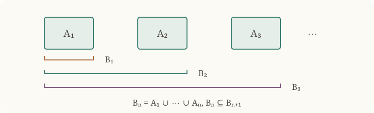

# Monotone Convergence and Lebesgue Measure

Absolute integrability controls the total size of local integrals, whereas
ordinary KH-integrability can depend on cancellation. We develop a criterion
for absolute integrability, prove that integration commutes with monotone
limits when the integrals are bounded, and use indicator functions to define
Lebesgue measure. The passage from integrable sets to locally integrable
indicators permits infinite measure while retaining countable additivity.
Translation invariance then leads to the construction of nonmeasurable
Vitali sets.

Throughout, $I$ denotes a compact cell unless another interval is specified,
and $\lambda(J)$ denotes the length of a compact cell $J$.

## Absolute Kurzweil–Henstock Integrability

!!! definition "Definition (Positive and negative parts)"
    
    Let $S$ be a set and let $f:S\to\mathbb R$. The **positive part** and
    **negative part** of $f$ are the nonnegative functions

    $$
    f^+(x):=\max\{f(x),0\},
    \qquad
    f^-(x):=-\min\{f(x),0\}.
    $$

    Pointwise on $S$,

    $$
    f=f^+-f^-,
    \qquad
    |f|=f^++f^-,
    $$

    and therefore

    $$
    f^+=\frac{|f|+f}{2},
    \qquad
    f^-=\frac{|f|-f}{2}.
    $$

    More generally, for real-valued functions $f$ and $g$ on the same set,

    $$
    \max\{f,g\}=\frac{f+g+|f-g|}{2},
    \qquad
    \min\{f,g\}=\frac{f+g-|f-g|}{2}.
    $$

!!! definition "Definition (Absolute KH-integrability)"
    
    Let $I$ be an interval and let $f:I\to\mathbb R$. We say that $f$ is
    **absolutely Kurzweil–Henstock integrable** on $I$, and write

    $$
    f\in\operatorname{AKH}(I),
    $$

    if both $f$ and $|f|$ belong to $\operatorname{KH}(I)$.

!!! proposition "Proposition (Characterization by positive and negative parts)"
    
    Let $I\subseteq\mathbb R$ be an interval and let $f:I\to\mathbb R$.
    The following are equivalent:

    1. $f\in\operatorname{AKH}(I)$;
    2. $f^+,f^-\in\operatorname{KH}(I)$.

??? proof "Proof"
    If $f$ and $|f|$ are KH-integrable, linearity and

    $$
    f^+=\frac{|f|+f}{2},
    \qquad
    f^-=\frac{|f|-f}{2}
    $$

    show that $f^+$ and $f^-$ are KH-integrable. Conversely, if $f^+$ and
    $f^-$ are KH-integrable, then

    $$
    f=f^+-f^-,
    \qquad
    |f|=f^++f^-
    $$

    are KH-integrable by linearity. Hence $f\in\operatorname{AKH}(I)$.

The word *absolute* is essential: a derivative may be KH-integrable without
its absolute value being KH-integrable.

!!! example "Example (Divergence of the integral of the reciprocal function)"
    
    The function $x\mapsto1/x$ is KH-integrable on every compact subinterval
    of $(0,1]$, but not on $(0,1]$ itself.

??? proof "Proof by an antiderivative"
    For $0<a<1$, the fundamental theorem of calculus gives

    $$
    \int_a^1\frac{dx}{x}=[\log x]_a^1=-\log a\longrightarrow+\infty
    \qquad(a\downarrow0).
    $$

    Thus the finite endpoint limit required for KH-integrability does not exist.

??? proof "Proof by lower rectangles"
    Put $a_n=1/(n+1)$ and $b_n=1/n$ for $n\geq1$. The cells
    $[a_n,b_n]$ have disjoint interiors and cover $(0,1]$. On each cell,
    $1/x\geq1/b_n=n$, while $b_n-a_n=1/(n(n+1))$. Therefore

    $$
    \int_{1/(N+1)}^1\frac{dx}{x}
    =\sum_{n=1}^N\int_{a_n}^{b_n}\frac{dx}{x}
    \geq\sum_{n=1}^N\frac{b_n-a_n}{b_n}
    =\sum_{n=1}^N\frac1{n+1}\longrightarrow+\infty.
    $$

    

    Each rectangle contributes $1/(n+1)$ despite its shrinking width.

!!! example "Example (A KH-integrable derivative that is not absolutely integrable)"
    
    Define $F:[-1,1]\to\mathbb R$ by

    $$
    F(x):=
    \begin{cases}
    x^2\sin(1/x^2),&x\neq0,\\
    0,&x=0.
    \end{cases}
    $$

    Then $F$ is differentiable everywhere, $F'(0)=0$, and

    $$
    F'(x)=2x\sin(1/x^2)-\frac{2}{x}\cos(1/x^2)
    \qquad(x\neq0).
    $$

    The [fundamental theorem of calculus](kurzweil-henstock-integration.md#thm-1-13-3)
    gives

    $$
    F'\in\operatorname{KH}([-1,1]),
    \qquad
    \int_{[-1,1]}F'=F(1)-F(-1)=0.
    $$

    Nevertheless, $|F'|\notin\operatorname{KH}([-1,1])$.

??? proof "Proof of non-absolute integrability"
    Write

    $$
    g(x):=2x\sin(1/x^2),
    \qquad
    h(x):=\frac{2}{x}\cos(1/x^2),
    $$

    so that $F'=g-h$ away from the origin. For $n\geq1$, put

    $$
    A_n:=2\pi n-\frac{\pi}{3},
    \qquad
    B_n:=2\pi n+\frac{\pi}{3},
    $$

    and define the pairwise disjoint compact cells

    $$
    I_n:=
    \left[\frac{1}{\sqrt{B_n}},\frac{1}{\sqrt{A_n}}\right]
    \subseteq(0,1].
    $$

    If $x\in I_n$, then $1/x^2\in[A_n,B_n]$ and hence
    $\cos(1/x^2)\geq1/2$. Consequently,

    $$
    h(x)\geq\frac1x\geq\sqrt{A_n},
    \qquad
    |g(x)|\leq2.
    $$

    For all sufficiently large $n$, $h(x)\geq4$ on $I_n$, and therefore

    $$
    |F'(x)|=|g(x)-h(x)|
    \geq h(x)-|g(x)|
    \geq\frac12\sqrt{A_n}.
    \tag{1}
    $$

    The mean value theorem applied to $u\mapsto u^{-1/2}$ gives

    $$
    \lambda(I_n)
    =\frac1{\sqrt{A_n}}-\frac1{\sqrt{B_n}}
    \geq\frac{\pi}{3B_n^{3/2}}.
    \tag{2}
    $$

    Since $A_n\geq(5\pi/3)n$ and $B_n\leq(7\pi/3)n$, (1) and (2) yield a
    constant $c>0$ such that

    $$
    \int_{I_n}|F'|
    \geq\frac12\sqrt{A_n}\,\lambda(I_n)
    \geq\frac{c}{n}
    $$

    for all sufficiently large $n$. If $|F'|$ were KH-integrable on
    $[-1,1]$, restriction, finite additivity, and monotonicity would imply

    $$
    \int_{[-1,1]}|F'|
    \geq\sum_{n=n_0}^{N}\int_{I_n}|F'|
    \geq c\sum_{n=n_0}^{N}\frac1n
    $$

    for every $N$. The right-hand side is unbounded, a contradiction. Thus
    $F'$ is KH-integrable but not absolutely KH-integrable.

??? proof "Proof by rationalizing the interval lengths"
    This gives the board's direct length estimate for the same construction.
    Extend $g$ and $h$ above by $g(0)=h(0)=0$, so that $F'=g-h$ everywhere.
    Write

    $$
    s_n=2\pi n-\frac{\pi}{3},\quad t_n=2\pi n+\frac{\pi}{3},
    \qquad a_n=\frac1{\sqrt{t_n}},\quad b_n=\frac1{\sqrt{s_n}},
    \qquad I_n=[a_n,b_n].
    $$

    The elementary implication
    $-\pi/3+2\pi n\leq\theta\leq\pi/3+2\pi n\Rightarrow\cos\theta\geq1/2$,
    applied to $\theta=1/x^2$, gives $\cos(1/x^2)\geq1/2$ on $I_n$.
    These cells are pairwise disjoint.

    

    Rationalizing twice yields

    $$
    \begin{aligned}
    b_n-a_n
    &=\frac{\sqrt{t_n}-\sqrt{s_n}}{\sqrt{s_n}\sqrt{t_n}}\\
    &=\frac{t_n-s_n}
      {\sqrt{s_n}\sqrt{t_n}(\sqrt{t_n}+\sqrt{s_n})}\\
    &=\frac{2\pi/3}{t_n\sqrt{s_n}+s_n\sqrt{t_n}}
    \geq\frac{c_1}{n^{3/2}}
    \end{aligned}
    $$

    for a constant $c_1>0$ independent of $n$. For $x\in I_n$,
    $x\leq b_1=\sqrt{3/(5\pi)}<1/2$, and hence

    $$
    |F'(x)|\geq |h(x)|-|g(x)|
    \geq\frac1x-2x\geq\frac1{2x}\geq\frac1{2b_n}.
    $$

    If $|F'|$ were integrable, positivity and finite additivity would give

    $$
    \int_0^1|F'|
    \geq\sum_{n=1}^N\int_{I_n}|F'|
    \geq\sum_{n=1}^N\frac{b_n-a_n}{2b_n}
    \geq c_2\sum_{n=1}^N\frac1n
    \longrightarrow+\infty,
    $$

    a contradiction. Here $1/b_n=\sqrt{s_n}$ grows like $\sqrt n$,
    not like $n$: multiplying it by the length bound $n^{-3/2}$ produces
    $n^{-1}$. This corrects the exponent in the board's final estimate.

The next observation makes explicit how nonnegative integrals on general
intervals are recovered from compact subintervals. It will also justify the
use of monotone convergence on $\mathbb R$ later in the chapter.

!!! lemma "Lemma (Nonnegative integrals on general intervals)"
    
    Let $I$ be an interval with nonempty interior and let $u:I\to[0,\infty)$.
    Suppose $u|_K\in\operatorname{KH}(K)$ for every compact cell
    $K\subseteq\operatorname{int}(I)$. Then $u\in\operatorname{KH}(I)$
    if and only if

    $$
    M:=\sup_{\substack{K\subseteq\operatorname{int}(I)\\K\text{ compact cell}}}
       \int_Ku<\infty.
    $$

    In that case $\int_Iu=M$.

??? proof "Proof"
    Fix $c\in\operatorname{int}(I)$ and define $U(x)=\int_c^xu$ there.
    Local finite additivity and continuity of indefinite integrals show that
    $U$ is continuous, nondecreasing, and satisfies
    $U(v)-U(w)=\int_w^vu$ whenever $w<v$ lie in the interior.
    If $M<\infty$, then $|U(x)|\leq M$. Thus its two endpoint limits
    exist and are finite. Extend $U$ to any included endpoints by these
    limits. It is an admissible primitive in the
    [Definition](kurzweil-henstock-integration.md#def-kh-general-interval).
    Moreover,

    $$
    \int_Iu
    =\lim_{v\to\sup I}U(v)-\lim_{w\to\inf I}U(w)
    =\sup_{w<v}\bigl(U(v)-U(w)\bigr)=M.
    $$

    Conversely, if $u$ is integrable, its normalized primitive is this $U$.
    Nonnegativity makes every interior increment bounded by the difference
    of the endpoint limits, and the same supremum identity proves the claim.
    Values of $u$ at included endpoints do not affect the integral.

!!! proposition "Proposition (Absolute integral bound and restriction)"
    
    Let $I$ be an interval and $f\in\operatorname{AKH}(I)$. Then

    $$
    \left|\int_If\right|\leq\int_I|f|.
    $$

    For every nondegenerate subinterval $J\subseteq I$,
    $f|_J\in\operatorname{AKH}(J)$.

??? proof "Proof"
    The inequalities $f\leq|f|$ and $-f\leq|f|$ imply
    $\int_If\leq\int_I|f|$ and $-\int_If=\int_I(-f)\leq\int_I|f|$.
    Monotonicity on general intervals follows by taking endpoint limits
    of the compact-interval inequalities.

    On compact subcells, restriction gives
    $f|_K\in\operatorname{KH}(K)$ and
    $\lvert f|_K\rvert=|f|\,|_K\in\operatorname{KH}(K)$.
    For an arbitrary subinterval $J$, apply
    [Lemma](#lem-nonnegative-general-interval) to $f^+|_J$ and $f^-|_J$:
    their local integrals are bounded by $\int_I f^+$ and $\int_I f^-$.
    Both parts are therefore integrable on $J$, and
    [Proposition](#prop-akh-positive-negative-parts) finishes the proof.

!!! theorem "Theorem (Criterion for absolute KH-integrability)"
    
    Let $f\in\operatorname{KH}(I)$. Define

    $$
    v_I(f):=\sup_{\Delta}
       \sum_{K\in\Delta}\left|\int_Kf\right|,
    $$

    where $\Delta$ runs over all finite partial divisions of $I$ into
    compact cells. Then

    $$
    f\in\operatorname{AKH}(I)
    \quad\Longleftrightarrow\quad v_I(f)<\infty.
    $$

    When these conditions hold, $v_I(f)=\int_I|f|$.
    The same statement holds for any nondegenerate interval $I$.

??? proof "Proof"
    **Absolute integrability implies the bound.**
    Suppose $|f|\in\operatorname{KH}(I)$ and let $\Delta$ be a partial
    division. Restriction, zero extension, and invariance under finite
    modification give

    $$
    \begin{aligned}
    \sum_{K\in\Delta}\left|\int_Kf\right|
    &=\sum_{K\in\Delta}\left|\int_I f\mathbf1_K\right|\\
    &\leq\sum_{K\in\Delta}\int_I|f|\mathbf1_{\operatorname{int}(K)}\\
    &=\int_I\sum_{K\in\Delta}|f|\mathbf1_{\operatorname{int}(K)}
    \leq\int_I|f|.
    \end{aligned}
    $$

    Here $\mathbf1_A$ is $1$ on $A$ and $0$ off $A$. Using the interiors
    avoids counting common endpoints twice. Hence $v_I(f)\leq\int_I|f|$.

    **The converse on a compact cell.**
    Write $v=v_I(f)<\infty$ and fix $\varepsilon>0$. Choose a partial
    division $\Delta$ such that

    $$
    v<\frac{\varepsilon}{2}
       +\sum_{K\in\Delta}\left|\int_Kf\right|.
    $$

    Complete $\Delta$ to a full division; adding nonnegative terms preserves
    this inequality. Let $\delta_1$ be the gauge supplied by the
    [subordinate tagged-division theorem](kurzweil-henstock-integration.md#thm-1-11-4),
    and choose an $\varepsilon/4$-adapted gauge $\delta_2$ for $f$.
    Put $\delta=\min\{\delta_1,\delta_2\}$.

    Given a $\delta$-fine tagged division $\Pi$, let $\Pi_K$ and
    $\widetilde\Pi=\bigcup_{K\in\Delta}\Pi_K$ be its subordinate refinement.
    This refinement preserves tags, Riemann sums, and $\delta_2$-fineness.

    

    Set $q=\sum_{(J,x)\in\widetilde\Pi}|\int_Jf|$. Since the underlying
    cells of $\widetilde\Pi$ form a division,

    $$
    \begin{aligned}
    q&\leq v
    <\frac{\varepsilon}{2}+\sum_{K\in\Delta}\left|\int_Kf\right|\\
    &=\frac{\varepsilon}{2}
      +\sum_{K\in\Delta}\left|\sum_{(J,x)\in\Pi_K}\int_Jf\right|
    \leq\frac{\varepsilon}{2}+q.
    \end{aligned}
    $$

    Thus $|v-q|<\varepsilon/2$. On the other hand,
    $S(\Pi,|f|)=S(\widetilde\Pi,|f|)$, even though integrability of $|f|$
    has not yet been proved. The reverse triangle inequality and the
    [Saks–Henstock lemma](kurzweil-henstock-integration.md#thm-saks-henstock)
    yield

    $$
    \begin{aligned}
    |S(\Pi,|f|)-q|
    &\leq\sum_{(J,x)\in\widetilde\Pi}
      \left||f(x)|\lambda(J)-\left|\int_Jf\right|\right|\\
    &\leq\sum_{(J,x)\in\widetilde\Pi}
      \left|f(x)\lambda(J)-\int_Jf\right|
    \leq 2\frac{\varepsilon}{4}=\frac{\varepsilon}{2}.
    \end{aligned}
    $$

    Consequently $|S(\Pi,|f|)-v|<\varepsilon$. This proves
    $|f|\in\operatorname{KH}(I)$ and $\int_I|f|=v$.

    **Extension to general intervals.**
    If $v_I(f)<\infty$, apply the compact case on each interior compact
    cell $K$. It gives
    $\int_K|f|=v_K(f|_K)\leq v_I(f)$.
    [Lemma](#lem-nonnegative-general-interval) now implies that $|f|$
    is integrable on $I$ and $\int_I|f|\leq v_I(f)$.
    The first part of the proof gives the reverse inequality.

!!! corollary "Corollary (Comparison test)"
    
    Let $I$ be an interval and let $f,g\in\operatorname{KH}(I)$.
    If $|f|\leq g$ on $I$, then $f\in\operatorname{AKH}(I)$ and
    $\int_I|f|\leq\int_Ig$.

??? proof "Proof"
    Since $g\geq0$, it is itself absolutely integrable. For every compact
    cell $K\subseteq I$, the inequalities $f\leq g$ and $-f\leq g$ give
    $|\int_Kf|\leq\int_Kg$. Thus, for every partial division $\Delta$,

    $$
    \sum_{K\in\Delta}\left|\int_Kf\right|
    \leq\sum_{K\in\Delta}\int_Kg
    \leq\int_Ig<\infty.
    $$

    The criterion gives $f\in\operatorname{AKH}(I)$ and
    $\int_I|f|=v_I(f)\leq\int_Ig$.
    The assumption $f\in\operatorname{KH}(I)$ is essential here:
    domination alone is not an integrability criterion for arbitrary functions.

!!! definition "Definition (Seminorm and norm)"
    
    A **seminorm** on a real vector space $E$ is a function
    $p:E\to[0,\infty)$ such that $p(0)=0$ and, for all $u,v\in E$
    and $\alpha\in\mathbb R$,

    $$
    p(\alpha u)=|\alpha|p(u),\qquad p(u+v)\leq p(u)+p(v).
    $$

    It is a **norm** if, in addition, $p(u)=0$ implies $u=0$.

!!! proposition "Proposition (The seminormed vector space of absolutely integrable functions)"
    
    For an interval $I$, the space $\operatorname{AKH}(I)$ is a real
    vector space, and

    $$
    \|f\|:=\int_I|f|
    $$

    defines a seminorm on it.

??? proof "Proof"
    The zero function belongs to $\operatorname{AKH}(I)$.
    If $f,g\in\operatorname{AKH}(I)$ and $\alpha\in\mathbb R$,
    linearity gives $\alpha f+g\in\operatorname{KH}(I)$, while

    $$
    |\alpha f+g|\leq|\alpha|\,|f|+|g|\in\operatorname{KH}(I).
    $$

    The comparison test therefore gives $\alpha f+g\in\operatorname{AKH}(I)$.
    Nonnegativity and $\|0\|=0$ are immediate. Finally,

    $$
    \|\alpha f\|=\int_I|\alpha f|=|\alpha|\int_I|f|=|\alpha|\|f\|,
    \qquad
    \|f+g\|\leq\int_I(|f|+|g|)=\|f\|+\|g\|.
    $$

    This need not be a norm on actual functions: the indicator of a single
    point is nonzero but has integral, and hence seminorm, zero.

!!! corollary "Corollary (Closure under maximum and minimum)"
    
    If $f,g\in\operatorname{AKH}(I)$, then
    $\max\{f,g\},\min\{f,g\}\in\operatorname{AKH}(I)$.

??? proof "Proof"
    The vector-space property gives $f-g\in\operatorname{AKH}(I)$.
    Also $|f-g|\in\operatorname{AKH}(I)$, because taking its absolute value
    changes nothing. Apply linearity to
    $\max\{f,g\}=(f+g+|f-g|)/2$ and
    $\min\{f,g\}=(f+g-|f-g|)/2$.

## Monotone Convergence

Uniform convergence is not the only condition that permits passage of a
limit through an integral. Monotonicity, together with a bound on the
integrals and a finite pointwise limit, also suffices.

!!! definition "Definition (Pointwise convergence and monotone sequences)"
    
    A sequence of functions $f_n:I\to\mathbb R$ **converges pointwise**
    to $f:I\to\mathbb R$ if $\lim_{n\to\infty}f_n(x)=f(x)$ for every $x\in I$.
    It is **increasing** if $f_n(x)\leq f_{n+1}(x)$ for every $x$ and $n$,
    and **decreasing** if these inequalities are reversed.
    The words increasing and decreasing allow equality.

!!! example "Example (Pointwise convergence need not be uniform)"
    
    A concrete version of the shrinking-spike sketch is
    $f_n(x)=\max\{1-nx,0\}$ on $I=(0,1]$, for $n\geq1$.
    For each fixed $x>0$, eventually $nx\geq1$, so $f_n(x)\to0$.
    However, $\sup_{x\in I}|f_n(x)|=1$ for every $n$, and convergence
    is not uniform.

    

!!! theorem "Theorem (Monotone convergence)"
    
    Let $I$ be a compact cell and let $f_n\in\operatorname{KH}(I)$
    for $n\geq0$. Suppose that $(f_n)$ is increasing, that
    $\sup_n\int_I f_n<\infty$, and that $f_n$ converges pointwise to
    a real-valued function $f:I\to\mathbb R$. Then

    $$
    f\in\operatorname{KH}(I),
    \qquad
    \int_I f=\lim_{n\to\infty}\int_I f_n.
    $$

    The functions $f_n$ need not be nonnegative.

??? proof "Proof"
    Monotonicity of the integral shows that $(\int_I f_n)$ is increasing.
    Since it is bounded above, its limit
    $r:=\lim_n\int_I f_n$ exists in $\mathbb R$.
    Fix $\varepsilon>0$. Choose $n_0$ such that, for all $n\geq n_0$,

    $$
    r-\frac{\varepsilon}{3}\leq\int_I f_n\leq r.
    $$

    For each $x\in I$, pointwise convergence allows a choice $n(x)\geq n_0$
    with

    $$
    f(x)-\frac{\varepsilon}{3\lambda(I)}
    <f_{n(x)}(x)\leq f(x).
    $$

    For each $n\geq0$, choose an $\varepsilon_n$-adapted gauge $\delta_n$
    for $f_n$, where $\varepsilon_n=\varepsilon/(3\cdot2^{n+2})$.
    Define the gauge $\delta(x):=\delta_{n(x)}(x)$.
    Let $\Pi$ be any $\delta$-fine tagged division of $I$.
    Insert the local integrals of $f_{n(x)}$ into its Riemann sum:

    $$
    \begin{aligned}
    S(\Pi,f)
    &=\sum_{(J,x)\in\Pi}(f(x)-f_{n(x)}(x))\lambda(J)\\
    &\quad+\sum_{(J,x)\in\Pi}
       \left(f_{n(x)}(x)\lambda(J)-\int_Jf_{n(x)}\right)
       +\sum_{(J,x)\in\Pi}\int_Jf_{n(x)}.
    \end{aligned}
    $$

    Consequently $|S(\Pi,f)-r|\leq E_1+E_2+E_3$, where

    $$
    \begin{aligned}
    E_1&=\sum_{(J,x)\in\Pi}|f(x)-f_{n(x)}(x)|\lambda(J),\\
    E_2&=\sum_{(J,x)\in\Pi}
       \left|f_{n(x)}(x)\lambda(J)-\int_Jf_{n(x)}\right|,\\
    E_3&=\left|r-\sum_{(J,x)\in\Pi}\int_Jf_{n(x)}\right|.
    \end{aligned}
    $$

    **Pointwise error.** The choice of $n(x)$ and additivity of length give

    $$
    E_1<\frac{\varepsilon}{3\lambda(I)}
        \sum_{(J,x)\in\Pi}\lambda(J)=\frac{\varepsilon}{3}.
    $$

    **Local integration errors.** For each $n$, set
    $\Pi_n:=\{(J,x)\in\Pi:n(x)=n\}$.
    Then $\Pi=\bigcup_{n\geq0}\Pi_n$, with only finitely many nonempty
    families. Each $\Pi_n$ is a partial $\delta_n$-fine tagged division:
    for $(J,x)\in\Pi_n$,

    $$
    J\subseteq[x-\delta(x),x+\delta(x)]
      =[x-\delta_n(x),x+\delta_n(x)].
    $$

    The [Saks–Henstock lemma](kurzweil-henstock-integration.md#thm-saks-henstock)
    therefore gives

    $$
    E_2=\sum_{n\geq0}\sum_{(J,x)\in\Pi_n}
      \left|f_n(x)\lambda(J)-\int_Jf_n\right|
    \leq\sum_{n\geq0}2\varepsilon_n=\frac{\varepsilon}{3}.
    $$

    **Integral error.** Put $N_\Pi=\max\{n(x):(J,x)\in\Pi\}$.
    Since $n_0\leq n(x)\leq N_\Pi$, monotonicity and finite additivity yield

    $$
    \begin{aligned}
    r-\frac{\varepsilon}{3}
    &\leq\int_I f_{n_0}
    =\sum_{(J,x)\in\Pi}\int_J f_{n_0}\\
    &\leq\sum_{(J,x)\in\Pi}\int_Jf_{n(x)}
    \leq\sum_{(J,x)\in\Pi}\int_Jf_{N_\Pi}
    =\int_I f_{N_\Pi}\leq r.
    \end{aligned}
    $$

    Thus $E_3\leq\varepsilon/3$. Combining all three estimates proves
    $|S(\Pi,f)-r|<\varepsilon$, as required.

!!! corollary "Corollary (Monotone convergence on a general interval)"
    
    The preceding theorem remains valid when $I$ is any nondegenerate
    interval, in particular when $I=\mathbb R$.

??? proof "Proof"
    Subtract $f_0$: put $u_n=f_n-f_0\geq0$ and $u=f-f_0$.
    Then $u_n\uparrow u$ and
    $R:=\sup_n\int_Iu_n<\infty$.
    On each compact cell $K\subseteq\operatorname{int}(I)$,
    $\int_Ku_n\leq R$. The compact theorem gives
    $u|_K\in\operatorname{KH}(K)$ and
    $\int_Ku=\sup_n\int_Ku_n\leq R$.
    By [Lemma](#lem-nonnegative-general-interval), $u$ is integrable on $I$.
    Taking suprema over the same interior compact cells,

    $$
    \int_Iu
    =\sup_K\int_Ku
    =\sup_K\sup_n\int_Ku_n
    =\sup_n\sup_K\int_Ku_n
    =\sup_n\int_Iu_n=R.
    $$

    The two suprema commute because both sides are the supremum of the
    same family indexed by $(K,n)$. Add back the integrable function $f_0$.

## Integrable Sets

Indicator functions translate set operations into operations on functions.
Their integrals define the measure of integrable sets; monotone convergence
then turns finite additivity into countable additivity when the total measure
is finite. Limit properties, elementary examples, and translation invariance
are first established for these finite-measure sets; the next section removes
the finiteness restriction.

!!! definition "Definition (Monotone and disjoint sequences of sets)"
    
    A sequence $(A_n)$ of subsets of $\mathbb R$ is **increasing** if
    $A_n\subseteq A_{n+1}$ for every $n$, and **decreasing** if
    $A_n\supseteq A_{n+1}$ for every $n$.
    It is **pairwise disjoint** if $A_n\cap A_m=\varnothing$ whenever $n\ne m$.

!!! definition "Definition (Indicator function)"
    
    For $A\subseteq I$, the **indicator function** of $A$ on $I$ is

    $$
    \mathbf1_A:I\to\mathbb R,\qquad
    \mathbf1_A(x)=
    \begin{cases}1,&x\in A,\\0,&x\notin A.\end{cases}
    $$

    When $A\subseteq\mathbb R$ and no ambient interval is indicated,
    the domain is $\mathbb R$.

!!! proposition "Proposition (Indicator calculus)"
    
    For pairwise disjoint sets $A_1,\ldots,A_N$,

    $$
    \mathbf1_{\bigcup_{n=1}^N A_n}=\sum_{n=1}^N\mathbf1_{A_n}.
    $$

    If $A\subseteq B$, then $\mathbf1_{B\setminus A}=\mathbf1_B-\mathbf1_A$.
    For arbitrary $A,B$,

    $$
    \mathbf1_{A\cap B}=\min\{\mathbf1_A,\mathbf1_B\},
    \qquad
    \mathbf1_{A\cup B}=\max\{\mathbf1_A,\mathbf1_B\}.
    $$

    If $A_n$ is increasing and $A=\bigcup_nA_n$, then
    $\mathbf1_{A_n}\uparrow\mathbf1_A$ pointwise.

??? proof "Proof"
    At a point in a finite disjoint union exactly one summand is $1$;
    outside the union all summands vanish. The difference formula follows
    by distinguishing $A$, $B\setminus A$, and the complement of $B$.
    The minimum is $1$ precisely when both indicators are $1$, and the
    maximum is $1$ precisely when at least one is $1$.
    Finally, if $x\in\bigcup_nA_n$, then $x\in A_{n_0}$ for some $n_0$
    and $x\in A_n$ for all $n\geq n_0$. If $x$ is outside the union,
    every indicator is zero. This proves the last assertion.

!!! definition "Definition (Integrable set and Lebesgue measure)"
    
    A set $A\subseteq\mathbb R$ is **integrable** if
    $\mathbf1_A\in\operatorname{KH}(\mathbb R)$. Its **Lebesgue measure** is

    $$
    \mathcal L^1(A):=\int_{\mathbb R}\mathbf1_A.
    $$

    Thus $\mathcal L^1(A)$ is a finite real number for every integrable set.

!!! example "Example (The empty set and the whole line)"
    The empty set is integrable and $\mathcal L^1(\varnothing)=0$,
    since $\mathbf1_\varnothing=0$. The whole line is not integrable:
    $\int_{[-R,R]}\mathbf1_{\mathbb R}=2R$ is unbounded as $R\to\infty$.
    This does not say that $\mathbb R$ is nonmeasurable; only finite
    integrals are allowed by the definition being used here.

!!! proposition "Proposition (Basic properties of Lebesgue measure)"
    
    The following properties hold.

    1. Every bounded interval $J$ with nonempty interior is integrable.
       Its endpoints do not affect its measure.
    2. If $A$ is integrable, then $\mathcal L^1(A)\geq0$.
    3. If $A\subseteq B$ are integrable, so is $B\setminus A$;
       moreover $\mathcal L^1(A)\leq\mathcal L^1(B)$.
    4. If $A,B$ are integrable, so are $A\cap B$ and $A\cup B$.
    5. A finite disjoint union of integrable sets is integrable and its
       measure is the sum of their measures.

    Explicitly, the formulas in (1), (3), and (5) are

    $$
    \mathcal L^1(J)=\mathcal L^1(\overline J)
       =\mathcal L^1(\operatorname{int}J)=\sup J-\inf J,
    $$

    $$
    \mathcal L^1(B\setminus A)=\mathcal L^1(B)-\mathcal L^1(A),
    $$

    $$
    \mathcal L^1\!\left(\bigcup_{n=1}^N A_n\right)
       =\sum_{n=1}^N\mathcal L^1(A_n)
       \qquad(A_1,\ldots,A_N\text{ pairwise disjoint}).
    $$

??? proof "Proof"
    **Intervals.** If $a=\inf J<b=\sup J$, then $\mathbf1_{[a,b]}$
    is locally a step function on $\mathbb R$, and
    $U(x)=0$ for $x\leq a$, $U(x)=x-a$ for $a\leq x\leq b$,
    and $U(x)=b-a$ for $x\geq b$ is an admissible primitive.
    Its endpoint limits differ by $b-a$. Removing either endpoint changes
    the indicator at only finitely many points, which does not change any
    integral. This proves (1).

    **Positivity and differences.** Since $\mathbf1_A\geq0$, (2) follows
    from positivity. For $A\subseteq B$, the indicator identity and linearity
    give
    $\int_{\mathbb R}\mathbf1_{B\setminus A} =\mathcal L^1(B)-\mathcal L^1(A)$.
    The left side is nonnegative, proving (3).

    **Unions and intersections.** An integrable indicator is absolutely
    integrable because $|\mathbf1_A|=\mathbf1_A$.
    The maximum and minimum identities and
    [Corollary](#cor-akh-lattice), applied on $\mathbb R$, prove (4).

    **Finite additivity.** If the sets are pairwise disjoint, then

    $$
    \begin{aligned}
    \mathcal L^1\!\left(\bigcup_{n=1}^N A_n\right)
    &=\int_{\mathbb R}\mathbf1_{\bigcup_{n=1}^N A_n}
      =\int_{\mathbb R}\sum_{n=1}^N\mathbf1_{A_n}\\
    &=\sum_{n=1}^N\int_{\mathbb R}\mathbf1_{A_n}
      =\sum_{n=1}^N\mathcal L^1(A_n).
    \end{aligned}
    $$

    The finite sum is integrable by linearity, proving (5).

!!! theorem "Theorem (Continuity from below for integrable sets)"
    
    Let $(A_n)$ be an increasing sequence of integrable sets. If
    $\sup_n\mathcal L^1(A_n)<\infty$, then $A=\bigcup_nA_n$ is integrable and

    $$
    \mathcal L^1(A)=\lim_{n\to\infty}\mathcal L^1(A_n)
       =\sup_n\mathcal L^1(A_n).
    $$

??? proof "Proof"
    The functions $\mathbf1_{A_n}$ are KH-integrable on $\mathbb R$,
    satisfy $\mathbf1_{A_n}\leq\mathbf1_{A_{n+1}}$, and converge pointwise
    to $\mathbf1_A$. Their integrals are bounded above by hypothesis.
    [Monotone convergence](#cor-monotone-convergence-general) therefore gives

    $$
    \mathbf1_A\in\operatorname{KH}(\mathbb R),\qquad
    \int_{\mathbb R}\mathbf1_A
       =\lim_{n\to\infty}\int_{\mathbb R}\mathbf1_{A_n}
       =\lim_{n\to\infty}\mathcal L^1(A_n).
    $$

    The limit is the supremum because the measures form an increasing sequence.

!!! theorem "Theorem (Countable additivity for integrable sets)"
    
    Let $(A_n)_{n\geq1}$ be a pairwise disjoint sequence of integrable
    subsets of $\mathbb R$. If $\sum_{n=1}^{\infty}\mathcal L^1(A_n)<\infty$,
    then $\bigcup_{n=1}^{\infty}A_n$ is integrable and

    $$
    \mathcal L^1\!\left(\bigcup_{n=1}^{\infty}A_n\right)
    =\sum_{n=1}^{\infty}\mathcal L^1(A_n).
    $$

??? proof "Proof"
    

    Put $B_N=\bigcup_{n=1}^NA_n$ and $A=\bigcup_{n=1}^\infty A_n$.
    Finite additivity gives $B_N$ integrable and
    $\int_{\mathbb R}\mathbf1_{B_N} =\sum_{n=1}^N\mathcal L^1(A_n)$.
    Also $B_N\uparrow A$, so $\mathbf1_{B_N}\uparrow\mathbf1_A$ pointwise.
    The partial sums of measures are bounded by the assumed convergent
    series. Apply [Corollary](#cor-monotone-convergence-general) on
    $\mathbb R$ to obtain $\mathbf1_A\in\operatorname{KH}(\mathbb R)$ and

    $$
    \mathcal L^1(A)=\int_{\mathbb R}\mathbf1_A
    =\lim_{N\to\infty}\int_{\mathbb R}\mathbf1_{B_N}
    =\sum_{n=1}^{\infty}\mathcal L^1(A_n).
    $$

!!! theorem "Theorem (Countable subadditivity for integrable sets)"
    
    Let $A$ and $A_n$, $n\geq1$, be integrable sets such that
    $A\subseteq\bigcup_{n\geq1}A_n$. Then

    $$
    \mathcal L^1(A)\leq\sum_{n=1}^{\infty}\mathcal L^1(A_n).
    $$

??? proof "Proof"
    If the series on the right diverges to $+\infty$, the inequality is
    immediate. Otherwise put

    $$
    E_1=A\cap A_1,\qquad
    E_n=A\cap\left(A_n\setminus\bigcup_{k=1}^{n-1}A_k\right)
       \quad(n\geq2).
    $$

    Finite unions, intersections, and differences of integrable sets are
    integrable. Thus each $E_n$ is integrable, the $E_n$ are pairwise
    disjoint, and $A=\bigcup_nE_n$. Also $E_n\subseteq A_n$, so
    $\sum_n\mathcal L^1(E_n)\leq\sum_n\mathcal L^1(A_n)<\infty$.
    [Countable additivity](#thm-countable-additivity) gives

    $$
    \mathcal L^1(A)=\sum_{n=1}^{\infty}\mathcal L^1(E_n)
       \leq\sum_{n=1}^{\infty}\mathcal L^1(A_n).
    $$

!!! corollary "Corollary (Countable unions inside an integrable set)"
    
    If each $A_n$ is integrable and $A_n\subseteq B$ for an integrable
    set $B$, then $\bigcup_nA_n$ is integrable.

??? proof "Proof"
    The finite unions $C_N=\bigcup_{n=1}^NA_n$ are integrable, increase
    to $\bigcup_nA_n$, and satisfy $\mathcal L^1(C_N)\leq\mathcal L^1(B)$.
    Apply [continuity from below](#thm-continuity-below-integrable).

!!! theorem "Theorem (Continuity from above for integrable sets)"
    
    If $(A_n)_{n\geq1}$ is a decreasing sequence of integrable sets, then
    $A=\bigcap_{n\geq1}A_n$ is integrable and

    $$
    \mathcal L^1(A)=\lim_{n\to\infty}\mathcal L^1(A_n)
       =\inf_n\mathcal L^1(A_n).
    $$

??? proof "Proof"
    **Local complements.** Fix a compact cell $I$. Although
    $A_n^c=\mathbb R\setminus A_n$ need not be integrable, the sets
    $I\cap A_n^c=I\setminus A_n$ are integrable and increase with $n$.
    Their measures are bounded by $\mathcal L^1(I)$, and

    $$
    \bigcup_n(I\cap A_n^c)=I\setminus\bigcap_nA_n=I\setminus A.
    $$

    Continuity from below makes $I\setminus A$ integrable. Its complement
    within $I$ is $I\cap A$, which is therefore integrable as well.
    Since $I\cap A\subseteq I\cap A_1$,

    $$
    0\leq\int_I\mathbf1_A
       =\mathcal L^1(I\cap A)\leq\mathcal L^1(A_1).
    $$

    The [nonnegative integrability criterion](#lem-nonnegative-general-interval)
    now gives $\mathbf1_A\in\operatorname{KH}(\mathbb R)$.

    **The limit of the measures.** The integrable sets
    $C_n=A_1\setminus A_n$ increase to $A_1\setminus A$, and their
    measures are bounded by $\mathcal L^1(A_1)$. Applying continuity
    from below once more yields

    $$
    \begin{aligned}
    \mathcal L^1(A_1)-\mathcal L^1(A)
    &=\mathcal L^1(A_1\setminus A)\\
    &=\lim_{n\to\infty}\mathcal L^1(A_1\setminus A_n)\\
    &=\mathcal L^1(A_1)-\lim_{n\to\infty}\mathcal L^1(A_n).
    \end{aligned}
    $$

    Subtracting the finite number $\mathcal L^1(A_1)$ proves the formula.

!!! theorem "Theorem (Elementary integrable sets)"
    
    Every countable subset of $\mathbb R$ is integrable with measure zero.
    Every bounded open subset of $\mathbb R$ and every compact subset of
    $\mathbb R$ is integrable.

??? proof "Proof"
    **Countable sets.** Let $A$ be countable. On every compact cell $I$,
    $\mathbf1_A|_I$ differs from the zero function on a countable set.
    [Invariance under countable modification](kurzweil-henstock-integration.md#thm-1-10-2)
    gives $\mathbf1_A|_I\in\operatorname{KH}(I)$ and
    $\int_I\mathbf1_A=0$. The
    [nonnegative integrability criterion](#lem-nonnegative-general-interval)
    then gives $\mathbf1_A\in\operatorname{KH}(\mathbb R)$ with integral zero.

    **Bounded open sets.** Let $O$ be bounded and open, and choose a
    compact cell $I$ with $O\subseteq\operatorname{int}(I)$.
    Write $O$ as the union of its pairwise disjoint open interval components:

    $$
    O=\bigcup_{n\in N}J_n,\qquad N\subseteq\mathbb N_+.
    $$

    To obtain these components, for each $x\in O$ take the union of all
    open intervals containing $x$ and contained in $O$. This union is an
    open interval; two such intervals are either equal or disjoint.
    Each contains a rational number, and assigning its first rational in
    a fixed enumeration of $\mathbb Q$ shows that the family is countable.
    Boundedness of $O$ makes each $J_n$ a bounded interval and hence an
    integrable set. For every finite $F\subseteq N$, finite additivity
    and monotonicity give

    $$
    \sum_{n\in F}\mathcal L^1(J_n)
       =\mathcal L^1\!\left(\bigcup_{n\in F}J_n\right)
       \leq\mathcal L^1(I).
    $$

    Thus $\sum_{n\in N}\mathcal L^1(J_n)\leq\mathcal L^1(I)<\infty$.
    [Countable additivity](#thm-countable-additivity) proves integrability
    of $O$; the empty and finite families are included.

    **Compact sets.** Let $K$ be compact and choose a bounded open interval
    $J$ containing $K$. Since $K$ is closed, $J\setminus K$ is bounded and
    open, hence integrable by the preceding part. Therefore

    $$
    K=J\setminus(J\setminus K)
    $$

    is integrable by the difference property.

!!! definition "Definition (Translation)"
    
    For $h\in\mathbb R$, the **translation by $h$** is the bijection

    $$
    \tau_h:\mathbb R\to\mathbb R,\qquad x\mapsto x+h,
    \qquad \tau_h^{-1}=\tau_{-h}.
    $$

    For $A\subseteq\mathbb R$, its direct image is
    $\tau_h(A)=h+A=\{h+x:x\in A\}$. The indicator satisfies

    $$
    \mathbf1_{\tau_h(A)}=\mathbf1_A\circ\tau_{-h}.
    $$

!!! theorem "Theorem (Translation invariance for integrable sets)"
    
    If $A$ is integrable and $h\in\mathbb R$, then $\tau_h(A)$ is
    integrable and $\mathcal L^1(\tau_h(A))=\mathcal L^1(A)$.

??? proof "Proof"
    For every compact cell $I$, the
    [change-of-variables theorem](kurzweil-henstock-integration.md#thm-1-14-2)
    applied to $x\mapsto x-h$ gives

    $$
    \int_I\mathbf1_{\tau_h(A)}
       =\int_I\mathbf1_A(x-h)\,dx
       =\int_{I-h}\mathbf1_A
       \leq\mathcal L^1(A).
    $$

    The indicator on $I-h$ is integrable by restriction of $\mathbf1_A$;
    change of variables then gives integrability of the translated indicator
    on $I$.
    The [nonnegative integrability criterion](#lem-nonnegative-general-interval)
    proves global integrability and identifies the integral with the
    supremum over compact cells. Since $I\mapsto I-h$ is a bijection
    on compact cells,

    $$
    \mathcal L^1(\tau_h(A))
       =\sup_I\int_I\mathbf1_{\tau_h(A)}
       =\sup_I\int_{I-h}\mathbf1_A
       =\mathcal L^1(A).
    $$

## Measurable Sets

Local integrability of an indicator is meaningful even when its integral
over the whole line is infinite. This leads to measurable sets and extends
Lebesgue measure to values in the nonnegative extended real numbers.

!!! definition "Definition (Nonnegative extended real numbers)"
    
    Write $\mathbb R^+:=\mathbb R_{\geq0}=\{s\in\mathbb R:s\geq0\}$ and
    $[0,+\infty]:=\mathbb R_{\geq0}\cup\{+\infty\}$. Extend addition by

    $$
    s+t=
    \begin{cases}
    \text{the usual real sum},&s,t\in\mathbb R_{\geq0},\\
    +\infty,&\text{otherwise}.
    \end{cases}
    $$

    The resulting operation is associative and commutative, with identity
    $0$; thus $([0,+\infty],+)$ is a commutative monoid. Extend the usual
    order by declaring that every element is at most $+\infty$:

    $$
    s\leq t
    \quad\Longleftrightarrow\quad
    \bigl(s,t\in\mathbb R_{\geq0}\text{ and }s\leq t\text{ in }\mathbb R\bigr)
    \ \text{or}\ t=+\infty.
    $$

!!! definition "Definition (Sums of nonnegative terms)"
    
    Finite sums in $[0,+\infty]$ are defined by repeated addition, starting
    from the **empty sum** $\sum_{n\in\varnothing}a_n=0$.
    For a sequence $(a_n)_{n\geq1}$ in $[0,+\infty]$ and a set
    $E\subseteq\mathbb N_{\geq1}$, define

    $$
    \sum_{n\in E}a_n
    :=\sup_{\substack{F\subseteq E\\F\text{ finite}}}\sum_{n\in F}a_n.
    $$

    In particular,

    $$
    \sum_{n=1}^{\infty}a_n
    =\sup_{N\geq1}\sum_{n=1}^Na_n
    =\lim_{N\to\infty}\sum_{n=1}^Na_n
    \quad\text{in }[0,+\infty].
    $$

    The supremum and limit are $+\infty$ when the partial sums are
    unbounded. Since the terms are nonnegative, this definition does not
    depend on the order of enumeration of a countable family.

!!! proposition "Proposition (Monotonicity of nonnegative sums)"
    
    If $a_n,b_n\in[0,+\infty]$ and $a_n\leq b_n$ for every $n$, then
    $\sum_{n\in E}a_n\leq\sum_{n\in E}b_n$ for every $E$.

??? proof "Proof"
    Addition preserves order, so induction gives the inequality for every
    finite $F\subseteq E$. Taking the suprema of the finite sums gives
    the result.

!!! definition "Definition (Measurable set and Lebesgue measure)"
    
    A set $A\subseteq\mathbb R$ is **Lebesgue measurable**, or simply
    **measurable**, if $A\cap I$ is integrable for every compact cell
    $I\subseteq\mathbb R$. Write $\mathcal M_0(\mathbb R)$ for the family
    of measurable subsets of $\mathbb R$.

    Extend Lebesgue measure to this family by

    $$
    \mathcal L^1:\mathcal M_0(\mathbb R)\longrightarrow[0,+\infty],
    \qquad
    \mathcal L^1(A):=
    \begin{cases}
    \displaystyle\int_{\mathbb R}\mathbf1_A,&A\text{ is integrable},\\
    +\infty,&A\text{ is not integrable}.
    \end{cases}
    $$

    This agrees with the earlier definition on integrable sets.

!!! proposition "Proposition (Integrable sets are measurable)"
    
    Every integrable subset of $\mathbb R$ is measurable. In particular,
    $\varnothing\in\mathcal M_0(\mathbb R)$ and
    $\mathcal L^1(\varnothing)=0$.

??? proof "Proof"
    Every compact cell $I$ is integrable, so the intersection property in
    [Proposition](#prop-measure-basic) shows that $A\cap I$ is integrable
    whenever $A$ is integrable.

!!! lemma "Lemma (Compact exhaustion)"
    
    A set $A\subseteq\mathbb R$ is measurable if and only if
    $A\cap[-k,k]$ is integrable for every integer $k\geq1$.

??? proof "Proof"
    Necessity follows from the definition. Conversely, any compact cell
    $I$ is contained in $[-k,k]$ for some $k$. The set $I$ is integrable,
    so $A\cap I=(A\cap[-k,k])\cap I$ is an intersection of integrable
    sets and is therefore integrable.

!!! definition "Definition (Sigma-algebra)"
    
    Let $X$ be a set. A family $\mathcal A\subseteq\mathcal P(X)$ is a
    **$\sigma$-algebra** (also called a **tribe**) on $X$ if it satisfies the following conditions.

    1. $\varnothing\in\mathcal A$.
    2. If $A\in\mathcal A$, then $X\setminus A\in\mathcal A$.
    3. If $A_n\in\mathcal A$ for every $n\geq1$, then
       $\bigcup_{n\geq1}A_n\in\mathcal A$.

    In particular, $X\in\mathcal A$. De Morgan's identity

    $$
    \bigcap_{n\geq1}A_n
    =X\setminus\bigcup_{n\geq1}(X\setminus A_n)
    $$

    shows that a $\sigma$-algebra is also closed under countable
    intersections, and hence under finite unions and intersections.

!!! theorem "Theorem (The sigma-algebra of measurable sets)"
    
    The family $\mathcal M_0(\mathbb R)$ is a $\sigma$-algebra on
    $\mathbb R$. Thus complements, countable unions, and countable
    intersections of measurable sets are measurable.

??? proof "Proof"
    The empty set is integrable and hence measurable. If $A$ is measurable
    and $I$ is a compact cell, both $I$ and $A\cap I$ are integrable.
    Therefore

    $$
    (\mathbb R\setminus A)\cap I=I\setminus(A\cap I)
    $$

    is integrable by the difference property for integrable sets. This
    proves closure under complements.

    Let $(A_n)$ be a sequence of measurable sets and fix a compact cell
    $I$. Every $A_n\cap I$ is integrable and is contained in $I$.
    By [Corollary](#cor-union-integrable-bound),

    $$
    \left(\bigcup_{n\geq1}A_n\right)\cap I
    =\bigcup_{n\geq1}(A_n\cap I)
    $$

    is integrable. Thus the union is measurable. Finally, De Morgan's
    identity gives closure under countable intersections.

!!! proposition "Proposition (Measure by compact exhaustion)"
    
    For every measurable set $A$,

    $$
    \mathcal L^1(A)
    =\lim_{k\to\infty}\mathcal L^1(A\cap[-k,k])
    =\sup_{k\geq1}\mathcal L^1(A\cap[-k,k]).
    $$

    In particular, a measurable set is integrable if and only if its
    measure is finite. The whole line is measurable and
    $\mathcal L^1(\mathbb R)=+\infty$.

??? proof "Proof"
    Put $A_k=A\cap[-k,k]$ and $r=\sup_k\mathcal L^1(A_k)$.
    These sets are integrable and $A_k\uparrow A$. If $r<\infty$,
    [Theorem](#thm-continuity-below-integrable) shows that $A$ is
    integrable and $\mathcal L^1(A)=r$.
    If $r=+\infty$, then $A$ cannot be integrable: otherwise monotonicity
    for integrable sets would bound every $\mathcal L^1(A_k)$ by the
    finite number $\mathcal L^1(A)$. Its measure is consequently
    $+\infty$ by definition.

    For $A=\mathbb R$, the compact intersections are the cells $[-k,k]$,
    which have measure $2k$. They are integrable, so $\mathbb R$ is
    measurable and the displayed formula gives its infinite measure.

!!! theorem "Theorem (Properties of Lebesgue measure)"
    
    Lebesgue measure on $\mathcal M_0(\mathbb R)$ has the following
    properties, with values and sums taken in $[0,+\infty]$.

    1. **Monotonicity.** If $A\subseteq B$ are measurable, then
       $\mathcal L^1(A)\leq\mathcal L^1(B)$.
    2. **Continuity from below.** If $(A_n)$ is an increasing sequence of
       measurable sets, then its union is measurable and its measure is
       the increasing limit of the measures of the $A_n$.
    3. **Countable additivity.** If $(A_n)_{n\geq1}$ is a pairwise disjoint
       sequence of measurable sets, then the measure of its union is the
       sum of its measures.
    4. **Countable subadditivity.** If $A$ and all the $A_n$ are measurable
       and $A\subseteq\bigcup_{n\geq1}A_n$, then
       $\mathcal L^1(A)\leq\sum_{n\geq1}\mathcal L^1(A_n)$.

    Explicitly, the identities in (2) and (3) are

    $$
    \mathcal L^1\!\left(\bigcup_{n\geq1}A_n\right)
    =\lim_{n\to\infty}\mathcal L^1(A_n)
    =\sup_{n\geq1}\mathcal L^1(A_n)
    \qquad(A_n\uparrow),
    $$

    $$
    \mathcal L^1\!\left(\bigcup_{n\geq1}A_n\right)
    =\sum_{n=1}^{\infty}\mathcal L^1(A_n)
    \qquad(A_n\text{ pairwise disjoint}).
    $$

??? proof "Proof"
    Write $C_k=[-k,k]$.

    **Monotonicity.** The integrable sets $A\cap C_k$ and $B\cap C_k$
    satisfy $A\cap C_k\subseteq B\cap C_k$. Apply finite-measure
    monotonicity and take the supremum over $k$, using
    [Proposition](#prop-measure-exhaustion).

    **Continuity from below.** Put $A=\bigcup_nA_n$. For a fixed $k$,
    the integrable sets $A_n\cap C_k$ increase to $A\cap C_k$, and their
    measures are bounded by $2k$. Thus

    $$
    \mathcal L^1(A\cap C_k)
    =\sup_n\mathcal L^1(A_n\cap C_k).
    $$

    Exhaustion now gives

    $$
    \begin{aligned}
    \mathcal L^1(A)
    &=\sup_k\sup_n\mathcal L^1(A_n\cap C_k)\\
    &=\sup_n\sup_k\mathcal L^1(A_n\cap C_k)
    =\sup_n\mathcal L^1(A_n).
    \end{aligned}
    $$

    The two suprema commute because both are the supremum of the same
    family indexed by $(n,k)$.

    **Countable additivity.** First let $E_1,\ldots,E_N$ be pairwise
    disjoint measurable sets. Their intersections with $C_k$ are
    integrable and pairwise disjoint, so finite additivity gives

    $$
    \mathcal L^1\!\left(\left(\bigcup_{n=1}^NE_n\right)\cap C_k\right)
    =\sum_{n=1}^N\mathcal L^1(E_n\cap C_k).
    $$

    Let $k\to\infty$. A finite sum of increasing sequences in
    $[0,+\infty]$ increases to the sum of their limits: when every limit
    is finite this is the usual finite-sum limit rule, and when one limit
    is infinite both sides are infinite. The exhaustion formula therefore
    proves finite additivity for measurable sets.

    Now put $B_N=\bigcup_{n=1}^NA_n$ for the disjoint sequence in (3).
    The sets $B_N$ increase to $\bigcup_{n\geq1}A_n$. Continuity from
    below and finite additivity give

    $$
    \mathcal L^1\!\left(\bigcup_{n\geq1}A_n\right)
    =\lim_{N\to\infty}\mathcal L^1(B_N)
    =\lim_{N\to\infty}\sum_{n=1}^N\mathcal L^1(A_n)
    =\sum_{n=1}^{\infty}\mathcal L^1(A_n).
    $$

    **Countable subadditivity.** Define
    $D_1=A_1$ and $D_n=A_n\setminus\bigcup_{j<n}A_j$ for $n\geq2$.
    These sets are measurable and pairwise disjoint, with
    $D_n\subseteq A_n$ and $\bigcup_nD_n=\bigcup_nA_n$. Hence

    $$
    \mathcal L^1(A)
    \leq\mathcal L^1\!\left(\bigcup_nA_n\right)
    =\sum_n\mathcal L^1(D_n)
    \leq\sum_n\mathcal L^1(A_n).
    $$

!!! proposition "Proposition (Measurable differences)"
    
    If $A,B$ are measurable and $B\subseteq A$, then $A\setminus B$ is
    measurable and

    $$
    \mathcal L^1(A\setminus B)+\mathcal L^1(B)=\mathcal L^1(A).
    $$

    If $A$ and $B$ are integrable, this is equivalently

    $$
    \mathcal L^1(A\setminus B)=\mathcal L^1(A)-\mathcal L^1(B).
    $$

    The additive identity remains valid for infinite measures; the
    subtraction $+\infty-(+\infty)$ is undefined.

??? proof "Proof"
    Closure under complements and intersections shows that
    $A\setminus B=A\cap(\mathbb R\setminus B)$ is measurable.
    Apply finite additivity to the disjoint decomposition
    $A=(A\setminus B)\cup B$. When $A$ and $B$ are integrable, both
    measures are finite, so ordinary subtraction is valid.

!!! example "Example (Continuity from above can fail)"
    
    Does every decreasing sequence of measurable sets satisfy

    $$
    \mathcal L^1\!\left(\bigcap_{n\geq1}A_n\right)
    =\lim_{n\to\infty}\mathcal L^1(A_n)
    =\inf_{n\geq1}\mathcal L^1(A_n)?
    $$

    In general the answer is no. Take $A_n=[n,+\infty)$.
    Each $A_n$ is measurable, since $A_n\cap[-k,k]$ is an interval or
    the empty set. Each has infinite measure, since it contains intervals
    of arbitrarily large length. But $\bigcap_{n\geq1}A_n=\varnothing$:
    every real number is less than some positive integer. Consequently

    $$
    \mathcal L^1\!\left(\bigcap_{n\geq1}A_n\right)=0,
    \qquad
    \inf_{n\geq1}\mathcal L^1(A_n)=+\infty.
    $$

!!! theorem "Theorem (Continuity from above with finite measure)"
    
    Let $(A_n)_{n\geq1}$ be a decreasing sequence of measurable sets.
    If $\mathcal L^1(A_1)<\infty$, then

    $$
    \mathcal L^1\!\left(\bigcap_{n\geq1}A_n\right)
    =\lim_{n\to\infty}\mathcal L^1(A_n)
    =\inf_{n\geq1}\mathcal L^1(A_n).
    $$

    The same conclusion holds if any one of the $A_n$ has finite measure,
    by applying the result to the tail beginning with that set.

??? proof "Proof"
    Put $A=\bigcap_nA_n$ and $B_n=A_1\setminus A_n$.
    Then $B_n\uparrow A_1\setminus A$. Every set under consideration is
    a measurable subset of $A_1$ and therefore has finite measure.
    The difference formula and continuity from below give

    $$
    \begin{aligned}
    \mathcal L^1(A_1)-\mathcal L^1(A)
    &=\mathcal L^1(A_1\setminus A)\\
    &=\lim_n\mathcal L^1(B_n)
    =\mathcal L^1(A_1)-\lim_n\mathcal L^1(A_n).
    \end{aligned}
    $$

    All quantities here are finite, so cancellation proves the result.

!!! theorem "Theorem (Open and closed sets are measurable)"
    
    Every open subset and every closed subset of $\mathbb R$ is measurable.

??? proof "Proof"
    If $O$ is open, then
    $O=\bigcup_{k\geq1}(O\cap(-k,k))$.
    Each $O\cap(-k,k)$ is a bounded open set and is integrable by
    [Theorem](#thm-elementary-integrable-sets), so each is measurable.
    Closure under countable unions proves that $O$ is measurable.
    Every closed set is the complement of an open set and is therefore
    measurable as well.

!!! theorem "Theorem (Translation invariance for measurable sets)"
    
    If $A\in\mathcal M_0(\mathbb R)$ and $h\in\mathbb R$, then
    $\tau_h(A)=h+A$ is measurable and

    $$
    \mathcal L^1(\tau_h(A))=\mathcal L^1(A).
    $$

??? proof "Proof"
    For a compact cell $I$, its translate $I-h$ is again a compact cell,
    and

    $$
    (h+A)\cap I=h+\bigl(A\cap(I-h)\bigr).
    $$

    The set inside parentheses is integrable by measurability of $A$.
    Its translate is integrable by [Theorem](#thm-translation-integrable).
    Hence $h+A$ is measurable.

    If $A$ is integrable, the same theorem gives equality of the measures.
    If $A$ is not integrable, neither is $h+A$: otherwise translating it
    by $-h$ would make $A$ integrable. Thus in this case both measures
    equal $+\infty$.

## Vitali Sets

Translation invariance and countable additivity impose restrictions on which
subsets of the real line can be measurable. A Vitali set selects one point
from each class of real numbers that differ by a rational number. Its
rational translates partition the line, but every measurable subset of the
selected set has measure zero.

!!! definition "Definition (Rational equivalence)"
    
    Define a relation $\sim$ on $\mathbb R$ by

    $$
    x\sim y\quad\Longleftrightarrow\quad x-y\in\mathbb Q.
    $$

!!! lemma "Lemma (Equivalence classes modulo the rationals)"
    
    The relation $\sim$ is an equivalence relation on $\mathbb R$.
    For $x\in\mathbb R$, its equivalence class is

    $$
    [x]:=\{y\in\mathbb R:x\sim y\}=x+\mathbb Q.
    $$

    Consequently $\mathcal P:=\{[x]:x\in\mathbb R\}$ is a partition of
    $\mathbb R$.

??? proof "Proof"
    Reflexivity follows from $x-x=0\in\mathbb Q$. For symmetry,
    $x-y\in\mathbb Q$ if and only if $y-x\in\mathbb Q$, since $\mathbb Q$
    is closed under negation. If $x\sim y$ and $y\sim z$, then

    $$
    x-z=(x-y)+(y-z)\in\mathbb Q,
    $$

    proving transitivity. Thus $\sim$ is an equivalence relation.
    Finally, $y\sim x$ holds exactly when $y=x+q$ for some
    $q\in\mathbb Q$, so $[x]=x+\mathbb Q$. The equivalence classes of
    an equivalence relation partition its domain.

!!! lemma "Lemma (Density of the equivalence classes)"
    
    Every class $[x]$ is dense in $\mathbb R$.

??? proof "Proof"
    Let $(a,b)$ be a nonempty open interval. Density of $\mathbb Q$
    supplies $q\in\mathbb Q$ with $a-x<q<b-x$.
    Then $x+q\in[x]\cap(a,b)$, so every nonempty open interval meets
    $[x]$.

!!! definition "Definition (Vitali set)"
    
    A **Vitali set** is a subset $V\subseteq\mathbb R$ such that
    $V\cap[x]$ contains exactly one point for every $x\in\mathbb R$.
    Thus $V$ selects one representative from every member of the
    partition $\mathcal P$.

!!! proposition "Proposition (Rational translates of a Vitali set)"
    
    Let $V$ be a Vitali set and, for $q\in\mathbb Q$, put
    $V_q:=q+V=\tau_q(V)$. Then each $V_q$ is a Vitali set, and
    $(V_q)_{q\in\mathbb Q}$ is a partition of $\mathbb R$:

    $$
    \mathbb R=\bigcup_{q\in\mathbb Q}V_q,
    \qquad
    V_q\cap V_r=\varnothing\quad(q,r\in\mathbb Q,\ q\ne r).
    $$

??? proof "Proof"
    If $q\in\mathbb Q$, then $q+[x]=[x]$ for every $x\in\mathbb R$:
    adding or subtracting a rational number does not change a class.
    Since translation is a bijection,

    $$
    (q+V)\cap[x]
    =(q+V)\cap(q+[x])
    =q+(V\cap[x]).
    $$

    The last set is a singleton. Hence $q+V$ is a Vitali set.

    **Covering the line.** Let $x\in\mathbb R$. The definition of $V$
    gives $v\in V\cap[x]$, so $q:=x-v\in\mathbb Q$.
    Therefore $x=v+q\in V_q$, proving the union identity.

    **Disjointness.** Argue contrapositively. Suppose that
    $x\in V_q\cap V_r$. There are $v,w\in V$ such that
    $x=v+q=w+r$. It follows that

    $$
    v-w=r-q\in\mathbb Q,
    \qquad [v]=[w].
    $$

    Both $v$ and $w$ lie in the intersection of $V$ with this class,
    which contains only one point. Thus $v=w$ and
    $q=x-v=x-w=r$. This proves pairwise disjointness.

!!! theorem "Theorem (Existence of a Vitali set)"
    
    Assuming the axiom of choice, there exists a Vitali set.

??? proof "Proof"
    The family $\mathcal P=\{[x]:x\in\mathbb R\}$ is a partition of
    $\mathbb R$ into nonempty sets. By the axiom of choice, there is a
    selector

    $$
    \Gamma:\mathcal P\longrightarrow\mathbb R,
    \qquad \Gamma(C)\in C\quad(C\in\mathcal P).
    $$

    Define its image

    $$
    V:=\operatorname{im}\Gamma
      =\{\Gamma(C):C\in\mathcal P\}.
    $$

    For every $x\in\mathbb R$, the point $\Gamma([x])$ belongs to
    $V\cap[x]$, so this intersection is nonempty.
    To prove uniqueness, let $y_1,y_2\in V\cap[x]$.
    For $j=1,2$, choose $C_j\in\mathcal P$ such that
    $y_j=\Gamma(C_j)\in C_j$. Since $y_j$ also lies in $[x]$, the
    classes $C_j$ and $[x]$ intersect and must coincide. Hence
    $C_1=[x]=C_2$ and

    $$
    y_1=\Gamma(C_1)=\Gamma(C_2)=y_2.
    $$

    Therefore $V$ is a Vitali set.

!!! theorem "Theorem (Measurable subsets of a Vitali set)"
    
    Let $V$ be a Vitali set. If $A\subseteq V$ is measurable, then
    $\mathcal L^1(A)=0$.

??? proof "Proof"
    For each integer $n\geq1$, put $A_n:=A\cap[-n,n]$.
    Measurability of $A$ implies that $A_n$ is integrable.
    For every $q\in\mathbb Q$, define

    $$
    B_{n,q}:=q+A_n\subseteq q+V=V_q.
    $$

    [Translation invariance](#thm-translation-integrable) shows that
    $B_{n,q}$ is integrable and that
    $\mathcal L^1(B_{n,q})=\mathcal L^1(A_n)$.
    The sets $(B_{n,q})_{q\in\mathbb Q}$ are pairwise disjoint because
    the containing sets $(V_q)_{q\in\mathbb Q}$ are pairwise disjoint.
    Every subfamily is therefore pairwise disjoint as well.

    Restrict the translation parameters to the infinite set
    $Q':=\mathbb Q\cap[-1,1]$. For $q\in Q'$,

    $$
    B_{n,q}\subseteq[-n-1,n+1].
    $$

    Thus, for every finite subset $F\subseteq Q'$, finite additivity
    and monotonicity give

    $$
    \begin{aligned}
    (\#F)\,\mathcal L^1(A_n)
    &=\sum_{q\in F}\mathcal L^1(B_{n,q})\\
    &=\mathcal L^1\!\left(\bigcup_{q\in F}B_{n,q}\right)\\
    &\leq\mathcal L^1([-n-1,n+1])=2n+2.
    \end{aligned}
    $$

    Since $Q'$ has finite subsets of arbitrarily large cardinality,
    this inequality forces $\mathcal L^1(A_n)=0$.
    Finally, $A_n\uparrow A$, so
    [continuity from below](#thm-lebesgue-measure-properties) yields

    $$
    \mathcal L^1(A)
    =\lim_{n\to\infty}\mathcal L^1(A_n)=0.
    $$

!!! theorem "Theorem (Nonmeasurability of Vitali sets)"
    
    Every Vitali set is nonmeasurable.

??? proof "Proof"
    Suppose, for a contradiction, that a Vitali set $V$ is measurable.
    Applying [Theorem](#thm-vitali-measurable-subsets) with $A=V$
    gives $\mathcal L^1(V)=0$. By
    [translation invariance](#thm-translation-measurable), every
    $V_q=q+V$ is measurable and has measure zero.
    By [Proposition](#prop-vitali-rational-translates), these sets are
    pairwise disjoint and their union is $\mathbb R$. Since $\mathbb Q$
    is countable, [countable additivity](#thm-lebesgue-measure-properties) gives

    $$
    \mathcal L^1(\mathbb R)
    =\sum_{q\in\mathbb Q}\mathcal L^1(V_q)=0,
    $$

    contradicting $\mathcal L^1(\mathbb R)=+\infty$.
