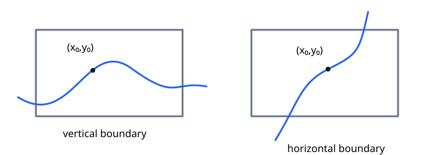
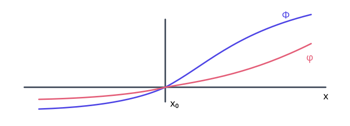
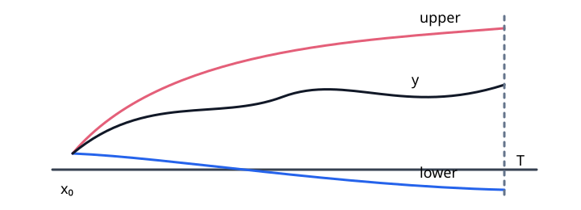

# General Theory

Explicit formulas are exceptional. The general theory instead asks whether an initial value problem has a solution, whether that solution is unique, and how far it can be continued. Compactness supplies existence; quantitative control in the dependent variable supplies uniqueness. Continuation and scalar comparison then control the interval of existence. For systems, continuous and differentiable dependence describe how solutions vary with their initial data and parameters.

## Compactness

Peano's existence theorem is proved by constructing polygonal approximations. The approximations need not converge as a whole, so one first needs a criterion that produces a uniformly convergent subsequence.

!!! definition "Definition (Uniform boundedness)"
    
    A family $\{f_\alpha\}_{\alpha\in A}$ on a set $D$ is **uniformly bounded** if there is an $M>0$ such that

    $$
    |f_\alpha(x)|\le M
    $$

    for every $\alpha\in A$ and every $x\in D$.

!!! definition "Definition (Equicontinuity)"
    
    A family $\{f_\alpha\}_{\alpha\in A}$ on an interval $I$ is **equicontinuous** if, for every $\varepsilon>0$, there is a $\delta>0$ such that

    $$
    |x-y|<\delta
    \quad\Longrightarrow\quad
    |f_\alpha(x)-f_\alpha(y)|<\varepsilon
    $$

    for every $\alpha\in A$. The same $\delta$ must work for the entire family.

!!! theorem "Theorem (Arzelà–Ascoli)"
    
    Every uniformly bounded and equicontinuous sequence of real-valued functions on a compact interval $[a,b]$ has a uniformly convergent subsequence.

??? proof "Proof"
    Choose a countable dense set $E=\{x_1,x_2,\ldots\}\subset[a,b]$. Uniform boundedness makes $\{f_n(x_1)\}$ a bounded numerical sequence, so it has a convergent subsequence. From that subsequence choose a further subsequence that converges at $x_2$. Continuing inductively gives nested subsequences. The diagonal sequence $g_k=f_{kk}$ converges at every $x_j\in E$.

    This pointwise limit extends continuously to all of $[a,b]$. Indeed, equicontinuity implies that values of every $g_k$ at two nearby points are uniformly close. Approximating an arbitrary $x$ by points of $E$ therefore makes $\{g_k(x)\}$ Cauchy.

    It remains to prove uniform convergence. Given $\varepsilon>0$, choose $\delta>0$ from equicontinuity so that

    $$
    |x-y|<\delta
    \quad\Longrightarrow\quad
    |g_k(x)-g_k(y)|<\frac{\varepsilon}{3}
    $$

    for every $k$. Choose finitely many points $x_{j_1},\ldots,x_{j_r}\in E$ whose $\delta$-neighbourhoods cover $[a,b]$. Since $g_k(x_{j_i})$ converges for each of these finitely many points, there is an $N$ such that

    $$
    |g_m(x_{j_i})-g_n(x_{j_i})|<\frac{\varepsilon}{3}
    $$

    whenever $m,n\ge N$ and $1\le i\le r$. For any $x\in[a,b]$, choose $x_{j_i}$ with $|x-x_{j_i}|<\delta$. Then

    $$
    \begin{aligned}
    |g_m(x)-g_n(x)|
    &\le |g_m(x)-g_m(x_{j_i})|\\
    &\quad+|g_m(x_{j_i})-g_n(x_{j_i})|\\
    &\quad+|g_n(x_{j_i})-g_n(x)|
    <\varepsilon.
    \end{aligned}
    $$

    Thus $\{g_k\}$ is uniformly Cauchy and hence uniformly convergent.

## Existence and Uniqueness

Consider the initial value problem

$$
y'=f(x,y),
\qquad
y(x_0)=y_0.
$$

Continuity of $f$ is enough for local existence. Uniqueness requires control of how rapidly $f$ changes in the $y$-direction.

!!! definition "Definition (Lipschitz condition)"
    
    The function $f$ is **Lipschitz in $y$** on a region $D$ if there is an $L>0$ such that

    $$
    |f(x,y_1)-f(x,y_2)|\le L|y_1-y_2|
    $$

    whenever $(x,y_1),(x,y_2)\in D$. If $f_y$ is continuous on a compact rectangle, the mean value theorem supplies such an $L$.

!!! theorem "Theorem (Picard)"
    
    Let $f$ be continuous on

    $$
    D=\{(x,y):|x-x_0|\le a,\ |y-y_0|\le b\}
    $$

    and Lipschitz in $y$ on $D$. Put

    $$
    M=\max_D|f|,
    \qquad
    h=\min\left\{a,\frac{b}{M}\right\},
    $$

    with $h=a$ if $M=0$. Then the IVP has a unique solution on $|x-x_0|\le h$.

The bound $h\le b/M$ has a geometric meaning: a curve with $|y'|\le M$ moves vertically by at most $M|x-x_0|$, so it cannot leave the rectangle through its horizontal sides.

??? idea "Idea"
    Rewrite the ODE as an integral equation and repeatedly substitute the previous approximation into its right-hand side. The Lipschitz estimate produces factorial decay between successive approximations. Their uniform limit solves the equation, and Gronwall's inequality forces any two solutions with the same initial value to coincide.

!!! lemma "Lemma (Gronwall inequality)"
    
    Let $u$ and $g$ be continuous and nonnegative on $[a,b]$. If $c\ge0$ and

    $$
    u(x)\le c+\int_a^x g(s)u(s)\,ds,
    $$

    then

    $$
    u(x)\le c\exp\left(\int_a^x g(s)\,ds\right).
    $$

??? proof "Proof"
    Set

    $$
    G(x)=\int_a^x g(s)u(s)\,ds.
    $$

    Then $G(a)=0$ and

    $$
    G'(x)=g(x)u(x)\le g(x)(c+G(x)).
    $$

    Multiplication by $\exp(-\int_a^x g)$ gives

    $$
    \left(e^{-\int_a^x g(s)\,ds}G(x)\right)'
    \le c g(x)e^{-\int_a^x g(s)\,ds}.
    $$

    Integrating from $a$ to $x$ yields

    $$
    G(x)\le c\left(e^{\int_a^x g(s)\,ds}-1\right).
    $$

    Since $u(x)\le c+G(x)$, the stated inequality follows.

??? proof "Proof of Picard's theorem"
    The ODE is equivalent to

    $$
    y(x)=y_0+\int_{x_0}^{x}f(s,y(s))\,ds.
    $$

    Define successive approximations by

    $$
    y_0(x)=y_0,
    \qquad
    y_{n+1}(x)=y_0+\int_{x_0}^{x}f(s,y_n(s))\,ds.
    $$

    Because $M h\le b$, every iterate remains in $D$. The first difference satisfies $|y_1-y_0|\le M|x-x_0|$. Inductively, the Lipschitz condition gives

    $$
    |y_{n+1}(x)-y_n(x)|
    \le \frac{M L^n|x-x_0|^{n+1}}{(n+1)!}.
    $$

    The majorant series converges, so $\sum_{n\ge0}(y_{n+1}-y_n)$ converges uniformly. Its limit $y$ is continuous. Uniform convergence and continuity of $f$ allow passage to the limit in the integral equation, proving that $y$ is a solution.

    If $y$ and $z$ are two solutions with the same initial value, then

    $$
    |y(x)-z(x)|
    \le L\int_{x_0}^{x}|y(s)-z(s)|\,ds
    $$

    for $x\ge x_0$. Gronwall's inequality with $c=0$ gives $y=z$. The argument to the left of $x_0$ is identical after reversing the interval.

Lipschitz continuity is sufficient but not necessary for uniqueness. The next result replaces the linear modulus $Lr$ by a more general one.

!!! theorem "Theorem (Osgood uniqueness criterion)"
    
    Suppose $f$ is continuous and there is a continuous function $\omega:(0,\infty)\to(0,\infty)$ such that

    $$
    |f(x,y_1)-f(x,y_2)|\le\omega(|y_1-y_2|)
    $$

    locally near the initial point. If

    $$
    \int_{0^+}\frac{dr}{\omega(r)}=\infty,
    $$

    then the IVP has at most one local solution.

??? proof "Proof"
    Suppose two solutions separate to the right of a last contact point $\bar x$. After interchanging them if necessary, let $r=y_1-y_2>0$ immediately to the right of $\bar x$. Then

    $$
    r'(x)\le |f(x,y_1)-f(x,y_2)|\le\omega(r(x)).
    $$

    For $\bar x<x_1<x$ this gives

    $$
    \int_{r(x_1)}^{r(x)}\frac{ds}{\omega(s)}\le x-x_1.
    $$

    Letting $x_1\downarrow\bar x$ forces the left-hand side to diverge because $r(x_1)\downarrow0$, while the right-hand side stays finite. This contradiction proves uniqueness. The argument on the left is analogous.

For $\omega(r)=Lr$, Osgood's divergent integral is exactly the Lipschitz case. By contrast, $\omega(r)=r^\alpha$ with $0<\alpha<1$ has a finite integral at zero, consistent with the branching solutions of $y'=y^{1/3}$.

!!! theorem "Theorem (Peano)"
    
    Let $f$ be continuous on the rectangle

    $$
    D=\{(x,y):|x-x_0|\le a,\ |y-y_0|\le b\}.
    $$

    With $M=\max_D|f|$ and $h=\min\{a,b/M\}$, the IVP has at least one solution on $|x-x_0|\le h$.

??? proof "Proof"
    It is enough to work on $[x_0,x_0+h]$; the other side is identical. Divide this interval into $n$ pieces with nodes $x_j=x_0+jh/n$. Starting at $y_n(x_0)=y_0$, define $y_n$ on $[x_j,x_{j+1}]$ to be the line of slope $f(x_j,y_n(x_j))$. Since every slope has absolute value at most $M$,

    $$
    |y_n(x)-y_0|\le M|x-x_0|\le Mh\le b.
    $$

    Thus all polygons remain in $D$. They are uniformly bounded and satisfy

    $$
    |y_n(x)-y_n(s)|\le M|x-s|,
    $$

    so they are equicontinuous. Arzelà–Ascoli gives a subsequence converging uniformly to a continuous function $y$.

    Let $\tau_n(s)$ be the left endpoint of the mesh interval containing $s$. The polygonal construction can be written

    $$
    y_n(x)=y_0+\int_{x_0}^{x}
    f\bigl(\tau_n(s),y_n(\tau_n(s))\bigr)\,ds.
    $$

    Now $|s-\tau_n(s)|\le h/n$ and $|y_n(s)-y_n(\tau_n(s))|\le Mh/n$. Uniform continuity of $f$ on $D$ therefore makes the integrand uniformly close to $f(s,y_n(s))$. Uniform convergence of $y_n$ then gives

    $$
    y(x)=y_0+\int_{x_0}^{x}f(s,y(s))\,ds.
    $$

    Hence $y$ solves the IVP.

Peano gives existence but says nothing about uniqueness. The equation $y'=y^{1/3}$ is the basic warning: its right-hand side is continuous, yet several integral curves pass through the same point.

## Extension of the Solution
Picard's and Peano's theorems give a solution near the initial point, on an interval determined by bounds for $f$. Taking an endpoint value as new initial data suggests continuing the solution. How far can this process go, and what obstructs a maximal interval of existence?
!!! example "Example (Finite-time escape)"
    For

    $$
    y'=1+y^2,
    \qquad
    y(0)=0,
    $$

    the solution is $y=\tan x$. Although the right-hand side is smooth on all of $\mathbb R^2$, the maximal interval is $(-\pi/2,\pi/2)$. The obstruction is not a singularity of $f$ but the escape $|y(x)|\to\infty$ in finite time.
!!! theorem "Theorem (Extension of solutions)"
    Let $G\subset\mathbb R^2$ be open and let $f:G\to\mathbb R$ be continuous.
    Suppose that $y$ is a solution of

    $$
    y'=f(x,y)
    $$

    on an interval $[x_0,\beta)$, where $\beta<\infty$.

    If the graph

    $$
    \{(x,y(x)):x_0\le x<\beta\}
    $$

    is contained in a bounded closed subset $G_1\subset G$, then $y$ can be extended
    beyond $\beta$.

    Equivalently, a maximal solution cannot terminate at a finite endpoint while
    its graph remains in a bounded closed subset of $G$.

??? proof "Proof"
    Since $G_1$ is bounded and closed, it is compact. Hence, by continuity of $f$,

    $$
    M:=\max_{G_1}|f|<\infty.
    $$

    As long as the graph of $y$ stays in $G_1$,

    $$
    |y'(x)|=|f(x,y(x))|\le M,
    $$

    so

    $$
    |y(x_2)-y(x_1)|\le M|x_2-x_1|.
    $$

    Therefore, if $\beta<\infty$ is the right endpoint of the interval of existence,
    the limit

    $$
    y_\beta:=\lim_{x\to\beta^-}y(x)
    $$

    exists. Since $G_1$ is closed,

    $$
    (\beta,y_\beta)\in G_1\subset G.
    $$

    Thus $(\beta,y_\beta)$ is still an interior point of the domain of $f$.
    By Peano's theorem, the IVP with initial value
    $y(\beta)=y_\beta$ has a local solution to the right of $\beta$.
    Gluing this solution to $y$ extends $y$ beyond $\beta$.

    <figure markdown="span">
      
      <figcaption>A curve may leave a compact rectangle through a vertical or horizontal side. A finite endpoint inside the domain permits continuation.</figcaption>
    </figure>

!!! example "Example (Comparison and blow-up)"
    Consider $y'=x^2+y^2$. Once $x\ge1$,

    $$
    y'\ge1+y^2.
    $$

    The comparison equation $z'=1+z^2$ has tangent solutions and blows up in finite forward time. Starting $z$ and $y$ from the same value at $x=1$, comparison shows that $y$ cannot exist for all positive time. Smoothness guarantees local uniqueness, not global existence.

!!! example "Example (Invariant strips)"
    Consider

    $$
    y'=(x^2+y^2+1)\sin(\pi y).
    $$

    Every horizontal line $y=k$, $k\in\mathbb Z$, is a solution. Uniqueness prevents any other integral curve from crossing these lines. Hence a solution starting with $k<y_0<k+1$ remains in that strip for all time. On every bounded $x$-interval its graph stays in a compact rectangle, so the continuation criterion extends it to all of $\mathbb R$.

    If $k$ is even, then $y'>0$ inside the strip and $y(x)$ increases. Its bounded limit as $x\to\infty$ must be $k+1$: any smaller limit would keep $\sin(\pi y)$ bounded away from zero while the factor $x^2+y^2+1$ grows. If $k$ is odd, the same argument shows that $y(x)$ decreases toward $k$.

## Comparison Theorems

Comparison controls a solution by other differential equations whose solutions are easier to understand. Together with continuation, it gives bounds on the maximal interval of existence.

!!! theorem "Theorem (Strict comparison)"
    
    Let $f,F$ be continuous on an open set $G\subset\mathbb R^2$, with $f(x,y)<F(x,y)$ throughout $G$. Suppose $\phi$ and $\Phi$ solve $y'=f(x,y)$ and $y'=F(x,y)$ on $(a,b)$ and have the same initial value at $x_0$. Then

    $$
    \phi(x)<\Phi(x)\quad(x_0<x<b),\qquad
    \phi(x)>\Phi(x)\quad(a<x<x_0).
    $$

??? proof "Proof"
    Set $\psi=\Phi-\phi$. At the initial point, $\psi(x_0)=0$ and $\psi'(x_0)>0$. The definition of derivative gives $\psi(x)/(x-x_0)>0$ sufficiently near $x_0$, so $\psi$ is positive just to the right and negative just to the left.

    If positivity fails to the right, choose a point $x_1>x_0$ with $\psi(x_1)\le0$ and let $\alpha$ be the first zero after an initial interval of positivity. Continuity guarantees such a first zero on the compact interval ending at $x_1$. Then $\psi>0$ on $(x_0,\alpha)$ and $\psi(\alpha)=0$, hence $\psi'(\alpha)\le0$. But the two solutions agree at $\alpha$, and therefore

    $$
    \psi'(\alpha)=F(\alpha,\Phi(\alpha))-f(\alpha,\phi(\alpha))>0,
    $$

    a contradiction. Reverse the independent variable for the left-hand assertion.

    <figure markdown="span">
      
      <figcaption>The order reverses across the initial point. At a hypothetical first later contact, the larger vector field prevents crossing.</figcaption>
    </figure>

!!! remark "Remark (Comparing slopes at contact)"
    The assumption compares $f$ and $F$ at the same point. It does not imply $F(x,\Phi(x))>f(x,\phi(x))$ when $\Phi(x)\ne\phi(x)$. This is why the proof uses a contact point instead of integrating an assumed inequality between derivatives.

!!! theorem "Theorem (Global existence under linear growth)"
    
    Suppose $f$ is continuous on $(a,b)\times\mathbb R$ and

    $$
    |f(x,y)|\le A(x)|y|+B(x),
    $$

    where $A,B\ge0$ are continuous on $(a,b)$. Every solution can be continued throughout $(a,b)$.

??? idea "Idea"
    Construct upper and lower comparison equations with at most linear growth. Their solutions bound the original curve on every compact time interval, allowing continuation.

??? proof "Proof"
    First consider $z'=A(x)|z|+B(x)+1$, $z(x_0)=y_0$. Its right-hand side is locally Lipschitz in $z$, so local existence and uniqueness hold. Since $z'>0$, the solution has at most one zero $x_1$. If such a zero occurs, solve the two linear equations

    $$
    z'=A(x)z+B(x)+1\quad(x\ge x_1),\qquad
    z'=-A(x)z+B(x)+1\quad(x\le x_1),
    $$

    with $z(x_1)=0$. Their integrating-factor formulas show that the first solution is positive for $x>x_1$ and the second negative for $x<x_1$. Both derivatives at $x_1$ equal $B(x_1)+1$, so the pieces glue to a $C^1$ solution on $(a,b)$. If no zero occurs, the solution follows one linear equation; at any finite interior endpoint it has a finite limit and continues, changing branch if that limit is zero. Thus $z$ exists on $(a,b)$.

    Similarly $w'=-A(x)|w|-B(x)-1$, $w(x_0)=y_0$, has a unique solution throughout $(a,b)$: apply the preceding argument to $-w$. Strict comparison gives

    $$
    w(x)<y(x)<z(x)\quad(x>x_0),\qquad
    z(x)<y(x)<w(x)\quad(x<x_0).
    $$

    On any compact time interval inside $(a,b)$, these barriers are bounded. The graph of $y$ therefore remains in a compact rectangle inside the domain, and the continuation theorem excludes a finite endpoint there.

    <figure markdown="span">
      
      <figcaption>Upper and lower comparison solutions bound the curve up to every interior time, so it cannot escape vertically there.</figcaption>
    </figure>

Strict comparison requires a strict inequality of vector fields. What survives when only $f\le F$ is known and solutions need not be unique?

!!! definition "Definition (Greatest and least solutions)"
    
    For a fixed IVP on an interval $J$ containing $x_0$, a **greatest solution** $y^+$ and a **least solution** $y^-$ satisfy

    $$
    y^-(x)\le y(x)\le y^+(x)\qquad(x\in J)
    $$

    for every solution $y$ of that IVP on $J$. These are also called maximal and minimal solutions in the pointwise order. This use of *maximal* is distinct from a solution with a maximal interval of existence.

!!! theorem "Theorem (Local extremal solutions)"
    
    For continuous $f$ near $(x_0,y_0)$, greatest and least solutions exist on some common interval $[x_0-c,x_0+c]$. This interval need not be the entire interval on which $f$ is defined.

??? proof "Proof"
    Choose a compact rectangle $|x-x_0|\le a$, $|y-y_0|\le b$ in the domain, put $M=\max|f|$, and choose $c>0$ with $c\le a$ and $(M+1)c<b$. Let $1\ge\varepsilon_n\downarrow0$ strictly. Peano's theorem supplies solutions $u_n$ of

    $$
    u_n'=f(x,u_n)+\varepsilon_n,\qquad u_n(x_0)=y_0,
    $$

    all on $[x_0-c,x_0+c]$. On the right half, strict comparison gives $u_n>u_{n+1}>y$ for every solution $y$ of the unperturbed IVP. Such a solution cannot leave the chosen rectangle before time $c$, by the same slope bound. Hence $u_n$ has a pointwise limit $u^+\ge y$ there. The sequence is uniformly bounded and has Lipschitz constant at most $M+1$. Arzelà–Ascoli gives uniformly convergent subsequences; their limits must equal the pointwise limit, so the whole sequence converges uniformly.

    In

    $$
    u_n(x)=y_0+\int_{x_0}^x\bigl(f(s,u_n(s))+\varepsilon_n\bigr)\,ds,
    $$

    uniform continuity of $f$ permits passage to the limit. Thus $u^+$ solves the original IVP and is its greatest solution on the right. Perturbing by $-\varepsilon_n$ gives its least solution there.

    On the left, the comparison inequalities reverse: the $+\varepsilon_n$ construction gives the least solution, and the $-\varepsilon_n$ construction gives the greatest. Glue the two greatest half-solutions, and likewise the two least half-solutions, at $x_0$. Their values agree and both one-sided derivatives equal $f(x_0,y_0)$, giving the asserted $C^1$ solutions.

!!! theorem "Theorem (Non-strict comparison)"
    
    Let $f\le F$ be continuous. On a common right-hand interval $[x_0,b)$ provided by the local extremal construction, let $\phi^-$ be the least solution for $f$ and $\Phi^+$ the greatest solution for $F$, with the same initial value. Then $\phi^-\le\Phi^+$.

??? proof "Proof"
    Locally, approximate the greatest solution for $F$ by solutions of $y'=F(x,y)+\varepsilon_n$ as above. Each lies strictly above every solution for $f$ to the right of $x_0$. Passing to the limit gives the non-strict inequality.

!!! remark "Remark (Equality and uniqueness)"
    Equality is possible, for example when $f=F=0$. If both IVPs are unique, their ordinary solutions are their extremal solutions, so the same comparison applies directly.

!!! example "Example (Bounding a blow-up time)"
    
    Let $[0,\beta)$ be the maximal forward interval for

    $$
    y'=x^2+(y+1)^2,\qquad y(0)=0.
    $$

    For $0\le x\le1$,

    $$
    (y+1)^2\le x^2+(y+1)^2\le1+(y+1)^2.
    $$

    The comparison IVPs with initial value zero have solutions

    $$
    z_1(x)=\frac{x}{1-x},\qquad z_2(x)=\tan(x+\pi/4)-1,
    $$

    with forward endpoints $1$ and $\pi/4$, respectively. Thus $z_1\le y\le z_2$ wherever the respective curves coexist. If $\beta<\pi/4$, the upper bound permits continuation at $\beta$; if $\beta>1$, the lower bound diverges while $y$ remains finite at $1$. Consequently $\pi/4\le\beta\le1$.

    In fact the inequalities are strict. To show $\beta>\pi/4$, choose $\pi/4<r<1$. On $[0,r]$, compare with $v'=r^2+(v+1)^2$, $v(0)=0$. Its blow-up time is $T_r=\arctan(r)/r>\pi/4$; the inequality follows because $\arctan(r)/r$ decreases on $(0,1]$. Thus $y$ is bounded through $\pi/4$ and continues beyond it.

    For the other endpoint, $y>0$ for $x>0$. Set $q=1/(y+1)$. Then

    $$
    q'=-1-\frac{x^2}{(y+1)^2},\qquad
    q(x)=1-x-\int_0^x\frac{s^2}{(y(s)+1)^2}\,ds.
    $$

    For any fixed $0<d<\beta$, the integral up to $d$ is a positive constant $c_d$. Since $q>0$, every $d\le x<\beta$ satisfies $x<1-c_d$, so $\beta\le1-c_d<1$. Hence $\pi/4<\beta<1$.

## First-Order Systems

Existence and uniqueness select a solution for each initial condition. Continuous and differentiable dependence describe how that solution changes when the initial data or the equation changes. The derivative of a nonlinear solution with respect to its data satisfies a linear differential equation.

!!! definition "Definition (First-order system)"
    
    For an unknown function $y:I\to\mathbb R^n$, a first-order system and its initial condition have the form

    $$
    y'=f(x,y),\qquad y(x_0)=y_0,
    $$

    where $f:G\subset\mathbb R\times\mathbb R^n\to\mathbb R^n$. In components, $y_i'=f_i(x,y_1,\ldots,y_n)$ for $1\le i\le n$.

!!! example "Example (Reduction of order)"
    The normal-form equation $u^{(n)}=F(x,u,u',\ldots,u^{(n-1)})$ becomes a first-order system by setting $y_i=u^{(i-1)}$:

    $$
    y_i'=y_{i+1}\quad(1\le i<n),\qquad
    y_n'=F(x,y_1,\ldots,y_n).
    $$

    The $n$ scalar initial values become the vector $y(x_0)$.

!!! theorem "Theorem (Local existence for systems)"
    
    Let $f$ be continuous on $D=\{(x,y):|x-x_0|\le a,\ \|y-y_0\|\le b\}$. Set $M=\max_D\|f\|$ and $h=\min\{a,b/M\}$, interpreting $h=a$ when $M=0$. Peano's theorem gives a solution on $|x-x_0|\le h$. If

    $$
    \|f(x,y)-f(x,z)\|\le L\|y-z\|\qquad((x,y),(x,z)\in D),
    $$

    Picard's theorem gives uniqueness there.

??? proof "Proof"
    The scalar constructions carry over using norms. Euler polygons have displacement at most $M|x-x_0|$, and their components form uniformly bounded equicontinuous families. Extracting subsequences for the finitely many components gives the Peano limit. For Picard iteration, the estimate is

    $$
    \|y_{k+1}(x)-y_k(x)\|\le\frac{ML^k|x-x_0|^{k+1}}{(k+1)!}.
    $$

    Uniform convergence gives a solution of the vector integral equation; Gronwall applied to $\|y-z\|$ proves uniqueness, as in the [scalar theorem](#thm-picard).

!!! definition "Definition (Linear system)"
    A system is **linear** if $y'=A(x)y+g(x)$, where $A$ is an $n\times n$ matrix-valued function and $g$ is vector-valued. It is **homogeneous** if $g=0$. The general structure of these systems is developed in [Linear Systems](linear-systems.md).

## Continuous Dependence

!!! example "Example (Harmonic oscillator)"
    For $a>0$, the IVP $u''+a^2u=0$, $u(t_0)=u_0$, $u'(t_0)=v_0$ has solution

    $$
    u(t)=u_0\cos(a(t-t_0))+\frac{v_0}{a}\sin(a(t-t_0)).
    $$

    Its continuous dependence on the initial data and parameter $a$ is visible in the formula. The general theorem obtains this dependence without an explicit solution.

!!! theorem "Theorem (Continuous dependence on parameters)"
    
    Let $\lambda\in\mathbb R^m$ and let $f$ be continuous on

    $$
    G=\{(x,y,\lambda):|x|\le a,\ \|y\|\le b,\ \|\lambda\|\le c\}.
    $$

    Assume a Lipschitz constant $L$ in $y$ works uniformly on $G$. Put $M=\max_G\|f\|$ and $h=\min\{a,b/M\}$, with $h=a$ if $M=0$. The solution $\phi(x,\lambda)$ of

    $$
    y'=f(x,y,\lambda),\qquad y(0)=0,
    $$

    is jointly continuous for $|x|\le h$, $\|\lambda\|\le c$.

??? proof "Proof"
    The IVP is equivalent to $y(x,\lambda)=\int_0^x f(s,y(s,\lambda),\lambda)\,ds$. Define

    $$
    \phi_0(x,\lambda)=0,\qquad
    \phi_{k+1}(x,\lambda)=\int_0^x f(s,\phi_k(s,\lambda),\lambda)\,ds.
    $$

    Each iterate stays in $G$ since $Mh\le b$. Inductively each is jointly continuous: composition preserves continuity, and integration of a continuous integrand with a variable endpoint preserves joint continuity on the compact parameter domain.

    The same induction as in Picard's theorem gives

    $$
    \|\phi_{k+1}(x,\lambda)-\phi_k(x,\lambda)\|
    \le\frac{ML^k|x|^{k+1}}{(k+1)!}
    \le\frac{ML^kh^{k+1}}{(k+1)!}.
    $$

    Unlike pointwise convergence for a fixed parameter, this bound is independent of $\lambda$. The telescoping series therefore converges uniformly in $(x,\lambda)$ to a continuous function $\phi$. Passing to the limit in the integral equation proves existence, and the uniform Lipschitz condition gives uniqueness.

!!! corollary "Corollary (Continuous dependence on initial values)"
    
    Let $f$ be continuous and Lipschitz in $y$ on $|x-x_0|\le a$, $\|y-y_0\|\le b$, and define $M,h$ as above. The solution $\phi(x;\eta)$ with $\phi(x_0;\eta)=\eta$ is jointly continuous on

    $$
    |x-x_0|\le h/2,\qquad \|\eta-y_0\|\le b/2.
    $$

??? proof "Proof"
    Write $y=\eta+z$. Then $z'=f(x,\eta+z)$ and $z(x_0)=0$, so $\eta$ is a parameter in the preceding theorem. For $\|z\|\le b/2$ and $\|\eta-y_0\|\le b/2$, the argument of $f$ stays in its original domain. Since $M(h/2)\le b/2$, all initial values share the claimed time interval. The smaller interval reserves room for the initial displacement; the original interval $h$ is not automatically uniform in $\eta$.

## Differentiable Dependence

If the vector field has continuous derivatives in the state and parameters, the solution has derivatives in those variables as well. Formal differentiation suggests their equations, but existence of those derivatives must first be established.

!!! theorem "Theorem (Differentiable dependence on parameters)"
    
    Under the domain assumptions of the [continuous-dependence theorem](#thm-continuous-parameters), assume $f$ is continuous and its partial derivatives $f_y$ and $f_\lambda$ exist and are jointly continuous on a neighbourhood of $G$. The solution $\phi(x,\lambda)$ is $C^1$ in $(x,\lambda)$ in the interior of the common domain. Its derivatives extend continuously to the closed domain, interpreted one-sided at the boundary. The matrix $U=\partial_\lambda\phi\in\mathbb R^{n\times m}$ solves

    $$
    U'=f_y(x,\phi(x,\lambda),\lambda)U+f_\lambda(x,\phi(x,\lambda),\lambda),
    \qquad U(0,\lambda)=0.
    $$

??? idea "Idea"
    Formally differentiate the integral equation to obtain a candidate $U$. Solve that linear equation independently. Then estimate the remainder $\phi(x,\lambda)-\phi(x,\lambda_0)-U(x,\lambda_0)(\lambda-\lambda_0)$ by interpolation and Gronwall, without assuming that $\phi$ is differentiable.

??? proof "Proof"
    **Candidate derivative.** Since $f_y$ is bounded, the preceding continuous-dependence theorem applies to $\phi$. Solve the displayed linear IVP for $U$. Its coefficients are continuous in $(x,\lambda)$; Picard iteration and a Gronwall bound give a solution on the whole common interval, continuous in $(x,\lambda)$. It satisfies

    $$
    U(x,\lambda)=\int_0^x\left[f_y(s,\phi(s,\lambda),\lambda)U(s,\lambda)+f_\lambda(s,\phi(s,\lambda),\lambda)\right]ds.
    $$

    In components, this is $\partial_x U_{ij}=\sum_{k=1}^n(\partial f_i/\partial y_k)U_{kj}+\partial f_i/\partial\lambda_j$, with $U_{ij}(0)=0$.

    **Interpolation.** Fix $\lambda_0$, write $d=\lambda-\lambda_0$, $\phi_0(s)=\phi(s,\lambda_0)$, $U_0(s)=U(s,\lambda_0)$, and set

    $$
    \Delta(x)=\phi(x,\lambda)-\phi_0(x)-U_0(x)d.
    $$

    Subtract the two integral equations for $\phi$ and the integral equation for $U_0d$. Split the nonlinear difference first in $y$, then in $\lambda$:

    $$
    \begin{aligned}
    f(s,\phi,\lambda)-f(s,\phi_0,\lambda_0)
    &=[f(s,\phi,\lambda)-f(s,\phi_0,\lambda)]\\
    &\quad+[f(s,\phi_0,\lambda)-f(s,\phi_0,\lambda_0)].
    \end{aligned}
    $$

    Apply the fundamental theorem of calculus to $t\mapsto f(s,t\phi+(1-t)\phi_0,\lambda)$ and to $t\mapsto f(s,\phi_0,\lambda_0+td)$. Define

    $$
    B(s)=\int_0^1 f_y(s,t\phi+(1-t)\phi_0,\lambda)\,dt,\qquad
    C(s)=\int_0^1 f_\lambda(s,\phi_0,\lambda_0+td)\,dt.
    $$

    Thus the nonlinear difference is $B(s)(\phi-\phi_0)+C(s)d$. With $A_0(s)=f_y(s,\phi_0,\lambda_0)$ and $C_0(s)=f_\lambda(s,\phi_0,\lambda_0)$, substituting $\phi-\phi_0=\Delta+U_0d$ yields the exact identity

    $$
    \Delta(x)=\int_0^x\left[B(s)\Delta(s)+(B(s)-A_0(s))U_0(s)d+(C(s)-C_0(s))d\right]ds.
    $$

    **Remainder estimate.** Choose $K\ge\sup\|f_y\|$ and $N\ge\sup\|U_0\|$. Uniform continuity of the derivatives, together with uniform continuity of $\phi$, implies that for every $\varepsilon>0$, sufficiently small $\|d\|$ gives $\|B-A_0\|\le\varepsilon$ and $\|C-C_0\|\le\varepsilon$, uniformly in $s$. For $0\le x\le h$,

    $$
    \|\Delta(x)\|\le K\int_0^x\|\Delta(s)\|\,ds+\varepsilon(N+1)h\|d\|.
    $$

    Gronwall therefore gives

    $$
    \sup_{0\le x\le h}\|\Delta(x)\|\le\varepsilon(N+1)he^{Kh}\|d\|=o(\|d\|).
    $$

    Reversing time gives the same estimate on $[-h,0]$. Consequently $\partial_\lambda\phi=U$, which is continuous. Finally $\partial_x\phi=f(x,\phi,\lambda)$ is continuous, proving the claim.

!!! theorem "Theorem (Derivatives with respect to initial data)"
    
    Let $f$ be continuous and $C^1$ in $(y,\lambda)$, with jointly continuous partial derivatives. Locally, after choosing a common smaller time interval for nearby data, the solution

    $$
    \phi(x;x_0,y_0,\lambda),\qquad \phi(x_0;x_0,y_0,\lambda)=y_0,
    $$

    is continuously differentiable in $x,x_0,y_0,\lambda$. Along the solution put $A(x)=f_y(x,\phi(x),\lambda)$. Its derivatives satisfy

    $$
    \begin{aligned}
    J'&=AJ,&J(x_0)&=I_n,&J&=\partial_{y_0}\phi,\\
    U'&=AU+f_\lambda(x,\phi,\lambda),&U(x_0)&=0,&U&=\partial_\lambda\phi,\\
    V'&=AV,&V(x_0)&=-f(x_0,y_0,\lambda),&V&=\partial_{x_0}\phi.
    \end{aligned}
    $$

??? proof "Proof"
    The parameter proof applies to $y-y_0$, with $y_0$ included among the parameters, giving $J$ and $U$ and their initial values. For the initial time, write

    $$
    \phi(x;x_0,y_0,\lambda)=y_0+\int_{x_0}^x f(s,\phi(s;x_0,y_0,\lambda),\lambda)\,ds.
    $$

    Changing $x_0$ by $r$ introduces the extra integral over $[x_0,x_0+r]$. Its quotient tends to $-f(x_0,y_0,\lambda)$ by continuity. Applying the same interpolation and Gronwall argument to the remaining difference gives

    $$
    V(x)=-f(x_0,y_0,\lambda)+\int_{x_0}^x A(s)V(s)\,ds.
    $$

    This proves existence of $V$, its continuity, and its stated linear equation. In particular, at the initial time,

    $$
    \frac{\phi(x_0;x_0+r,y_0,\lambda)-y_0}{r}
    =-\frac1r\int_{x_0}^{x_0+r}f(s,\phi(s;x_0+r,y_0,\lambda),\lambda)\,ds
    \longrightarrow-f(x_0,y_0,\lambda).
    $$

    Equivalently, differentiating $\phi(x_0;x_0,y_0,\lambda)=y_0$ gives $\partial_x\phi+\partial_{x_0}\phi=0$ at $x=x_0$. No time-translation identity is needed; such an identity is generally unavailable for a nonautonomous equation.

!!! example "Example (A parameter derivative without solving the nonlinear equation)"
    
    Let $y(x,\mu)$ solve

    $$
    y'=y+\mu(x+y^2),\qquad y(0,\mu)=1.
    $$

    The integral equation is $y(x,\mu)=1+\int_0^x[y(s,\mu)+\mu(s+y(s,\mu)^2)]\,ds$. Differentiating, now justified by the theorem, shows that $V=\partial_\mu y$ satisfies

    $$
    V(x,\mu)=\int_0^x[V(s,\mu)+s+y(s,\mu)^2+2\mu y(s,\mu)V(s,\mu)]\,ds,
    $$

    hence $V'=(1+2\mu y)V+x+y^2$ and $V(0,\mu)=0$. Treating the known solution $y$ as a coefficient, the integrating-factor formula gives

    $$
    V(x,\mu)=e^{\int_0^x(1+2\mu y(s,\mu))ds}
    \int_0^x e^{-\int_0^t(1+2\mu y(s,\mu))ds}(t+y(t,\mu)^2)\,dt.
    $$

    At $\mu=0$, $y(x,0)=e^x$, so

    $$
    \left.\frac{\partial y}{\partial\mu}\right|_{\mu=0}
    =e^x\int_0^x e^{-t}(t+e^{2t})\,dt
    =e^x\bigl(e^x-(x+1)e^{-x}\bigr)
    =e^{2x}-x-1.
    $$
